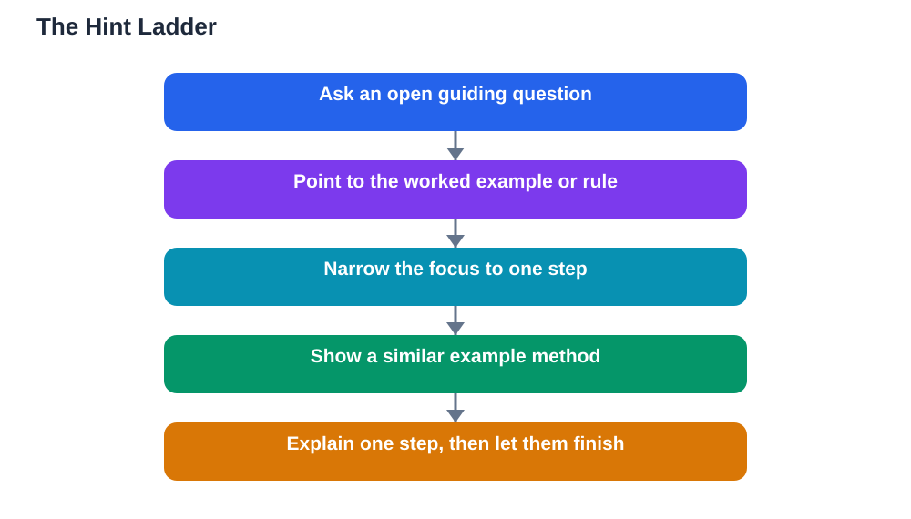

Explaining without giving answers is a skill every good study partner needs, because the moment you hand someone the final answer, their thinking stops. They may copy it correctly and feel relieved, but they have not learned how to reach it themselves, so the same problem will defeat them again next time. Real help looks different: a well-chosen hint, a guiding question, or a reminder of the step they already know. This guide shows how to explain in a way that keeps your friend thinking, so they arrive at the answer themselves and actually remember how they got there.

## Explaining Without Giving Answers Starts With Patience

The hardest part of explaining without giving answers is patience. When your friend is stuck and frustrated, the answer sits on the tip of your tongue, and giving it feels kind. But a quick answer is a short-term kindness with a long-term cost: it robs your friend of the struggle that builds understanding. Instead, pause and remind yourself that struggling is part of learning, not a sign of failure. Your job is to make the struggle productive, not to remove it. A good rule is to wait a few seconds longer than feels comfortable before speaking, because friends often find the next step themselves if you give them silence instead of a rescue. Patience also means accepting that a session guided by hints takes longer than one where you simply dictate answers, and that extra time is exactly what makes it valuable.

## The Hint Ladder: Small Clues Before Big Ones

Think of hints as a ladder. Start with the smallest clue that could help, and only climb higher if your friend is still stuck. The first rung is a question: "What do we know so far?" or "What did the last step give us?" The second rung points to a resource: "Look at the worked example on this page" or "Which rule did we use last time?" The third rung narrows the focus: "Check the sign in the second step" or "What happens to the first part here?" Only the final rung gives a substantial piece of the solution, and even then, let your friend finish the rest. This ladder matters because a hint that is too big is just an answer in disguise, while a hint that is too small leaves your friend guessing blindly. Climbing one rung at a time keeps the thinking with your friend at every stage, and it teaches them to ask themselves these same questions when they study alone.

## Ask Questions That Open Thinking

Questions are your most powerful tool when explaining without giving answers, but not all questions help equally. Closed questions that can be answered with yes or no often shut thinking down, while open questions invite your friend to reason out loud. Compare "Is this step right?" with "Why did you choose this step?" The second question forces your friend to explain their reasoning, and their explanation will usually reveal the mistake or the missing idea. Other useful questions include "What would happen if we tried the opposite?", "Can you say that step in your own words?", and "What part feels uncertain?" Listen carefully to the answers, because they tell you where the real gap is. Often the gap is one step earlier than where your friend got stuck, and your next hint should aim there rather than at the visible problem.

## Show the Method, Not the Final Answer

When a hint is not enough, show the method instead of the answer. Work through a similar but different example together, step by step, and then ask your friend to apply the same method to their own problem. Or write out the steps of the method as a blank framework they can fill in, such as "First we find..., then we..., finally we..." This approach is especially useful for homework help, because it respects the line between helping and doing someone's work for them. Always verify the method against the textbook, since a method remembered wrongly will produce confident but incorrect answers. If you both use the free lesson solver tool for a textbook problem, treat its step-by-step explanation as a study aid to understand and check, not as an answer to copy: the tool needs your own free Google AI Studio API key, and AI can make mistakes, so the textbook remains the final check. The guide on [homework help without copying answers](/blog/homework-help-without-copying-answers.html) covers this boundary in more depth.

## Know When a Direct Explanation Is Fair

Explaining without giving answers does not mean never explaining directly. If your friend lacks a basic fact or a definition, no amount of hinting will invent it. In that case, teach the missing fact clearly, then return to hints for applying it. The distinction is simple: teach the knowledge they do not have, but let them do the thinking they can do. Similarly, if your friend has struggled productively for a while and frustration is shutting down learning, a clear explanation of one step can restart progress. The goal is not to withhold help cruelly, it is to give the smallest help that restores independent thinking. After any direct explanation, always check understanding by asking your friend to redo a similar problem alone. If they can, the help worked. If they cannot, the concept needs more work, not more answers.

## Practise the Skill on Yourself Too

You can practise explaining without giving answers even when you study alone. When you catch yourself reading a solution before trying a problem, stop and ask yourself the hint-ladder questions instead. Write the questions down if it helps, and only look at the solution after a genuine attempt. You can also practise with the lesson solver tool by covering its final answer and reading only its first steps, then finishing the problem yourself. This self-discipline builds the same habit you use with friends, and it makes you a better learner in your own right. Over time, you will notice that you need fewer hints yourself, because your brain learns to generate its own guiding questions whenever it gets stuck.

## AI Help: Muse AI

Muse AI is Meta's personal AI assistant, and it can help you practise hint-based explaining. You can ask it to suggest guiding questions for a topic you are helping a friend with, or to rephrase a concept as a series of small clues instead of a full explanation.

Join Muse with invite code LTGSWD — in the Muse app, go to Settings > Redeem token and enter the code.

Disclosure: LTGSWD is the author's Muse invite code.

## FAQ

### Is it unkind to withhold the answer from a struggling friend?

No, as long as you stay supportive and keep giving hints. Withholding the answer while abandoning your friend would be unkind, but guiding them step by step is the most helpful thing you can do. Explain why you are using hints, so your friend understands that you are protecting their learning, not showing off.

### What if my friend gets angry when I only give hints?

Acknowledge the frustration honestly: "I know this is annoying, but you will remember it better if you reach it yourself." Offer a bigger hint or a similar example if they are truly stuck. If frustration keeps rising, take a short break or explain one step directly, then return to hints. The relationship matters more than any single problem.

### How do I help without doing their homework for them?

Draw a clear line: you can explain methods, give examples, and check steps, but your friend writes their own final work. If you find yourself dictating answers, stop and switch to questions. The guide on [homework help without copying answers](/blog/homework-help-without-copying-answers.html) explains this boundary with practical examples.

### What if I do not know the answer either?

Work it out together. That is often the best session of all, because both of you practise the hint ladder, check the textbook, and test ideas. Admitting you do not know something is honest and normal, and solving a problem side by side teaches both of you more than a one-way explanation ever could.

## Conclusion

Explaining without giving answers is a habit built on patience, small hints, good questions, and a clear sense of when direct teaching is fair. Use the hint ladder, show methods instead of final answers, and always check that your friend can repeat the thinking alone. Your friend will learn more deeply, and you will sharpen your own understanding every time you guide someone else to an answer they earned themselves. For step-by-step help with your own textbook problems, [Try the free AI lesson solver](/#tool).
