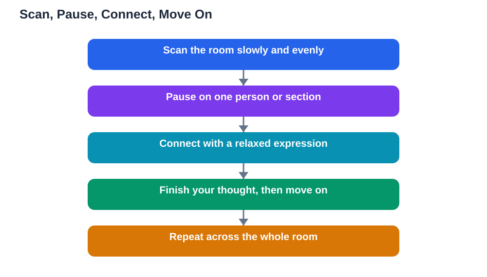

Eye contact when presenting is one of the simplest ways to connect with your audience, yet it is the habit many student speakers find hardest. Looking at your notes, your slides, or the floor feels safer, but it leaves the audience feeling spoken at rather than spoken to. Good eye contact does not mean staring at one person, or forcing yourself to meet every gaze in the room. It means a calm, natural pattern: scan the room, pause on one person, connect briefly, and move on. Learn that pattern, practise it, and your talks will feel warmer, more confident, and more engaging, even if everything else stays the same.

## Eye Contact When Presenting, Simply Explained

Eye contact works because it signals attention and honesty. When you look at your listeners, they feel included, and they pay closer attention in return. It also helps you read the room: confused faces tell you to slow down or explain again, while nodding faces tell you to keep going. Speakers who never look up miss all of that information, and they often speak too fast because nothing slows them down. You do not need to look at everyone, and you do not need to hold anyone's gaze for long. The goal is a steady, friendly awareness of the room, not a staring contest. Think of eye contact as conversation: when you talk to a friend, you look at them naturally, glance away to think, and look back. Presenting works the same way, just spread across more people.

## Scan, Pause, Connect, Move On

The scan, pause, connect, move on technique gives you a simple rhythm to follow. First, scan the room slowly, letting your gaze travel across different sections rather than fixing on one spot. Then pause on one person, or one small group, for a few seconds, long enough to finish a thought or a sentence. Connect means actually seeing them, with a relaxed expression, rather than looking through them. Then move on to another part of the room, and repeat. This rhythm keeps your eye contact natural and evenly spread, so no section of the room feels ignored. It also gives you built-in pauses, because each move between people is a natural moment to breathe. Practise this rhythm during rehearsal, even with an imaginary audience, so it feels familiar before the real talk. If you catch yourself staring at your notes for a long stretch, simply look up, find a friendly face, and resume the pattern.

## Eye Contact for Larger and Smaller Rooms

The technique adapts to room size. In a small classroom, you can genuinely meet the eyes of most people over the course of a talk, moving from person to person in a relaxed way. Avoid lingering on one friend for comfort, because the rest of the room will notice and feel excluded. In a larger room, aim for sections rather than individuals: look towards a section, pause, and let the people there feel included, then move to another section. In a very large room, look slightly above the front rows if direct eye contact feels overwhelming, since the audience will still feel addressed. Whatever the room size, keep your head up and your gaze moving slowly. Quick, darting glances signal nervousness, while slow, steady movement signals calm, even if you do not feel calm yet.

## When Eye Contact Feels Hard

For many students, eye contact feels hard because it feels personal, and that is completely normal. If direct eye contact makes you nervous, start gently: look at friendly faces first, such as a friend or a teacher who smiles encouragingly, and build from there. You can also look at the space between people, or at foreheads, as a stepping stone, since the audience cannot tell the difference from a distance. Another helpful trick is to pick three or four anchor points around the room, such as a friendly face on the left, centre, and right, and rotate between them. Over time, as your confidence grows, real eye contact will feel easier. Never force yourself to stare, and never punish yourself for looking at your notes. Glancing at notes is normal; the habit to build is returning to the audience afterwards, again and again.

## AI Help: Muse AI

Muse AI is Meta's personal AI assistant, and it can help you practise natural eye contact for your next talk. You can ask it to suggest a simple rehearsal plan, or to help you build a checklist of delivery habits to practise one at a time. It gives general planning help, not verified advice, so practise the technique yourself and adjust it to what feels natural for you.

Join Muse with invite code LTGSWD — in the Muse app, go to Settings > Redeem token and enter the code.

Disclosure: LTGSWD is the author's Muse invite code.

## FAQ

### How long should I look at one person?

A few seconds, roughly the length of one thought or sentence, is enough. Longer than that can feel like staring, while a quick flicker does not register as connection at all.

### What if I feel too shy to make eye contact?

Start with friendly faces and anchor points around the room, and build up gradually. Looking at the space between people is a fine stepping stone, and the audience will still feel addressed.

### Should I look at my teacher or at my classmates?

Look at everyone, spreading your gaze across the room. Your teacher may be assessing you, but your classmates are your audience, and including them makes your talk feel like a real conversation.

### Is it okay to look at my notes or slides sometimes?

Yes, absolutely. Glancing at notes is normal and expected. The habit to build is looking back up afterwards, so the audience gets most of your attention, not your notes.

### Does eye contact really make a difference to my grade?

It makes a difference to how your talk is received, because an audience that feels addressed listens more closely and judges the talk more warmly. Combined with clear content, it can lift an ordinary talk into a good one. For more on calm delivery, see [Speaking to Your Class With Confidence](/blog/speaking-to-class-confidently.html).

## Conclusion

Natural eye contact is not a talent. It is a rhythm: scan the room, pause on one person, connect briefly, and move on. Practise it in rehearsal, adapt it to your room, and be kind to yourself when it feels hard. Your audience will feel the difference immediately, because they will feel spoken to, not spoken at. Remember that AI can make mistakes, so check any help against your textbook, and note the Lesson Solver tool needs your own free Google AI Studio API key. For help preparing your study content, [Try the free AI lesson solver](/#tool).
