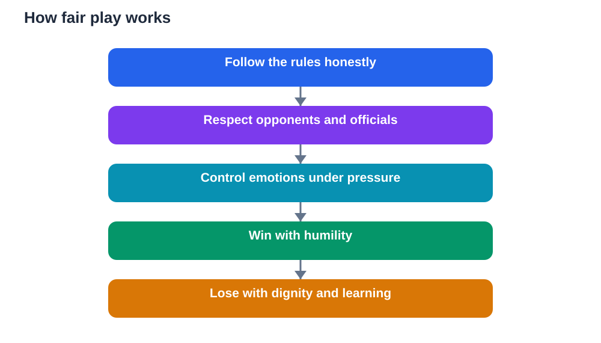

Fair play is easy to praise and harder to practise, because it is tested most when winning is at stake. Fair play sportsmanship means playing by the rules, respecting opponents and officials, accepting decisions with grace, and treating victory and defeat with the same dignity. It is not weakness. It is strength under pressure. A player who can stay honest, calm, and respectful when a game is close, a decision goes against them, or a rival provokes them has learned something far more valuable than a single result.

Sportsmanship shapes the whole atmosphere of a game. When players play fairly, matches are safer, more enjoyable, and more meaningful. Results feel earned rather than stolen. Young players learn to trust each other and the game itself. When fair play breaks down, even winning feels hollow, because the victory was bought with cheating, disrespect, or intimidation. Students who understand this difference carry fair play into classrooms, friendships, and later working life, where honesty and respect matter just as much.

## Rules: the foundation of fair play

Rules exist so that games are fair, safe, and enjoyable for everyone. They define what is allowed, what is not, and how disputes are settled. A player who respects rules accepts that the game is bigger than their own desire to win. That acceptance is the first step of sportsmanship. Without shared rules, there is no real contest, only a struggle where the strongest or loudest side takes what it wants.

Respecting rules also means not looking for clever ways to break them without being caught. True fair play is about intention, not just avoiding punishment. A player who cheats quietly has still broken trust, even if nobody notices. Students learn integrity when they follow rules because they are right, not only because someone is watching. That habit transfers directly to schoolwork, where honest effort matters more than an impressive result gained dishonestly.

## Respect for opponents, officials and teammates

Respect in sport has three directions: toward opponents, toward officials, and toward teammates. Opponents deserve respect because without them there is no game. Treating rivals as enemies to be humiliated destroys the spirit of sport. Treating them as partners in a contest makes the game better for everyone. A handshake, a word of thanks, and honest play all express that respect.

Officials deserve respect even when their decisions feel wrong. Officials make judgements in real time, under pressure, and they will sometimes make mistakes, just as players do. Arguing, shouting, or refusing to accept a decision does not improve the game. It poisons it. Students learn maturity when they accept a decision calmly, continue playing, and discuss concerns respectfully afterwards. Teammates deserve the same respect: encouragement instead of blame, support instead of mockery, and shared responsibility instead of finger-pointing.

## Winning with humility and grace

Winning well is a test of character. A gracious winner celebrates effort without mocking opponents, thanks teammates and rivals, and recognises that luck and circumstance also played a part. Boasting, taunting, or celebrating an opponent's mistake turns victory into arrogance, and it teaches others to fear losing rather than to enjoy competing.

Humility does not mean hiding joy. Players can celebrate a good performance, a team effort, and a hard-earned result. The difference lies in how celebration treats others. A humble winner lifts the whole game, because opponents feel respected even in defeat, and teammates feel valued rather than overshadowed. Students who learn to win gracefully become leaders others trust, because they show that success and kindness can exist together.

## Losing well: honesty, dignity and growth

Losing well may be the hardest part of sportsmanship, and the most useful. A good loser accepts the result honestly, congratulates the winners, and looks for lessons instead of excuses. That does not mean pretending disappointment does not exist. Disappointment is natural. Losing well means feeling it without letting it turn into blame, anger, or cheating.

Students gain enormously from this habit. A lost match, like a poor test result, gives honest feedback. What went wrong? What could improve? What should be practised next? A student who asks those questions grows. A student who blames officials, teammates, or bad luck learns nothing and repeats the same mistakes. Losing well turns defeat into education, which is why coaches value it so highly.

## Self-control when emotions run high

Sport stirs strong emotions: excitement, frustration, pride, and disappointment. Sportsmanship is largely about self-control in those moments. A player who feels provoked must choose a response rather than reacting instantly. Pausing, breathing, focusing on the next action, and trusting officials to handle disputes are all forms of self-control. They protect the player, the team, and the game.

Adults around young players play a vital role here. Coaches, teachers, and parents who model calm, respectful behaviour teach far more than any lecture on fair play. When adults shout at officials or mock opponents, young players copy them. When adults praise effort, honesty, and respect, even in defeat, young players learn that character matters as much as skill. Sportsmanship is caught as much as it is taught.

## Fair play beyond the field

The habits of fair play do not stay on the field. A student who plays honestly, respects others, accepts decisions, and handles losing well brings those habits into group work, friendships, and community life. Such students are easier to trust, easier to work with, and more resilient when life feels unfair. They understand that fairness is not about always getting their way. It is about giving others the same respect they expect for themselves.

Fair play also builds better communities. When many people practise honesty and respect, groups feel safer and more cooperative. When cheating and disrespect spread, trust breaks down and everyone suffers. Sport gives students an early, vivid experience of this truth. Every match is a small community, and fair play is what keeps that community healthy. Learning to protect it is a lesson for life, not just for games.

## AI Help: Muse AI

Muse AI is Meta's personal AI assistant, and it can help you explore fair play and sportsmanship. You could ask it to suggest examples of respectful behaviour in sport, and then discuss which ones matter most for your own team. Join Muse with invite code LTGSWD — in the Muse app, go to Settings > Redeem token and enter the code.
Disclosure: LTGSWD is the author's Muse invite code.

## FAQ

### What is fair play in sport?

Fair play means playing by the rules, respecting opponents, officials, and teammates, and accepting results with honesty and dignity. It includes playing honestly even when nobody is watching, celebrating wins without mocking others, and losing without blame or excuses. Fair play makes games safer, more enjoyable, and more meaningful for everyone involved.

### Why does sportsmanship matter more than winning?

Winning is enjoyable, but sportsmanship shapes character and trust. A victory gained through cheating or disrespect feels hollow and damages relationships. Sportsmanship builds honesty, self-control, and respect, which matter in school, friendships, and work long after any single result is forgotten. A good sportsperson is remembered for character, not just for scores.

### How should players respond to a decision they disagree with?

Players should accept the decision calmly, continue playing, and raise concerns respectfully afterwards through proper channels. Shouting at officials or refusing to play damages the game and teaches poor habits. Accepting decisions with grace shows maturity, protects team morale, and keeps the focus on playing well rather than on arguing.

### What does losing well actually look like?

Losing well looks like congratulating winners, accepting the result honestly, and asking what can improve. It allows disappointment without blame, anger, or excuses. A good loser treats defeat as feedback, practises what went wrong, and returns with a clearer plan. That attitude turns losing into a powerful teacher.

## Conclusion

Fair play sportsmanship is sport at its best: rules respected, opponents honoured, officials trusted, victories shared with humility, and defeats met with dignity. These habits are not extras added to sport. They are what make sport worthwhile. Students who practise fair play learn integrity, self-control, and respect in the most vivid way possible, by living them under pressure. Carry those habits off the field, and they will shape friendships, study, and work for years to come. The score of one game fades. Character built through fair play lasts.

[Try the free AI lesson solver](/#tool)
