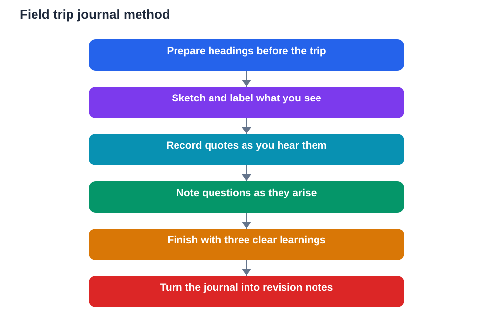

A field trip passes quickly. By the evening, small details fade, conversations blur, and the day becomes a general feeling rather than a set of clear memories. A field trip journal solves that problem. It captures the day while it is happening, in your own words and pictures, so you can return to it later and still feel close to what you saw and learned. A good journal is not a formal report. It is a personal record of attention, curiosity, and discovery.

Keeping a journal also changes how you experience the visit itself. When you know you will write, sketch, and reflect, you look more carefully and listen more closely. You start noticing quotes worth recording, details worth drawing, and moments worth remembering. The journal becomes both a record of learning and a tool that deepens learning while the day unfolds.

## Prepare Your Journal Before the Trip

A journal works best when it is ready before you leave. Choose a notebook you like writing in, and set up a few simple sections so you are not inventing a structure on a busy day. Useful headings include observations, sketches, quotes, questions, and learnings. A little preparation makes writing during the visit quick and natural rather than a chore.

Write the date, the place in general terms, and the purpose of the visit at the top of the first page. Add a few questions you hope to explore. These opening lines give your journal a focus and make it easier to find your way back into the day later. A journal that starts with purpose is far more useful than one that starts with blank pages and good intentions.

## Capture Sketches, Not Just Words

Sketches are one of the most valuable parts of a field trip journal. A quick drawing of a shape, a layout, a process, or a detail forces you to observe closely and remember spatially. You do not need artistic skill. Simple lines, labels, and arrows can capture a surprising amount of information, and a sketch often recalls a whole scene faster than a paragraph.

Label every sketch with a few words about what it shows and why it mattered. Note scale roughly, such as whether something was larger than your hand or taller than a person, and add any detail that a drawing alone cannot show, like colour, texture, or movement. A labelled sketch becomes evidence you can trust, not just a doodle you later struggle to interpret.

## Record Quotes in the Words You Heard

Quotes bring a journal to life. A short remark from a guide, a classmate, or a member of staff can capture an idea, a feeling, or a perspective that your own summary would flatten. Write quotes as close as you can to the words actually spoken, and note who said them in general terms, such as a guide or a classmate, rather than recording personal details unnecessarily.

Quotes also preserve thinking. A question someone asked, an explanation that suddenly made sense, or a reaction that surprised you can all become starting points for later reflection. When you reread your journal, quotes often trigger memories of the whole moment around them, which is why they are worth capturing even when they seem small at the time.

## Note Questions as They Arise

A journal should have plenty of room for questions. During a visit, questions arise naturally: why something works a certain way, how it connects to a lesson, or what would happen if conditions changed. Writing them down immediately preserves curiosity that might otherwise vanish by the end of the day.

Treat unanswered questions as valuable, not as failures. A journal full of thoughtful questions shows active learning. After the visit, you can sort your questions into those you can answer from your notes, those to check against your textbook, and those to raise in class. This sorting turns curiosity into a clear plan for follow-up study.

## End the Day With Three Learnings

At the end of the visit, choose three learnings that matter most to you. These are not necessarily the most impressive facts. They are the ideas that changed how you think, surprised you, or connected clearly to your lessons. Writing just three forces you to prioritise and to express each learning clearly, which is itself a powerful act of understanding.

For each learning, write a short paragraph explaining what you learned, what evidence supports it, and why it matters. This structure keeps your journal honest and useful. A learning backed by something you saw or heard is stronger than a vague impression, and explaining why it matters helps you remember it when you revise.

## Turn Your Journal Into Revision Material

A journal is not finished when the trip ends. Soon afterwards, reread it and turn its best parts into study material. You might write a summary, create revision questions from your notes, or prepare points to share in class. The journal gives you raw material; the follow-up turns it into organised knowledge.

When you use your journal for homework, check uncertain points against your textbook, and remember that AI helpers can make mistakes, so verify important details rather than copying them uncritically. Your journal is most valuable when it remains your own record, checked and refined, rather than a set of borrowed answers. That care keeps your learning both personal and reliable.

## AI Help: Muse AI

Muse AI is Meta's personal AI assistant, and it can help you keep a better field trip journal. You can ask it to suggest journal headings for a visit, or to help you turn rough journal notes into a clear summary afterwards. It is useful for organising thoughts, explaining ideas simply, and drafting revision notes from your own observations.

Join Muse with invite code LTGSWD — in the Muse app, go to Settings > Redeem token and enter the code.

Disclosure: LTGSWD is the author's Muse invite code.

## FAQ

### What should a field trip journal include?

Observations, quick sketches, quotes, questions, and a short reflection. Together these capture what you saw, what you heard, what you wondered, and what you learned, in a form you can revisit.

### Do sketches need to be neat or artistic?

No, quick labelled sketches are more useful than polished drawings. What matters is that the sketch helps you observe carefully and remember the detail later.

### How do I choose my three learnings?

Pick ideas that surprised you, changed your thinking, or connected clearly to your lessons. Write each one with its evidence and why it matters, so the choice reflects real understanding.

### What if I fall behind writing during the visit?

Use short keywords and quick sketches on the spot, then expand them soon after the visit while memories are fresh. Brief notes made promptly are far better than long notes attempted too late.

### How is a journal different from a report?

A journal is a personal record made during and just after the visit, full of observations and questions. A report is a polished piece written later, and a good journal makes writing that report much easier.

## Conclusion

A field trip journal captures a day that would otherwise fade. Sketch what you see, record quotes as you hear them, note questions as they arise, and finish with three learnings you can explain. Kept this way, your journal becomes more than a souvenir. It becomes study material shaped by your own attention and curiosity.

[Try the free AI lesson solver](/#tool)
