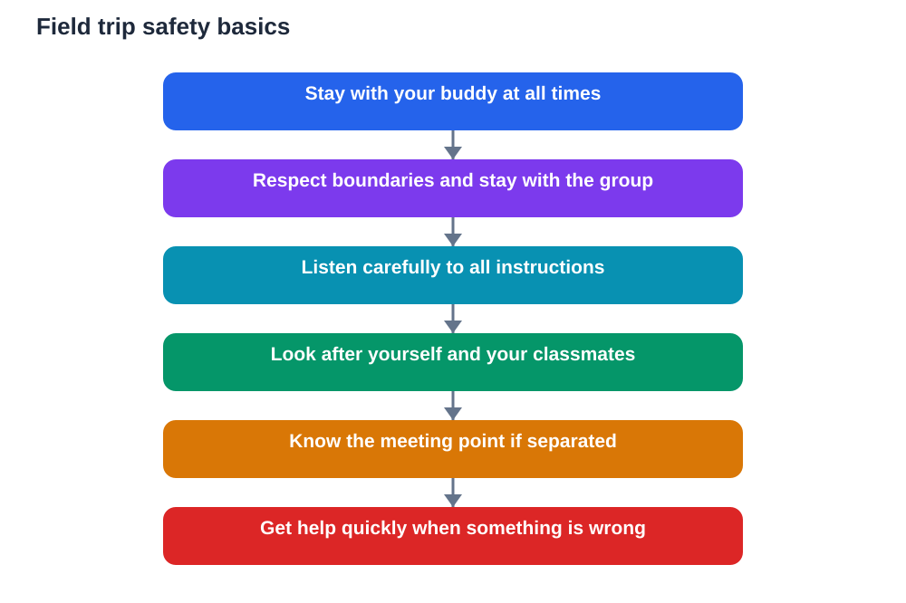

A field trip should be exciting, not worrying. Yet any visit away from familiar surroundings brings new risks: busy spaces, unfamiliar routes, water, traffic, equipment, and simply the challenge of keeping a group together. Safety rules exist so that everyone can enjoy learning without unnecessary danger. When students understand the rules and the reasons behind them, they are far more likely to follow them willingly and to look out for each other.

Safety on a trip is a shared responsibility. Teachers plan, organise, and supervise, but students also play a vital role by staying aware, staying together, and speaking up when something feels wrong. Knowing a few clear basics before you leave can prevent most problems and help you respond calmly if something unexpected happens. Safety is not about fear. It is about care, attention, and good habits.

## Know the Buddy System and Use It

The buddy system is one of the simplest and most effective safety habits on any trip. Each student stays paired with a buddy, and buddies look out for each other throughout the day. You notice if your buddy is missing, unwell, or struggling, and your buddy does the same for you. This mutual care catches problems early, before they become serious.

Use the system properly. Stay within sight of your buddy, check in regularly, and tell a teacher immediately if your buddy is missing or needs help. Never agree to split up casually or to cover for a buddy who has wandered off. The buddy system only works when it is taken seriously by everyone, and taking it seriously is a sign of maturity, not a restriction on fun.

## Respect Boundaries and Stay With the Group

Every visit has boundaries: areas you may enter, areas that are off limits, and routes you should follow. These boundaries exist for good reasons, such as safety, preservation, or the needs of other visitors. Respect them even when they seem inconvenient. An off-limits area may hide hazards you cannot see, and a closed route may protect a fragile place or a working area.

Staying with the group is equally important. Groups are counted, supervised, and guided, and a student who drifts away can quickly become lost or unsupervised. If you need to leave the group for any reason, ask permission and make sure a teacher knows where you are going and when you will return. Never leave a visit area alone, and never follow a stranger or an unfamiliar route without a teacher's clear direction.

## Listen Carefully to Instructions

Listening is a safety skill, not just good manners. At the start of a visit, teachers and guides explain meeting points, timings, hazards, and what to do in an emergency. These instructions may seem routine, but they contain exactly the information you would need if something went wrong. Listening fully the first time saves confusion later.

If you miss an instruction or do not understand it, ask for it to be repeated. There is no embarrassment in checking. It is far better to ask a simple question than to guess about a meeting point or a safety procedure. Keep your phone and distractions away during briefings so you can hear clearly and remember what matters.

## Look After Yourself and Others

Basic self-care keeps a trip safe and enjoyable. Drink water regularly, eat when food breaks are given, wear suitable clothing and footwear for the place and weather, and tell a teacher promptly if you feel unwell, tired, or uncomfortable. Small problems dealt with early rarely become big ones, while problems hidden out of embarrassment can grow quickly.

Looking after others matters just as much. If a classmate seems unwell, upset, or lost, stay with them if you can and get help from a teacher straight away. Do not try to handle a serious situation alone. Getting help quickly is responsible, not tattling, and it is exactly what teachers hope students will do. A caring group is a safer group.

## Know What to Do If You Get Separated

Even with good habits, separation can occasionally happen in a busy place. Knowing what to do in advance makes it far less frightening. Stay calm, stay where you are if you have been told to do so, and look for a teacher, a guide, or a clearly identified member of staff. If you have been given a meeting point, make your way there calmly if it is safe to do so.

Do not panic, wander further, or accept help from strangers to leave the area. If you have a way to contact a teacher that you were told to use, use it as instructed. Most separations are resolved quickly when students stay calm and follow the plan they were given. Rehearsing the plan in your mind before the trip helps you act confidently if you ever need it.

## Behave Safely Around Hazards

Different visits bring different hazards, and part of safety is adapting to the place you are in. Near water, stay back from edges and follow all guidance about where you may stand. Near roads or traffic, stay on paths and crossings and follow teacher directions. Around equipment or displays, look but do not touch unless you are clearly invited to do so, and never climb, lean, or run where it could cause harm.

Think before you act, especially when excitement runs high. A moment of carelessness around a hazard can spoil a trip for everyone. Safe behaviour also shows respect for the place, its staff, and other visitors. Teachers notice students who act responsibly, and that trust often leads to greater freedom and richer experiences on future visits.

## AI Help: Muse AI

Muse AI is Meta's personal AI assistant, and it can help you prepare for a safe field trip. You can ask it to help you make a simple personal safety checklist before a visit, or to summarise safety rules into clear points you can remember. It is useful for explaining ideas simply, organising notes, and drafting checklists for revision.

Join Muse with invite code LTGSWD — in the Muse app, go to Settings > Redeem token and enter the code.

Disclosure: LTGSWD is the author's Muse invite code.

## FAQ

### What is the buddy system and why does it matter?

The buddy system pairs students so each looks out for the other throughout the trip. It helps spot a missing, unwell, or struggling student quickly, which makes the whole group safer.

### What should I do if I feel unwell on a trip?

Tell a teacher promptly, stay with your buddy if you can, and rest as directed. Early reporting helps small problems stay small and ensures you get the right care quickly.

### What if I get separated from my group?

Stay calm, look for a teacher or guide, and follow the plan you were given, such as going to the meeting point if it is safe. Do not wander further or leave the area with a stranger.

### Why are some areas off limits on a visit?

Off-limits areas may contain hazards, fragile features, or working spaces that need protection. Boundaries keep visitors safe and protect the place for others.

### How can I help keep my classmates safe?

Stay with your group, follow instructions, look out for your buddy, and get help quickly if someone seems unwell or lost. Caring, prompt action is the most helpful thing a student can do.

## Conclusion

Field trip safety comes down to a few habits practised consistently: use the buddy system, respect boundaries, listen carefully, look after yourself and others, and know what to do if you get separated. These habits do not spoil a trip. They protect it, so everyone can learn, explore, and enjoy the day with confidence.

[Try the free AI lesson solver](/#tool)
