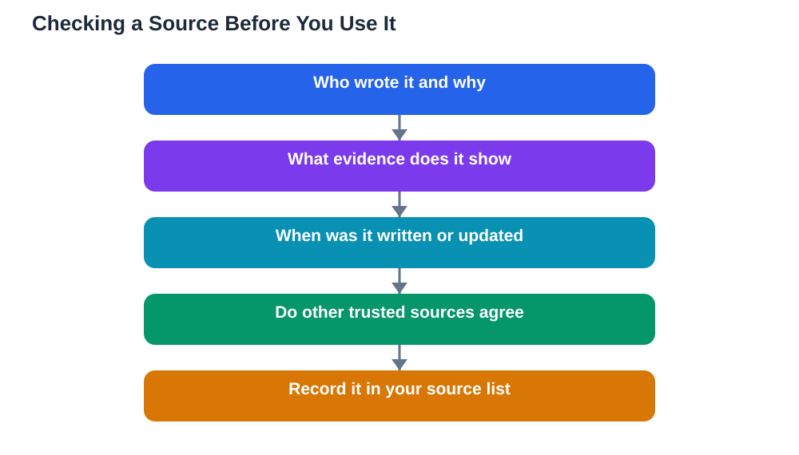

Finding reliable sources is the skill that separates a strong school project from one built on guesswork. The internet offers endless information, but not all of it is accurate, up to date, or written by someone who knows the subject. A project that leans on weak sources can sound confident while being wrong, and that is a risk no careful student wants to take. Learning to judge a source takes only a few habits: checking who wrote it, what evidence it offers, why it was written, and whether other trustworthy sources agree. Once those habits become automatic, finding reliable sources stops feeling like a chore and starts feeling like detective work you can actually enjoy.

## Finding Reliable Sources: Start With Your Library

A school or public library is still one of the best places to begin, even in a world full of search engines. Librarians choose books and resources for accuracy and reading level, and library books usually show their authors, publishers, and sources clearly. Start by asking a librarian for help with your topic, because a short conversation can point you to the right shelf far faster than an hour of random searching. Many libraries also offer databases, which are collections of articles, reference entries, and reports that have been selected and organised for students. These databases are especially useful because their contents have already passed some quality checks, unlike the open web, where anyone can publish anything. If your library offers online access, learn how to search it properly with key words from your research question, and keep a list of what you find.

## Judge a Website Before You Trust It

When you move to the open web, judge every site before you use it as evidence. Start with the author: is a real person or organisation named, and do they show knowledge or experience in the subject? Next, look for evidence: does the page explain where its facts come from, link to original material, or show its own sources? Then consider purpose: was the page written to inform, to persuade, to sell something, or to entertain? A page written to sell a product may still contain facts, but its claims deserve extra checking. Also check the date, because older pages may describe ideas, tools, or rules that have since changed. If a page hides its author, offers no evidence, or makes dramatic claims without support, treat it with caution and look for a stronger source instead. For a deeper checklist, see [How to Evaluate Sources](/blog/how-to-evaluate-sources.html).

## Use Several Kinds of Sources, Not Just One

A reliable project rarely rests on a single kind of source. Books give depth and background, reference works give clear definitions and overviews, articles give recent discussion, and original documents or data give direct evidence. Using several kinds together also lets you cross-check: when different independent sources agree, your confidence grows, and when they disagree, you have found something worth explaining in your project. Be careful with sources that simply repeat each other, because ten pages copying the same claim are not ten independent confirmations. Look for sources that reached their conclusions in different ways, and note where they agree and where they differ. That comparison itself is good research, and it shows your reader that you thought carefully rather than copying the first answer you found.

## Search Smarter With Better Key Words

Good searching is a skill in itself, and small changes to your search words can transform your results. Start with the key words from your research question, then try synonyms and related phrases when results are thin or off-topic. Adding a word that describes the kind of material you want, such as "overview", "guide", or "explained", can surface clearer introductions. If your results are flooded with irrelevant pages, add a limiting word from your narrowed question to focus them. Read the short descriptions under search results before clicking, and favour pages whose descriptions match your question closely. Keep a simple search log of the phrases you tried and the useful pages they produced, so you can return to good sources later and show your working if a teacher asks how you found your material.

## Keep a Source List From the Very First Day

Nothing wastes research time like finding a perfect source and then losing it. From the first day, keep a running list of every source you might use, with the author, title, date, and link or shelf location. This list becomes your bibliography later, and it also helps you remember which idea came from where, which protects you from accidental copying. When you take notes, label each note with its source right away, so you never have to guess later whether an idea was yours or someone else's. If you use the Lesson Solver tool for textbook exercises, remember to verify its solutions against your textbook, keep in mind that AI can make mistakes, and note that the tool needs your own free Google AI Studio API key. The same careful habit applies to all your sources: trust, but always verify before you build your project on a claim.

## AI Help: Muse AI

Muse AI is Meta's personal AI assistant, and it can help you with finding reliable sources. You can ask it to suggest search phrases for your topic or to explain in simple terms how to judge whether a website looks trustworthy.
Join Muse with invite code LTGSWD — in the Muse app, go to Settings > Redeem token and enter the code.
Disclosure: LTGSWD is the author's Muse invite code.

## FAQ

### What counts as a reliable source for a school project?

A reliable source names its author, shows evidence for its claims, states its sources where possible, and was written to inform rather than to mislead or sell. Library books, reference works, and vetted databases usually meet these tests well. A page with no author, no evidence, and dramatic unsupported claims does not, even if it looks polished.

### Are websites less reliable than books?

Not always, but websites vary far more in quality than published books, because anyone can publish a web page while books pass through editors and publishers. That means websites need closer checking, not automatic rejection. A well-sourced page from a respected organisation can be excellent, while a careless page on any topic can mislead, so judge each source on its own merits.

### How many sources should a school project use?

There is no single right number, because it depends on the length and depth of your project. A useful rule is to use enough independent sources that your main points are supported from more than one place, and to include more than one kind of source. Quality matters more than quantity: a few strong, well-understood sources beat a long list of weak ones you barely read.

### What should I do when two sources disagree?

Disagreement is not a problem to hide; it is something to explain. Check each source's evidence and purpose, look for a third source that might clarify the point, and report the disagreement honestly in your project. Explaining why sources differ shows careful thinking and gives your reader a fairer picture than picking one side silently.

## Conclusion

Finding reliable sources is less about knowing secret websites and more about building steady habits: start with your library, judge every website before trusting it, use several kinds of sources, search with thoughtful key words, and keep a source list from day one. These habits protect your project from weak claims and give your reader good reason to trust your work. Take the time to check your sources, and the rest of your research will stand on much firmer ground.

[Try the free AI lesson solver](/#tool)
