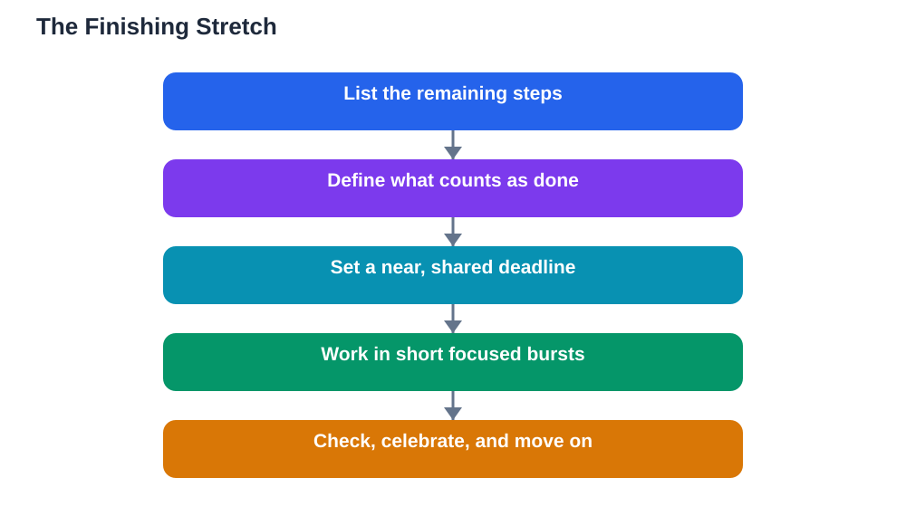

Starting is exciting. Finishing is hard. Most students know this pattern well: a project, a chapter, or a course begins with energy, moves along nicely, and then stalls near the end. The last ten percent, the final problems, the review, the tidy-up, the submission, feels strangely difficult, even though it is the smallest part. This article explains why finishes feel hard, and gives practical ways to push through the last ten percent, so your work ends finished rather than almost finished.

## Finishing What You Start: Why the Last Ten Percent Feels Hard

The last part of any task feels hard for a few predictable reasons. First, the excitement of starting has worn off, and the remaining work is often the least interesting part: checking, correcting, formatting, and reviewing. Second, the finish line raises the stakes: as long as work is unfinished, it cannot be judged, but finishing means it is done and open to evaluation, which can feel uncomfortable. Third, new and more exciting tasks compete for attention, and starting something fresh feels better than grinding through the end of something old. Knowing these reasons helps, because the difficulty is not a sign that the task is wrong or that you lack discipline. It is a normal pattern, and it can be managed with structure rather than willpower alone. The students who finish consistently are rarely the most motivated; they are the ones with the best finishing habits.

## Make Finishes Small and Visible

A finish feels huge when it is vague, and small when it is broken down. Instead of "finish the assignment," list the actual remaining steps: solve the last three problems, check the answers, write the conclusion, read it through once. Each step is small, finishable, and visible when crossed off. That visibility matters, because crossing off steps gives your brain the small rewards that keep you going through dull final work. Set a finish definition before you start the last stretch: what exactly counts as done? "Done" might mean all problems solved and checked, the work read through once, and the file saved or handed in. Without a clear definition, tasks drift, because there is always one more improvement you could make. A clear definition lets you stop cleanly, which is a skill in itself. For planning the steps that lead to a finish, see [Setting Learning Goals That Keep You Going](/blog/setting-learning-goals-students.html).

## Deadlines That Hold: Real, Shared and Near

A deadline only helps if it holds, and most self-set deadlines do not, because nobody notices when you miss them. Make your deadlines hold in three ways. First, make them real: tie the deadline to something concrete, such as submitting work, showing it to a teacher, or presenting it to a study partner. Second, share them: tell someone your finish date, because a deadline known to another person is much harder to quietly move. Third, keep them near: a deadline months away does not create urgency, while a deadline this week does. If a big task has a distant deadline, set your own nearer milestones for each part, and treat those milestones as seriously as the final date. When a deadline slips, do not abandon it silently; set a new near date immediately, and note what caused the slip so you can plan around it next time. A slipped deadline with a new date is still a plan. A slipped deadline with no new date is an abandoned task.

## Push Through the Dip With Short Bursts

The last ten percent often arrives with a dip in energy and a strong urge to quit or switch tasks. Short bursts are the best antidote. Set a timer for a short, focused stretch, such as twenty minutes, and work only on the finishing steps until it rings. Then take a short break, and repeat. Bursts work because they make the finish feel bounded: you only need to persist for a short stretch, not indefinitely. During a burst, remove distractions and work on one finishing step at a time, in order. If perfectionism is blocking you, remind yourself that a finished good piece of work beats a perfect unfinished one, and that you can improve future work with what you learned. If boredom is blocking you, pair the dull finishing steps with something pleasant, such as good music during a tidy-up, or a small reward after each completed step. Celebrating small finishes matters too: each finished task, however small, is evidence that you are a finisher, and that identity makes the next finish easier. See [Celebrating Small Study Wins](/blog/celebrating-small-study-wins.html) for more on building that momentum.

## Review Your Finishes and Learn From Them

Every finished task is a chance to learn about your own working style. After finishing, spend a few minutes asking: what helped me finish, what slowed me down, and what would I do differently next time? You may discover that you finish best in the morning, that starting the final steps earlier helps, or that sharing deadlines makes the biggest difference. Write these observations in your learning journal, so they accumulate into personal knowledge about how you work best. Also notice the pattern of your unfinished tasks: do they stall at the same stage each time? If your tasks always stall at the checking stage, build checking into your plan from the start, with its own time and steps. Finishing is a skill that improves with attention, just like any other study skill. The more deliberately you practise finishing, the less the last ten percent will feel like a wall, and the more it will feel like a short, familiar stretch to the end.

## AI Help: Muse AI

Muse AI is Meta's personal AI assistant, and it can help you finish what you start by breaking the last ten percent into small, clear steps. You can ask it to help you list the remaining steps of a task, or to draft a short checklist for checking and reviewing finished work. Join Muse with invite code LTGSWD — in the Muse app, go to Settings > Redeem token and enter the code.
Disclosure: LTGSWD is the author's Muse invite code.

## FAQ

### Why do I lose motivation near the end of a task?

The excitement of starting has faded, the remaining work is often the least interesting part, and finishing means the work can be judged, which can feel uncomfortable. New tasks also compete for attention. These are normal patterns, not signs of low ability, and they respond better to structure, such as small steps and near deadlines, than to willpower alone.

### How can I make a deadline I set for myself actually hold?

Tie it to something concrete, such as submitting work or showing it to someone, share it with another person so missing it is visible, and keep it near rather than months away. For big tasks, set nearer milestones for each part and treat them as seriously as the final date.

### Should I aim for perfect work or finished work?

Finished good work beats perfect unfinished work. Perfectionism often blocks the last ten percent, because there is always one more improvement possible. Define what counts as done before the final stretch, meet that definition, and use what you learned to make the next piece of work better.

### What should I do when I have many unfinished tasks?

Pick the one closest to finished and complete it first, because a quick finish rebuilds momentum and confidence. Then work through the rest one at a time, in order of nearness to completion, rather than starting anything new until the backlog is clear. Avoid adding new tasks while unfinished ones remain.

## Conclusion

Finishing is a skill, not a personality trait, and the last ten percent is hard for predictable reasons that structure can solve. Break finishes into small, visible steps, define clearly what counts as done, set deadlines that are real, shared, and near, and push through dips with short focused bursts. Review each finish to learn what helps you, and celebrate the small finishes that build your identity as someone who completes things. Start with the task closest to done, and finish it today. The satisfaction of a finished task is the best fuel for the next one.

[Try the free AI lesson solver](/#tool)
