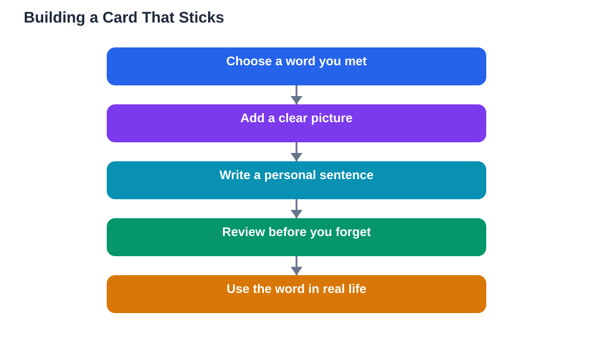

Flashcards that work for language learning look different from the bare word lists many learners build. A card that shows a single word on one side and a translation on the other teaches recognition, but recognition alone fades quickly and rarely becomes usable language. Cards that work use pictures, full sentences, and spaced review, because each of these adds a memory path that makes the word easier to recall later. The difference is not about fancy tools or expensive apps. It is about how you build each card and how you review it, and both parts are simple to fix.

## Flashcards That Work Language: Pictures Before Translations

A picture on a card does something a translation cannot: it connects the new word directly to meaning, without passing through your first language. When you see a picture of an everyday object, an action, or a feeling, and recall the new word for it, you practise thinking in the new language rather than translating. Pictures work best for concrete words, such as objects, places, and actions you can draw or find as images. For abstract words, a simple scene or a symbol can still help, as long as the image means something personal to you. Keep pictures simple and clear, because a confusing image adds work instead of helping memory. Even a quick hand-drawn sketch beats a bare word, because the act of drawing it already helps you remember.

## Sentences Turn Cards Into Usable Language

The single biggest upgrade you can make to a flashcard is to put the word inside a sentence. On the front of the card, show the word in a short sentence with the word missing, or show a picture plus a sentence that uses the word. On the back, show the complete sentence. This teaches you the word together with its grammar, its companions, and its natural context, so you learn how to use it, not just how to recognise it. Make your sentences personal and simple, about your own life, because personal sentences are far more memorable than generic ones. When you review, read the whole sentence aloud, not just the single word, so pronunciation and sentence rhythm get practised at the same time. A deck of sentence cards becomes a collection of usable language, while a deck of single words stays a collection of trivia.

## Spaced Review: The Rhythm That Makes Cards Stick

Spaced review is the system that turns a good card into a lasting memory. The idea is simple: review a card again just before you are likely to forget it, with gaps that grow longer each time you remember it. New cards return the next day, remembered cards return after a few days, and well-known cards return after weeks. This rhythm works because each successful recall, done just as the memory starts to fade, strengthens the memory more than many reviews done all at once. When you review, always try to recall the answer before turning the card over, because the effort of recall is itself what builds memory. If you get a card wrong, it simply returns sooner, which is the system working as designed, not a failure on your part.

## Building a Deck You Will Actually Use

A flashcard deck fails when it grows too fast, fills with rare words, or becomes a chore. Keep your deck focused on words you meet in lessons, reading, or conversation, because those words have context and a real chance of being used. Add new cards in small batches, and let older cards graduate to longer review gaps so the daily load stays manageable. Remove or suspend cards you have fully mastered, and rewrite cards that keep failing, since a failing card usually needs a better picture or a clearer sentence, not more repetition. Review at a regular time each day, in a short session you can complete without strain. A deck of well-built cards, reviewed briefly every day, will quietly carry a large part of your vocabulary progress.

## Common Flashcard Mistakes to Avoid

Several habits quietly weaken flashcards, and all of them are easy to fix. Reading the answer before trying to recall it turns review into rereading, which feels productive but teaches little. Always guess first, even if you are unsure, because the attempt matters. Learning cards in the same order every time teaches you the order rather than the words, so shuffle your deck regularly. Building huge decks of words you never meet wastes review time on words you will not use, so prune ruthlessly. Finally, relying only on cards without speaking or reading means words stay trapped in the deck, so use new words in sentences, conversation, or writing as soon as you can. Cards are a tool for memory, not a substitute for using the language. For a daily word routine that pairs well with cards, see [Ten Words a Day: A Language Habit That Sticks](/blog/ten-words-a-day-language.html).

## AI Help: Muse AI

Muse AI is Meta's personal AI assistant, and it can help you build better flashcards. You can ask it to write a simple example sentence for a new word, or to suggest a picture idea that captures a word's meaning clearly. Join Muse with invite code LTGSWD — in the Muse app, go to Settings > Redeem token and enter the code.
Disclosure: LTGSWD is the author's Muse invite code.

## FAQ

### Should flashcards show a translation or a picture?

Pictures are usually better for concrete words, because they connect the new word directly to meaning without translation. Translations are still useful for abstract words that are hard to picture, or as a backup on the back of the card. A good rule is to use a picture first, a sentence always, and a translation only when the picture alone is unclear.

### How many new cards should I add each day?

A small number, such as the words from one lesson or a daily set of ten, keeps the review load manageable. Adding too many cards at once creates a mountain of reviews that soon feels overwhelming and leads to abandoned decks. Slow, steady additions with proper spaced review build a stronger deck than large, irregular batches.

### Is it better to make cards by hand or use an app?

Both work, and the best choice is the one you will actually use every day. Handmade cards add the memory benefit of writing and drawing, while apps handle spaced review scheduling automatically. Many learners combine both: they build cards by hand for tricky words and use an app for the daily review rhythm.

### Why do I remember cards during review but forget words in conversation?

Review often gives you hints, such as the order of cards or the picture style, that real conversation does not provide. To bridge the gap, practise recalling words without hints, use new words in your own sentences, and try them in real speaking as soon as possible. Cards build the memory, but using the language is what makes it available when you need it.

## Conclusion

Flashcards that actually work are built on three simple ideas: pictures that connect words to meaning, sentences that teach words in use, and spaced review that brings words back at the right moment. Build your deck slowly from words you genuinely meet, review briefly every day, and use new words outside the deck as soon as you can. With that approach, a small stack of cards becomes one of the most reliable tools in your language learning.

[Try the free AI lesson solver](/#tool)
