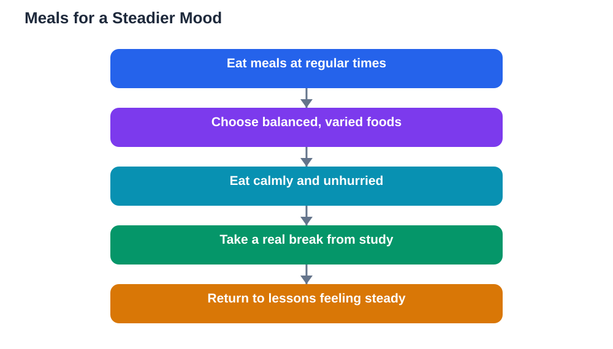

Food and mood students experience are connected in ways that are easy to miss. A skipped meal can turn into irritability during a lesson. A rushed, sugary lunch can lead to a restless afternoon. A calm, balanced meal can leave you feeling steady and ready to work. These are not coincidences. What you eat, when you eat, and how you eat all shape how you feel, and how you feel shapes how well you learn.

Mood affects learning directly. A learner who feels calm and comfortable can listen, ask questions, and persist with difficult work. A learner who feels hungry, jittery, or low finds the same work far harder. Protecting your mood through regular, balanced meals is therefore a study strategy, not just a health tip. It works quietly in the background of every lesson.

## Regular meals and steady feelings

Regular meals give your day a rhythm, and rhythm supports mood. When meals arrive at predictable times, your body spends less time signalling hunger and urgency, and your mind stays freer for learning. Skipped meals break that rhythm. Hunger builds gradually, often unnoticed, until it appears as impatience, low energy, or difficulty concentrating.

Breakfast, lunch, and an evening meal form the backbone of that rhythm, with small snacks where needed. The exact timing can flex around your school day, but the pattern should stay roughly consistent. Learners who eat at similar times each day often report steadier afternoons, because their bodies are no longer guessing when the next meal will come. Consistency is kinder than perfection.

## The gut and brain connection

Your digestive system and your brain communicate constantly. Feelings of hunger, fullness, and comfort travel from the gut to the brain and influence mood, attention, and even sleepiness. That is why a heavy, rushed meal can leave you feeling sluggish, and why hunger can make you feel on edge. The connection works in both directions: stress and worry can also disturb appetite and digestion, creating a cycle that affects both eating and mood.

Understanding this connection helps you respond wisely. If you feel suddenly irritable during a lesson, consider whether hunger or a recent sugar rush might be contributing. If worry is spoiling your appetite, a small, familiar meal may be easier than a large one. You are not imagining the link between stomach and feelings. It is a real, everyday part of how your body works.

## Balanced meals and emotional steadiness

Balanced meals support mood because they avoid sharp swings. A meal that combines food groups provides steadier energy than a single sweet or salty item, and steadier energy usually means steadier feelings. You are less likely to crash into tiredness or restlessness, and more likely to stay patient with difficult work and with other people.

Variety also matters for mood. Meals that are enjoyable, colourful, and shared with others tend to lift spirits in a way that rushed, lonely snacking does not. Eating with family or friends adds conversation and calm to the meal, turning it into a genuine break. Food is not only fuel. It is also a daily moment of comfort, and protecting that moment protects your mood.

## Sugar swings and irritability

Sweet snacks and drinks can create a short-lived lift followed by a low that feels like irritability or tiredness. During the low, small frustrations feel larger, patience runs thin, and schoolwork feels harder than it is. Students often blame the subject or the teacher, when part of the story is an energy swing that has left them less steady.

This does not mean sweets must be banned. It means they work better as occasional treats than as the main fuel for a school day. When sweets follow a balanced meal, or are enjoyed after study, their effect on mood is far gentler. Timing and context turn the same food from a mood disruptor into a simple pleasure.

## Eating calmly matters too

How you eat affects mood as much as what you eat. A meal eaten in a rush, while standing, or while worrying about the next lesson rarely feels satisfying, even if the food itself is good. Sitting down, eating at a calm pace, and giving the meal a few unhurried minutes helps your body register fullness and comfort. That calm carries into the next lesson.

Build small pauses around meals. Put study aside during lunch, talk with friends or family, and step away from screens briefly. These pauses are not wasted time. They let your mind rest, your mood settle, and your body digest comfortably. A calm meal is a better preparation for afternoon learning than a hurried one eaten over your notes.

## When food and mood feel stuck

Sometimes the link between food and mood becomes a difficult cycle. Low mood reduces appetite, poor eating worsens mood, and the pattern repeats. If you notice this happening over days or weeks, talk to a trusted adult. You do not need to fix it alone, and a caring adult can help you find support, adjust routines, and get personal advice that general articles cannot provide.

Gentle steps still help while you seek support. Keep meals regular even when appetite is low, choose small, familiar foods, and eat with others when possible. Avoid using food as punishment or reward, and avoid strict rules that add stress. Kindness toward yourself, in eating as in studying, is a habit that supports recovery and steadiness.

## AI Help: Muse AI

Muse AI is Meta's personal AI assistant, and it can help you build calmer daily routines around meals. You could ask it to help you plan regular meal times, or to suggest simple ways to make lunch breaks more relaxing. Join Muse with invite code LTGSWD — in the Muse app, go to Settings > Redeem token and enter the code.
Disclosure: LTGSWD is the author's Muse invite code.

## FAQ

### Can food really affect my mood?

Yes. Hunger, energy swings, and rushed meals can all influence irritability, tiredness, and patience. Regular, balanced meals support steadier energy, which usually means steadier feelings. Food is one of several influences on mood, alongside sleep, activity, and relationships.

### Why do I feel grumpy when I skip a meal?

Skipping a meal leaves your body signalling hunger, which competes with attention and patience. You may feel restless or easily annoyed without realising hunger is part of the cause. A regular meal pattern prevents that build-up and keeps your mood on a steadier footing.

### What is the gut-brain connection?

It is the constant communication between your digestive system and your brain. Signals about hunger, fullness, and comfort travel from the gut and influence mood and focus, while stress and worry can affect appetite in return. That two-way link is why calm, regular meals support both comfort and concentration.

### Do sweets make mood worse?

Sweets can bring a brief lift followed by a low that feels like irritability or tiredness, especially when they replace balanced food during study. Enjoyed occasionally, after a meal or after study, they cause far less trouble. The key is timing and balance, not a total ban.

### What should I do if low mood is affecting my eating?

Talk to a trusted adult, and keep gentle routines going in the meantime: regular small meals, familiar foods, and meals shared with others when possible. Persistent low mood or appetite changes deserve personal support, and asking for help is a strong and sensible step.

## Conclusion

Food and mood students live with are deeply connected, through regular meals, balanced energy, and the quiet conversation between gut and brain. Keep meals regular, choose balanced foods over sugar-led snacking, and eat calmly with time to enjoy the break. Watch for patterns in your own day, and ask for help if food and mood ever feel stuck. When meals support a steady mood, learning becomes easier, patience grows, and every lesson gets a fairer chance.

[Try the free AI lesson solver](/#tool)
