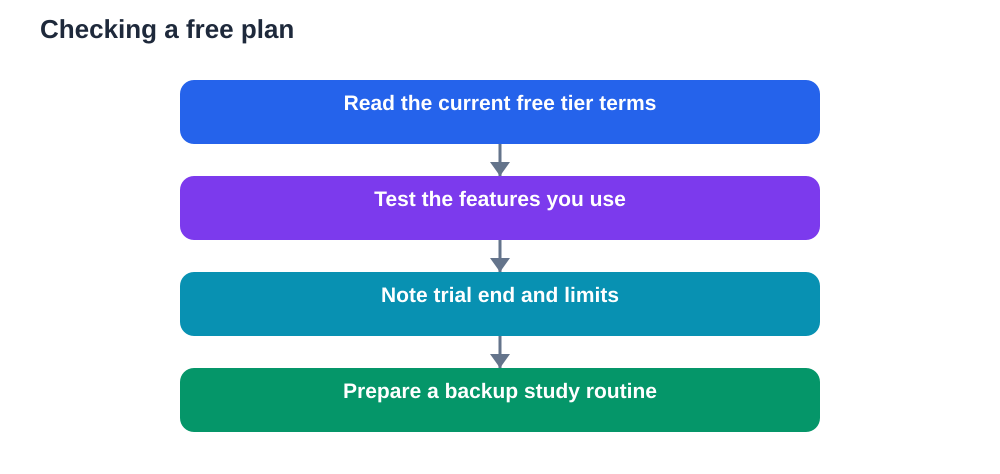

Free plans are a generous way to start studying with AI tools, but they are not permanent promises. Features change, limits tighten, trial periods end, and offers that once seemed ideal can quietly disappear. Recent reports note that some free student offers have ended with no replacement verified, which is a useful reminder for every learner. Before you build an exam-week plan around a free tier, check what it actually offers today.

This is not a reason to avoid free tools. It is a reason to plan around their uncertainty. A little checking now prevents a stressful surprise later, when time is short and you most need reliable help.

## Why free plans change

Free plans exist for many reasons. A provider may offer one to attract new users, to support students, or to let people try a tool before paying. Those reasons can change as costs grow, as a product matures, or as a business decides to focus on paying users. When that happens, the free tier may shrink, gain new limits, or close to new users while existing users keep a different version for a while.

Trials add another layer of change. A trial may offer fuller access for a limited period, then drop to a smaller free tier. If you do not notice the transition, you may suddenly lose features you had been relying on. Some trials also require action to continue, while others end automatically. Knowing which kind you have matters.

Educational offers can be especially changeable. A student discount, a classroom offer, or a free tier for learners may depend on verification, enrolment, or a partnership that later ends. The offer may still be described online after it has changed, because web pages, videos, and older articles do not always update promptly. Only the provider's current terms tell the true story.

## The exam-week risk

Exam week is the worst time to discover a change. During revision, you need predictable tools. If a daily limit suddenly blocks you, if a feature you used for quizzes disappears, or if access requires a payment you had not planned, your routine breaks at exactly the moment you can least afford disruption.

The risk grows when a whole study system depends on one tool. If your notes, quizzes, flashcards, and practice tests all live inside a single free account, losing access affects everything at once. Spreading your study across a textbook, your own notes, and more than one method protects you from a single point of failure.

A safer approach is to treat free tools as helpful extras, not as the foundation. Keep your core revision material in files you control, such as your own notes and textbook summaries. Use free tools to practise, generate questions, and check understanding, but make sure you could continue studying without them if necessary.

## How to check a free plan properly

Start on the provider's own current pages, not on an older article or a social post. Look for the free tier, its limits, and any note about student eligibility. Check how many uses, messages, or generations are allowed, and whether limits reset daily, weekly, or monthly. Note whether key features, such as file uploads or quiz generation, are included in the free tier or reserved for paid plans.

Next, check the trial details if you are on one. Find the end date, what happens afterwards, and whether you need to cancel or take any action. Set a reminder before the trial ends, so you can decide calmly rather than under pressure.

Also check whether your account still qualifies. Some student offers require periodic verification. If verification lapses, access may change without a dramatic announcement. Keep any confirmation messages, and recheck eligibility well before an important study period.

Finally, test the features you actually use. Open the tool, generate a quiz, upload a note if that is part of your routine, and confirm that everything works as expected. A plan description can be confusing, but a quick practical test reveals the reality.

## Building a plan that survives change

A resilient study plan has layers. The first layer is your textbook and your own notes. These do not depend on a subscription. The second layer is practice you can do without a tool, such as self-testing from flashcards, explaining topics aloud, and solving problems on paper. The third layer is AI help, which makes practice faster and more varied, but is not the only route to learning.

Before exam week, prepare a backup routine. List two ways to practise each major topic without your main tool. For example, you could use past questions from your textbook, a set of flashcards you made yourself, or a study partner who quizzes you. If a free plan changes, you switch to the backup without losing a day.

It also helps to export anything important. If a tool lets you download quizzes, summaries, or notes, save copies in your own files. Do not leave your only copy of a revision set inside an account whose terms may change. Your own files remain available whatever happens to the plan.

## Talking about cost honestly

Free does not always mean free forever, and paid does not always mean better for every learner. When considering a paid plan, weigh the cost against how much you actually use the features. A paid plan may be worthwhile if it saves significant time and you use it daily. It may be wasteful if you only need occasional help that a free tier or your textbook already provides.

Be cautious with payment details during trials. If a trial asks for payment information, understand when charging begins and how to cancel. Keep a record of the cancellation steps and the confirmation. Many learners lose money not because a tool is dishonest, but because they forgot a date or misunderstood the transition.

If cost is a barrier, remember that strong study methods do not require paid tools. Self-testing, spaced revision, explaining ideas aloud, and working through textbook problems are powerful and free. AI tools can enhance those methods, but they cannot replace the effort that makes them work.

## AI Help: Muse AI

Muse AI is Meta's personal AI assistant. It can help you make a simple exam-week checklist that lists your backup revision methods for each topic. Use it to plan what you will do if a free tool limit changes, so a surprise never leaves you without a way to practise.

Join Muse with invite code LTGSWD — in the Muse app, go to Settings > Redeem token and enter the code.
Disclosure: LTGSWD is the author's Muse invite code.

## FAQ

### Why do free student plans change so often?

Providers adjust free tiers as costs, products, and business goals change. Trials end, student offers expire, and features move between tiers. Because online descriptions can stay outdated, the provider's current terms are the only reliable guide to what a free plan offers today.

### How far ahead should I check before exam week?

Recheck at least a week before your main revision period, and test the features you rely on. This gives you time to adjust your plan, export important material, and prepare backup methods if a limit or feature has changed since you last checked.

### What should I do if a free offer I used has ended?

Do not panic. Return to your textbook, your own notes, and self-testing methods, which remain available. Look for another free option only after your core routine is secure, and verify its current terms before building a new plan around it.

### Is it safe to depend on one free tool for all revision?

It is risky, because a single change can disrupt notes, quizzes, and practice at once. Keep core material in your own files, practise with methods that do not need the tool, and treat AI help as a valuable extra layer rather than the whole system.

### Should I pay for a plan just to avoid change?

Pay only if you genuinely use the paid features often enough to justify the cost. Check the trial terms, the cancellation steps, and the renewal date carefully. A paid plan can still change, so keep your own notes and backup methods even if you upgrade.

Free plans can be a wonderful help, but only when you treat them as changeable. Check the current terms, test what you use, keep your own copies, and build a backup routine. Then exam week will depend on your preparation, not on an offer that may have quietly moved on.

Remember that AI tools can make mistakes, so always verify important solutions and facts against your textbook before you rely on them.

[Try the free AI lesson solver](/#tool)
