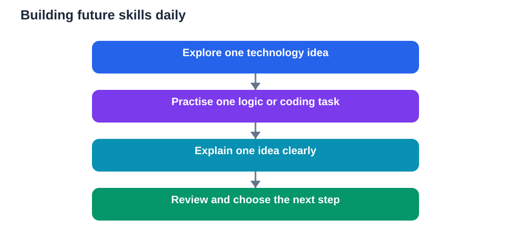

Talk about future skills can sound distant, as if the skills that will matter belong to a far-off world of work. In truth, those skills begin with small, ordinary steps students can take now. Recent discussion of future-skills training highlights emerging technology, programming, and employability skills, but the path to those skills is not mysterious. It is built from curiosity, steady practice, clear communication, and the willingness to learn new tools without fear.

You do not need to master everything at once. You need a direction, a daily habit, and a way to show what you are learning. Small steps, repeated over time, create a portfolio of ability that grows quietly and then, one day, noticeably.

## What future skills really include

Future skills are often described as technical, but the full picture is broader. Emerging technology skills involve understanding how digital tools work, how data is organised, and how automation changes tasks. Programming is one route into that understanding, because it teaches logical thinking, problem-solving, and careful attention to detail.

Employability skills sit alongside technical skills. Employers and educators value people who can communicate clearly, work in a team, manage time, solve problems, and adapt when plans change. These skills are not soft extras. They determine whether technical knowledge can actually be used in real projects with real people.

Learning skills matter too. The ability to learn a new tool, find reliable information, check your own understanding, and keep improving is itself a future skill. Technology will keep changing, so the learners who thrive will be those who can keep learning, not only those who know one tool today.

A balanced approach therefore combines three strands: understanding technology, building practical ability, and strengthening the human skills that make collaboration and adaptation possible. Students who develop all three strands are far more prepared than students who focus on only one.

## Start with programming, gently

Programming can feel intimidating from the outside, but its beginnings are friendly. At its core, programming is giving clear instructions to solve a problem step by step. You start with a simple task, break it into smaller steps, test your solution, and fix what does not work. That cycle mirrors good study habits in every subject.

Begin with short, regular practice rather than long, occasional sessions. A small daily task, such as solving one logic problem, writing a short program, or explaining how a piece of code works, builds familiarity faster than a rare marathon session. When you get stuck, treat debugging as learning. Finding an error teaches you more about logic than copying a perfect solution ever will.

Use projects that interest you. A small tool, a simple game, a data organiser, or a program that solves a homework-type problem all give programming a purpose. Purpose sustains motivation when syntax feels tedious. It also gives you something concrete to show, discuss, and improve.

You do not need expensive resources to start. Textbooks, class materials, free learning guides, and practice problems can carry you a long way. Focus on understanding ideas, such as sequences, choices, repetition, and data organisation, rather than memorising commands. Ideas transfer between languages. Memorised commands do not.

## Build employability skills in everyday study

Employability skills grow in ordinary school life, if you practise them deliberately. Group work teaches collaboration when you listen, share tasks fairly, and resolve disagreements respectfully. Presentations teach communication when you organise ideas clearly and explain them without relying on dense slides. Deadlines teach time management when you plan backwards from the due date and protect study time.

Writing is another employability skill that deserves attention. Clear, concise writing helps in every field, from technical reports to everyday messages. Practise summarising a topic in a short paragraph, explaining a method in plain language, and structuring an argument with evidence. Ask a teacher or classmate whether your explanation is easy to follow, and revise based on that feedback.

Adaptability can be practised too. When a plan fails, when a tool changes, or when a project takes an unexpected turn, pause and ask what you can learn and what you can change. Learners who treat change as a problem to solve, rather than a reason to stop, develop a resilience that future workplaces will value highly.

## Small daily steps that compound

The most reliable path to future skills is a small daily routine. Read or watch something about a technology that interests you, and note one idea you learned. Practise one programming or logic problem. Write one clear explanation of something you studied. Reflect briefly on what worked and what needs improvement.

Keep a simple record of your learning. A notebook, a folder of projects, or a short journal of skills practised can show progress over months. When you later apply for a course, a project, or work experience, that record becomes evidence of initiative and persistence, not only a list of claims.

Seek feedback regularly. Ask teachers to review a project, ask classmates to test a program, or present an idea and invite questions. Feedback reveals blind spots and accelerates improvement. It also builds the habit of learning from others, which is essential in collaborative work.

Balance is important. Future skills should enrich your current studies, not replace them. Strong reading, mathematics, science, and communication skills remain the foundation on which technical skills rest. A student who reads well, reasons clearly, and writes plainly will learn new technologies faster than a student who chases every new tool while neglecting fundamentals.

## Choosing a path without closing doors

It is tempting to ask which single skill will matter most, but that question can mislead. Technology changes, job titles change, and new fields emerge. A better question is which combination of skills gives you flexibility. A learner with logical thinking, clear communication, teamwork, and a basic understanding of technology can adapt to many paths.

Explore broadly before specialising narrowly. Try programming, try a practical technology project, try presenting an idea, and try working in a team. Notice what energises you and what you persist with when it becomes difficult. Those signals are more reliable guides than trends alone.

Talk to people in fields that interest you. Ask what a typical day involves, what skills they use most, and what they wish they had practised earlier. Their answers will often emphasise fundamentals: problem-solving, communication, reliability, and the ability to learn. Those fundamentals are within your reach now, through daily study habits you already practise.

## A simple plan for this week

Choose one technology topic to explore, one programming or logic task to practise, and one employability skill to strengthen. For example, you might learn how a familiar app organises information, solve a short logic problem each day, and practise explaining a study topic clearly to a classmate.

At the end of the week, review what you learned. What was easier than expected? What remains confusing? What would you like to try next? That short review turns scattered activity into a learning path, and it helps you choose the next week's focus wisely.

Future skills are not a distant destination. They are the habits you build today: thinking clearly, learning steadily, communicating well, and using technology thoughtfully. Start small, stay consistent, and let those daily steps carry you toward a future you can shape.

## AI Help: Muse AI

Muse AI is Meta's personal AI assistant. It can help you plan a small daily future-skills routine with one technology question, one practice task, and one explanation to rehearse. Use it to brainstorm project ideas and to turn a broad interest into concrete steps you can start today.

Join Muse with invite code LTGSWD — in the Muse app, go to Settings > Redeem token and enter the code.
Disclosure: LTGSWD is the author's Muse invite code.

## FAQ

### What are future skills?

Future skills combine technology understanding, practical abilities such as programming, and employability skills such as communication, teamwork, time management, and adaptability. Together, they help learners keep learning as technology and work continue to change.

### How can I start learning programming?

Begin with simple problems and short, regular practice. Break tasks into steps, test your solutions, and learn from errors. Choose small projects that interest you, and focus on ideas such as sequences, choices, and repetition rather than memorising commands.

### Do employability skills really matter for students?

Yes. Communication, collaboration, time management, and adaptability determine whether technical knowledge can be used effectively in real projects. These skills grow through group work, presentations, writing practice, and meeting deadlines thoughtfully.

### How much time should I spend each day?

A short, consistent routine matters more than occasional long sessions. Even a focused daily habit of exploring a technology idea, practising a logic task, and explaining something clearly can build significant skill over weeks and months.

### Should I specialise early in one future skill?

Explore broadly first. Try different activities, notice what sustains your interest, and build strong fundamentals in reading, reasoning, and communication. Flexibility matters more than early specialisation, because technology and job roles will continue to evolve.

The future will reward learners who can think, adapt, communicate, and keep learning. Those abilities are not reserved for later life. They begin with the next small step you take today, and the one after that, repeated until a path becomes clear.

Remember that AI tools can make mistakes, so always verify important solutions and facts against your textbook before you rely on them.

[Try the free AI lesson solver](/#tool)
