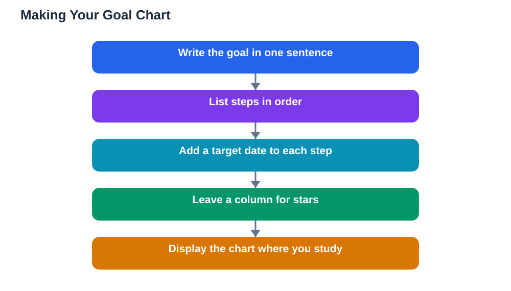

A goal written in a notebook can disappear among pages of notes, but a goal chart on one page stays visible every day. This guide shows how to make a simple goal chart in a short session, using nothing more than a sheet of paper and a pen. The chart holds four things: the goal, its steps, their dates, and stars for finished work. That is all it needs, and that simplicity is why it works.

Start with a blank sheet, turned so the long side runs across. You will divide it into sections, and keeping everything on one page is the whole point: the chart should be readable at a glance from your study spot. Put it where you will see it daily, such as on a wall, inside a folder cover, or beside your desk. A chart that lives in a closed drawer is just another forgotten note, so visibility matters as much as design.

## The Four Parts of the Chart

The top of the page holds the goal itself, written in one clear sentence. Under it, list the steps in order, each on its own row. Beside each step, write its target date, so every step has a deadline. The last column is for stars: one star, tick or coloured mark for each step finished. Some students add a small notes column for what they learned or what was hard, which turns the chart into a record of progress as well as a plan. Keep the layout roomy rather than cramped; a chart you enjoy looking at is a chart you will keep using.

## Writing a Goal Worth Charting

A chart works best for a goal that is concrete and finishable within a few weeks, such as completing a project, mastering a topic, or building a study habit. Write the goal as a finished outcome, not as a vague hope: the chart needs a finish line it can show. If your goal is very large, chart one stage of it rather than the whole thing, and make a fresh chart for the next stage when this one is complete. A finished chart is satisfying in itself, and a series of completed charts tells the story of a term far better than one overwhelming sheet.

## Laying Out Steps and Dates

Break the goal into steps small enough to finish in one or two study sessions, and list them in the order you will do them. Place easier steps early where possible, so the chart gains stars quickly and momentum builds. Assign each step a target date by working backwards from the goal deadline, leaving a little slack for busy days. Write dates in pencil if you like, so they can be adjusted without spoiling the chart. When a step is done, mark its star on the same day, because a delayed star feels less rewarding and is easy to forget. Watching the stars spread down the page is the chart's quiet magic: progress becomes something you can see.

## Using the Chart Every Day

A chart earns its keep through daily use. Glance at it at the start of each study session to see the next step, and mark progress at the end of the session. If a step is missed, move its date rather than leaving it overdue and discouraging; a chart should guide, not guilt. Once a week, spend a few minutes reviewing the chart as a whole: which steps are done, which are coming, and whether any step needs splitting or help. If a step turns out to be stuck, note the problem beside it and ask for help with that specific point. The chart then becomes not only a plan but a conversation starter with anyone who can support your learning.

## Keeping the Chart Alive All Term

Charts fade when they are treated as decoration. Keep yours alive by updating it promptly, celebrating completed rows, and replacing a finished chart with a new one without delay. If a chart stops matching reality, revise it openly: cross out a changed step, add a new row, adjust a date. A chart full of honest corrections is more useful than a pristine chart that no longer describes your work. Over a term, keep finished charts together in a folder; flipping through them shows growth that daily effort hides, and that record becomes encouraging evidence whenever a new goal feels daunting.

## AI Help: Muse AI

Muse AI is Meta's personal AI assistant, and it can help you plan a one-page goal chart. You can describe your goal and ask it to suggest a sequence of steps with sensible dates, then copy the best version onto your chart. Adjust its draft to fit your real timetable, and keep the chart in your own words.

Join Muse with invite code LTGSWD — in the Muse app, go to Settings > Redeem token and enter the code.

Disclosure: LTGSWD is the author's Muse invite code.

## FAQ

### What materials do I need for a goal chart?

Just a sheet of paper, a pen and something to mark finished steps, such as a coloured pen or stickers. Fancy supplies are optional; the chart works because it is simple and visible, not because it looks professional. A plain chart you actually use beats a beautiful one you never update.

### How many steps should fit on one chart?

Aim for a number that fills one page comfortably, usually a handful of steps grouped under clear headings if needed. If the list grows too long, split the goal into stages and chart one stage at a time. A readable chart with room to write is far more useful than a cramped one.

### What if I miss a step's target date?

Move the date and keep going. Missing a date is information, not failure: it may mean the step was too large, the week was busy, or help is needed. Adjust the step or its date, note the reason briefly, and continue. A chart that bends survives; a rigid chart gets abandoned.

### Can a goal chart work for group goals too?

Yes, with one shared chart and a column showing who is responsible for each step. The visible stars keep everyone aware of progress, and the weekly review gives the group a natural moment to discuss problems. Keep the chart in a shared space or a shared document everyone can see.

## Conclusion

A goal chart turns a distant goal into a single page you can see, follow and finish: goal at the top, steps and dates down the side, stars marking every win. Make one in a short session, put it where you study, and update it daily. The stars will add up faster than you expect.

[Try the free AI lesson solver](/#tool)
