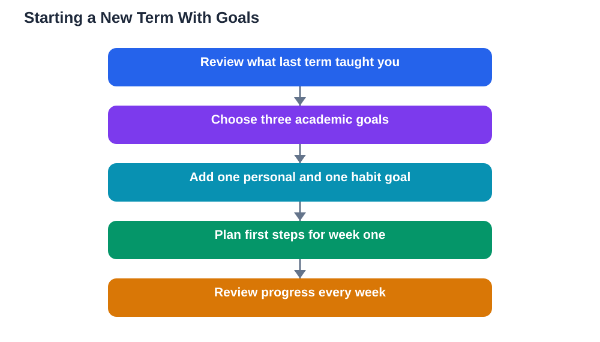

A new term is a natural fresh start. New topics, new routines and a clean planner make it the easiest moment of the year to set goals. But fresh starts fade quickly when goals are vague or too many. The trick is to use the new-term energy wisely: choose a small, balanced set of goals, give each one a plan, and set up a review routine before the term gets busy. Done well, a new term becomes not just a fresh page but a better pattern for the months ahead.

Start by looking back briefly before looking forward. Ask what worked last term and what did not, which subjects felt strong and which felt shaky, and which habits helped or hindered you. A few honest sentences are enough; the point is to carry lessons forward, not to dwell on regrets. Then look at the new term realistically: its subjects, its workload, its busy periods. Goals set with that picture in mind fit the term you will actually live, not an imaginary one.

## A Balanced Set: Three Academic, One Personal, One Habit

A balanced new-term set keeps learning at the centre without ignoring the rest of life. Choose three academic goals, one for each area that matters most this term, such as mastering a difficult topic, improving at a skill like writing or problem-solving, or keeping up with weekly work instead of cramming. Add one personal goal, something that makes the term enjoyable or meaningful, like joining an activity, learning a skill outside lessons, or spending regular time on a hobby. Finally, add one habit goal, a small daily or weekly routine that supports everything else, such as planning each evening, reviewing notes regularly, or keeping study materials organised. Five goals in this shape cover ambition, enjoyment and the routines that make ambition possible.

## Making Each New-Term Goal Concrete

A new-term goal needs the same clarity as any other goal: a specific outcome, a way to measure progress and a deadline. For an academic goal, name the topic and the evidence of learning, such as completing practice sets or explaining ideas without notes. For a personal goal, name what you will actually do and how often. For a habit goal, name the routine and the days it happens. Then break each goal into its first few steps, and put the first step into your planner for the opening week. Goals that begin with a scheduled first action survive the first week, while goals left as intentions usually fade by the second.

## Setting Up the Term Review Routine

The review routine is what keeps new-term goals alive past the early enthusiasm. Choose a short weekly review time, and keep it all term: look at each goal, note progress, and set the next step. Add a longer mid-term review, where you check whether each goal still fits, adjust deadlines or scope, and replace any goal that has lost its meaning. Write both reviews into your planner at the start of the term, before busy weeks can crowd them out. Students who review regularly rarely lose a goal silently; they either progress, adjust or consciously replace it, and all three are better than forgetting.

## Handling the First Difficult Weeks

New terms often start smoothly and then hit a difficult patch: harder topics, heavier workloads or tiredness as novelty wears off. Expect this patch rather than fearing it. When it arrives, protect the habit goal first, because routines carry you when motivation dips. Shrink academic goals temporarily if needed, rather than abandoning them, and use the weekly review to make those adjustments deliberately. If a subject becomes confusing, ask for help early, with a specific question about the part that is unclear. Difficult weeks are a normal part of every term, and a goal set that bends a little will outlast one that demands perfection from the start.

## Finishing the Term With Evidence

As the term nears its end, gather evidence for each goal: completed work, charts, notes and reflections. Reviewing this evidence shows growth that daily effort hides, and it gives you honest material for the next term's goals. Celebrate finished goals properly, even modestly, and note unfinished ones without harsh judgement: carry forward what still matters, and let go of what does not. Ending a term this way turns goal-setting into a cycle that improves each time, because every new term starts with real knowledge of what you can do and how you work best.

## AI Help: Muse AI

Muse AI is Meta's personal AI assistant, and it can help you plan goals for a new term. You can describe your subjects and interests and ask it to suggest a balanced set of goals or to help you break one goal into first steps. Treat its suggestions as a draft, then choose goals that genuinely matter to you and fit your real timetable.

Join Muse with invite code LTGSWD — in the Muse app, go to Settings > Redeem token and enter the code.

Disclosure: LTGSWD is the author's Muse invite code.

## FAQ

### How many goals should I set for a new term?

Five is a good balanced set: three academic, one personal and one habit goal. Fewer can work if the term is very demanding, and more usually means some goals get forgotten. The right number is the number you can review every week without the review becoming a chore.

### Should new-term goals be ambitious or safe?

Aim for a mix: mostly achievable goals that build confidence, plus one goal that stretches you. Goals that are too safe teach little, while goals that are all stretch risk early failure. A stretch goal works best when it is broken into small steps with regular check-ins.

### What if I realise mid-term that a goal was wrong?

Replace or adjust it. Goals serve your learning, not the other way around. Use the mid-term review to ask whether each goal still matters and still fits, and change any that do not. An honestly revised goal beats a dutifully kept goal that no longer helps.

### How do I keep personal goals from distracting from study?

Keep personal goals modest in time and clearly scheduled, so they enrich the term rather than competing with study. A personal goal with its own small slot in the week, such as a regular activity session, usually improves energy and focus instead of draining them.

## Conclusion

A new term deserves more than good intentions: it deserves a balanced set of goals, concrete first steps and a review routine that lasts. Choose three academic goals, one personal goal and one habit goal, plan their first actions, and review them weekly. Start fresh, and this time, stay fresh all term long.

[Try the free AI lesson solver](/#tool)
