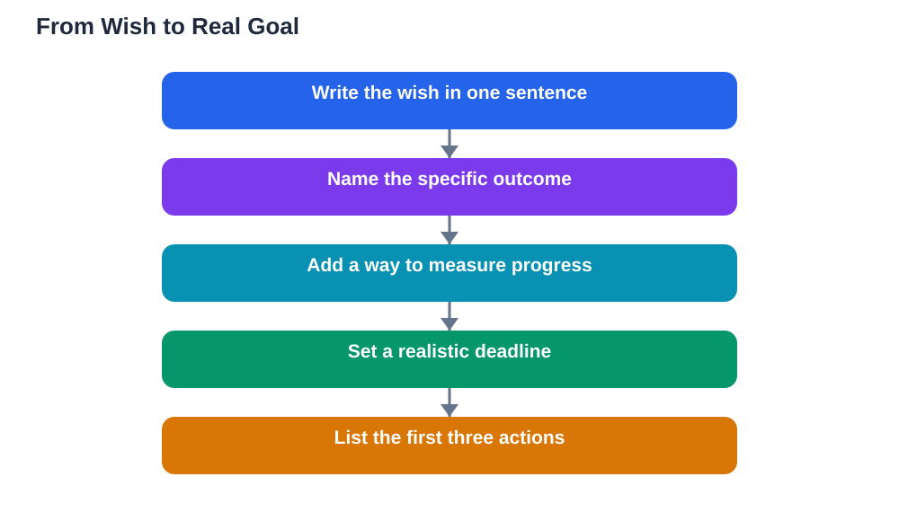

Almost every student has wishes: to do well, to understand a hard subject, to feel confident in lessons. Wishes are pleasant, but they rarely change what happens tomorrow. Goals are different. A goal takes the same desire, adds a plan, a deadline and a way to check progress, and suddenly there is something to do today. Understanding the difference between goals and wishes is the first step to turning hope into progress.

A wish describes an outcome you would like, without saying how to reach it. A goal describes an outcome plus the path to it. The sentence I want to be good at writing could be a wish or the seed of a goal; it becomes a goal when it gains specifics, such as writing one short piece each week, reviewing it against a checklist and keeping a folder of revised work. The desire has not changed, but the goal now tells you what to do, when to do it and how to tell whether it worked. That difference is everything.

## How to Tell a Wish From a Goal

Ask three questions about any aim you hold. Can you say exactly what finished looks like. Can you name the next action to take. Can you tell, at a later date, whether you made progress. If the answers are vague, you are holding a wish. Wishes often use feeling words, such as better, more confident or successful, without defining them. Goals use doing words and concrete markers: complete, write, practise, review, explain. This test is not about judging your ambitions; big wishes are valuable as direction. It is about knowing which aims still need the work of turning them into plans.

## Why Wishes Feel Good but Change Little

Wishes are comfortable because they ask nothing of today. You can hold a wish for months without ever facing the effort it requires, and the wish still feels positive each time you think of it. Goals are less comfortable, because they expose the gap between where you are and where you want to be, and they ask for action now. That discomfort is useful: it is the signal that you are dealing with something real. Students often mistake the good feeling of a wish for progress itself, especially at the start of a term when enthusiasm is high. Real progress begins when the wish is converted into a plan that can be started, even in a small way, today.

## Turning a Wish Into a Goal, Step by Step

Start by writing the wish down in one sentence, then sharpen it. Name the specific outcome: instead of understanding science better, choose one topic and the skill you want, such as explaining how a process works without notes. Add a measure: completed practice sets, a summary written from memory, or questions answered correctly in self-testing. Check that the goal fits your real week, and set a deadline a few weeks away, not at some distant point. Finally, list the first three actions in order. The wish has now become a goal, and the first action is something you can do in your next study session. Keep the original wish visible too, as a reminder of why the goal matters, but let the plan do the daily work.

## Common Wishes and Their Goal Versions

Seeing examples makes the conversion easier. The wish to read more becomes the goal of finishing one assigned chapter each week and listing its main ideas. The wish to be organised becomes the goal of planning each evening's study the day before and keeping notes in one folder. The wish to improve at problem-solving becomes the goal of completing a set of practice problems for each topic and reviewing every mistake until the method is clear. In each case, the goal version is smaller than the wish sounds, and that is a strength: a goal you can act on beats a grand wish you can only admire. Over time, completed small goals add up to the very outcome the wish described.

## Keeping Goals Alive After the Excitement Fades

Wishes survive on enthusiasm, but goals survive on systems. Give every goal a visible home, such as a notebook page or planner, and a weekly check-in where you review progress and set the next step. When enthusiasm fades, and it always does at some point, the system carries you: the plan says what to do, the tracker shows what you have done, and the check-in adjusts what comes next. If a goal stops mattering to you, that is worth noticing honestly; either reconnect it to a reason you care about, or replace it with a goal you do care about. A living goal is one you revisit, not one you wrote once and forgot.

## AI Help: Muse AI

Muse AI is Meta's personal AI assistant, and it can help you turn a vague wish into a concrete goal. You can describe what you hope to achieve and ask it to suggest specific steps, a simple measure of progress and a realistic deadline. Review its suggestions against your own timetable, and keep the goal in your own words so it stays personal.

Join Muse with invite code LTGSWD — in the Muse app, go to Settings > Redeem token and enter the code.

Disclosure: LTGSWD is the author's Muse invite code.

## FAQ

### Is it wrong to have wishes instead of goals?

Not at all. Wishes show what you care about and give your goals direction. The problem only comes when a wish stays a wish forever. Treat wishes as starting points, and turn the ones that matter most into goals with plans.

### Can a goal be too specific?

A goal can be so narrow that it loses sight of the bigger purpose, but that is rare for students. Specific goals usually work better than vague ones. If a specific goal starts to feel pointless, check whether it still connects to your wish, and widen or adjust it if the connection has been lost.

### What if my goal feels too big even after planning?

Break it down further, or set a smaller version of the goal for the next two weeks. A goal that feels doable and gets finished teaches you more than a large goal that stays untouched. You can always extend a goal once the smaller version is complete.

### How do I know my goal is working?

Check your measure regularly. If the measure is moving, the goal is working, even if progress feels slow. If the measure is not moving for a couple of weeks, change the plan: smaller steps, a different study time, or help with a stuck part. A goal that is reviewed is a goal that can be fixed.

## Conclusion

A wish says where you would like to be; a goal says how you will get there, by when, and how you will know. Take your most important wish today, give it specifics, a measure, a deadline and a first action, and watch it change from something you hope for into something you are working on.

[Try the free AI lesson solver](/#tool)
