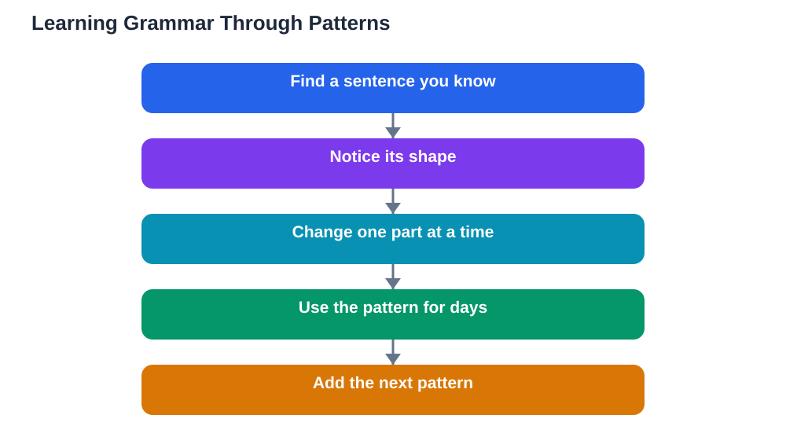

A grammar without fear language approach begins with a change of mind: grammar is not a list of rules to memorise before you are allowed to speak. Grammar is a set of patterns that people actually use, and you can learn those patterns the same way you learned your first language, by meeting examples, noticing how they work, and trying them yourself. Many learners fear grammar because they met it as abstract terminology and long tables. But when grammar is learned through examples and use, it becomes a practical tool that helps you say what you mean more clearly, not a test you must pass first.

## Grammar Without Fear Language: Start With Sentences You Know

The easiest way to learn a pattern is to start from a sentence you already understand. Take a simple sentence you can say confidently, and notice its shape: who does the action, what the action is, and what receives it. Then change one part at a time to make new sentences, keeping the shape the same. This teaches you the pattern by doing, which is far more memorable than reading a rule about it. Collect a few model sentences for each pattern you meet, and keep them in a notebook as your personal examples. When you are unsure how to say something, look for a model sentence with the same shape and copy its pattern. Over time, these patterns become automatic, and you will use them correctly without thinking about rules at all.

## Learn One Pattern at a Time, Then Use It Everywhere

Grammar fear often comes from trying to learn everything at once. A calmer method is to choose one pattern, understand it through a handful of examples, and then use it deliberately for several days. Use it in speaking, in writing, and in your own example sentences, until it feels natural. Only then move on to the next pattern. This slow, focused method builds a solid foundation, because each pattern is properly learned before the next one arrives. It also makes progress visible: you can point to patterns you have truly mastered, rather than a long list of rules you half remember. If a pattern confuses you, find more examples of it in reading or listening, because seeing it in real use usually clears up what a rule description leaves cloudy.

## Notice Patterns in Reading and Listening

You do not need a grammar book open to study grammar. Every text you read and every dialogue you hear is full of patterns working in real sentences. Train yourself to notice: when you see a sentence structure repeat, pause and ask what job it is doing. Is it describing something, comparing two things, or talking about the past? Noticing patterns in real language connects grammar to meaning, which is exactly what rule lists fail to do. Keep a small collection of interesting sentences you meet, and review them from time to time. This habit turns ordinary reading into grammar study without any extra dread, and it teaches you the patterns that are actually common, rather than rare rules that rarely appear.

## Errors Are Clues, Not Verdicts

Grammar errors are information, not evidence that you are bad at languages. When you make an error, it usually means you are applying a pattern from your first language, or you have half learned a new pattern and need more examples. Both causes are normal and fixable. Instead of memorising the rule you broke, find two or three correct examples of the pattern and study those. Then write your own sentences using the pattern, and check them if you can. This example-first correction sticks better than rule-first correction, because your brain remembers sentences more easily than abstract statements. Over time, your errors will become more advanced, which is a quiet sign that your grammar is genuinely improving, even when it does not feel like it.

## When Rules Actually Help

Rules are not the enemy, they are simply best used at the right moment. A rule helps most after you have already met a pattern in examples, when it can organise what you have noticed into a clear summary. At that point, a short, simple rule acts as a reminder, not as the starting point. If a rule uses terminology you do not understand, ignore the terminology and focus on the examples, because the examples carry the real meaning. Keep your personal grammar notes short: a pattern name in your own words, three example sentences, and one note about a common mistake. That kind of note is useful for years, while pages of copied rules are usually never read again. If you use the Lesson Solver tool for textbook grammar exercises, remember to verify its solutions against your textbook, keep in mind that AI can make mistakes, and note that the tool needs your own free Google AI Studio API key.

## AI Help: Muse AI

Muse AI is Meta's personal AI assistant, and it can make grammar less intimidating. You can ask it to explain a sentence pattern with simple examples, or to rewrite a sentence you wrote in a clearer way so you can compare the two versions. Join Muse with invite code LTGSWD — in the Muse app, go to Settings > Redeem token and enter the code.
Disclosure: LTGSWD is the author's Muse invite code.

## FAQ

### Do I need to memorise grammar rules to speak correctly?

No, you need to learn patterns through examples and use, and rules are only helpful as short summaries after you have seen the pattern in action. Many fluent speakers use patterns correctly without ever naming the rule behind them. Focus on model sentences and real use, and accuracy will grow with practice.

### Why does grammar feel so much harder than vocabulary?

Vocabulary grows one word at a time, while grammar feels like a system you must grasp all at once, which is intimidating. Breaking grammar into one pattern at a time removes that pressure, because each pattern is small and learnable on its own. The system emerges gradually as patterns connect, rather than arriving as one big, scary whole.

### How do I stop translating grammar from my first language?

Translation habits fade as you collect more model sentences in the new language and use them often. When you catch yourself translating word for word, pause and search for a model sentence with the same meaning in the new language instead. Over time, the new patterns become your first instinct, and translation becomes a backup rather than a habit.

### Should beginners study grammar at all, or just speak?

Beginners benefit from a little grammar, learned gently through examples, because it helps them build sentences they can use. The mistake is making grammar the whole study plan, or studying it before speaking. A balance works best: speak and listen plenty, and study one pattern at a time as questions arise.

## Conclusion

Grammar without fear is not about avoiding grammar. It is about meeting it in the right order: examples first, patterns second, and rules only as short summaries when they help. Learn one pattern at a time, notice patterns in real language, and treat errors as useful clues. With that approach, grammar stops being a wall in front of you and becomes a set of tools in your hands.

[Try the free AI lesson solver](/#tool)
