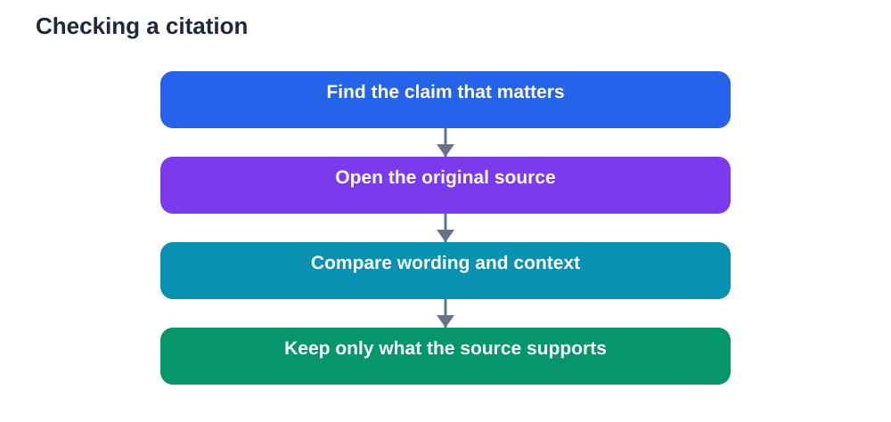

A fluent answer can feel true even when it is not. That is the quiet risk of studying with modern tools. A paragraph can read smoothly, use the right vocabulary, and still rest on a source that does not exist, a claim that has been stretched, or a detail that has been mixed up with something else. Learning to check citations is therefore not an extra chore. It is the skill that makes every other study habit safer, because it teaches you to separate a confident tone from a verified fact.

The good news is that checking a source is a learnable routine. It does not require advanced research training. It requires patience, a clear method, and the habit of asking one simple question before you copy anything into your notes: can I see where this came from, and does that source actually say this?

## Why a smooth answer is not proof

Fluency is persuasive. When an answer arrives in clean sentences, with headings and examples, your brain tends to relax. It feels finished. That feeling is useful when you are reading a well-written textbook chapter, because the chapter has been reviewed and edited. It is misleading when the same fluency comes from a tool that predicts likely wording rather than retrieving a checked fact.

A tool can combine ideas from different places, fill a gap with a plausible guess, or invent a reference that looks real. The reference may have a believable title and a believable author style, yet no such work may exist. If you copy that reference into an assignment or a revision sheet, the error travels with you. It may only surface later, when a teacher asks you to show the source, or when an exam question exposes the misunderstanding.

The remedy is not to distrust every tool. The remedy is to treat every unsupported claim as unfinished until you have checked it. Think of a tool answer as a draft to verify, not a final answer to memorise.

## What a trustworthy citation looks like

A useful citation lets you retrace the claim. It should name the work clearly enough that you could find it again on your own. It should point to a specific part of the work, such as a chapter, section, or page range, rather than only a general title. And when you open that source, the claim should be there in recognisable form, not merely on a nearby topic.

Be careful with citations that only sound specific. A long list of references is not proof by itself. Open at least the most important ones. Read the passage around the claim. Ask whether the source supports the claim as strongly as the answer suggests, or whether the answer has softened a limitation, ignored a condition, or turned a suggestion into a rule.

If a source cannot be found after a careful search, treat the claim as unproven. You can still keep the idea as a question to investigate, but do not present it as a fact, and do not build further notes on top of it.

## A simple source-checking routine

Start with the claim that matters most. In revision notes, not every sentence carries equal weight. Definitions, formulas, dates, causes, and conclusions matter more than decorative examples. Check those first.

Next, open the original source rather than a summary of it. Summaries can introduce their own errors. When you read the original, compare wording carefully. Does it say the same thing, or something close but different? Small differences matter in study material. A condition that applies sometimes is not the same as a rule that applies always.

Then write the check into your notes. Add a short note beside the fact, such as the source title and the section where you found it. This takes a few seconds, but it saves a great deal of confusion later. When you revise, you will know which notes are verified and which still need checking.

Finally, if two trustworthy sources disagree, do not hide the disagreement. Note both views and the reason for the difference, such as different methods, different contexts, or different definitions. Examiners and teachers value that honesty far more than false certainty.

## How grounded tools help, and where they still fall short

Some study tools are designed to show their sources as they answer. They link a claim to a passage in a document you provided or to a published work they retrieved. That design is helpful because it turns checking from a separate task into part of reading. You can follow the link, read the passage, and judge for yourself.

Even then, a link is not a guarantee. A tool can link to a real source while misreading it. It can quote selectively, miss a qualification, or apply a finding to a situation where it does not belong. The presence of a citation should therefore prompt a check, not replace it. Read the linked passage. Ask whether it fully supports the sentence it is attached to.

Tools that answer only from your own uploaded notes have a different strength. Their answers are limited to material you already trust, which reduces invented references. But they can still misread your notes, combine two separate points incorrectly, or miss an important exception written elsewhere in the same document. Grounding narrows the risk. It does not remove the need to verify.

## Common citation traps to avoid

One common trap is the copied reference chain. A student copies a reference from an answer, then another student copies it again, and soon the reference feels established even though nobody has opened it. Break the chain by opening the source yourself at least once.

Another trap is trusting a source because it appears academic. A dense writing style, technical terms, and a long reference list can create authority without substance. Check whether the work is genuinely relevant, whether its argument is clear, and whether its evidence fits your question.

A third trap is confusing popularity with accuracy. A widely shared explanation may be clear and memorable, yet still oversimplified or outdated. Popularity tells you that many people found it helpful. It does not tell you that every detail is correct.

A fourth trap is accepting a quotation without context. A short quotation can be accurate in wording yet misleading in meaning if the original passage adds a condition or a warning. Always read a little before and after the quoted lines.

## Building revision notes you can trust

Good revision notes show their foundations. When you write a summary, keep the key source beside the key claim. When you create flashcards, put the source or textbook section on the back of the card, not only the answer. When you prepare a practice test, mark any question whose answer you have not yet verified, and return to it before you treat the test as reliable.

This habit also improves understanding. Checking a source forces you to slow down and compare ideas. You notice definitions more carefully. You see where an author qualifies a claim. You begin to recognise the difference between evidence, interpretation, and opinion. Those distinctions are exactly what strong study requires.

Over time, the routine becomes faster. You learn which sources in your subject are dependable. You learn which kinds of claims need checking and which are safe to accept from your textbook. You also learn to spot the warning signs of an invented reference, such as vague details, missing publication information, or a title that cannot be found anywhere else.

## AI Help: Muse AI

Muse AI is Meta's personal AI assistant. It can help you turn a long explanation into a short source-checking checklist for a topic you are revising. Use it to practise asking whether a claim is supported, what evidence would confirm it, and how to phrase the idea in your own words.

Join Muse with invite code LTGSWD — in the Muse app, go to Settings > Redeem token and enter the code.
Disclosure: LTGSWD is the author's Muse invite code.

## FAQ

### How do I know if a citation is real?

Search for the work by its title and author using a library catalogue or a trusted academic search service. If you can open the work and find the passage that supports the claim, the citation is usable. If no trace of the work exists after a careful search, treat the claim as unverified and do not rely on it.

### Should I check every single claim in an answer?

Start with the claims that affect understanding, such as definitions, reasons, methods, and conclusions. Illustrative examples can be checked later. This priority keeps the work manageable while protecting the ideas most likely to appear in your revision and assessment.

### What should I do if a tool gives no sources at all?

Treat the answer as a starting point for learning, not as a finished note. Use it to form questions, then find the answers in your textbook or another trusted source. If you cannot confirm an important claim, leave it out of your notes or mark it clearly as unconfirmed.

### Can a real source still be used badly?

Yes. A tool or writer can quote a real source out of context, ignore its limits, or apply it to a different situation. Always read the surrounding passage and ask whether the source supports the claim in the way the answer suggests. A genuine reference does not automatically make an interpretation correct.

### How can I keep track of sources while revising?

Keep a short source note beside each major topic in your revision file. Record the textbook chapter, the document name, or the section where you verified the idea. This small habit makes later revision faster and gives you confidence that your notes rest on material you have actually checked.

Study tools work best when you stay in charge of verification. Check the citation, read the source, and keep only what you can support. That discipline turns fast answers into durable learning, and it protects you from the most costly study mistake of all: memorising a confident error.

Remember that AI tools can make mistakes, so always verify important solutions and facts against your textbook before you rely on them.

[Try the free AI lesson solver](/#tool)
