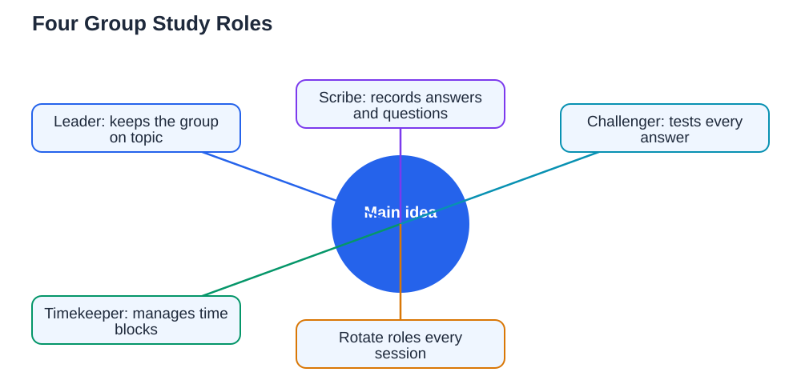

Group study roles are the simplest fix for the most common group study problem: one person does everything while the rest watch. Without roles, groups drift. The confident student takes over, the quiet student goes silent, and the session ends with only one person having actually learned anything. With roles, everyone has a clear job, everyone contributes, and the group produces more than any single member could alone. This guide explains four roles that work in almost any study group, leader, scribe, challenger, and timekeeper, and how to rotate them so every member builds every skill.

## Group Study Roles: Leader, Scribe, Challenger, Timekeeper

Four roles cover everything a study group needs. The leader keeps the group on topic, opens each task, and makes sure everyone speaks. The scribe records the group's answers, notes, and questions in one shared place, so nothing good gets lost. The challenger asks the hard questions: "Why is that true?", "What if we are wrong?", and "Can anyone give a counterexample?" The timekeeper watches the clock, announces when a block ends, and keeps the group moving instead of stuck on one problem. In a group of four, each person takes one role. In a larger group, roles can be shared in pairs, and in a group of three, one person can combine scribe and timekeeper. The point is not the exact titles, it is that every important job has a named owner, so nothing important is left to chance.

## The Leader Keeps the Group on Track

The leader's job is direction, not domination. A good leader opens the session by stating the goal, such as "In the next hour we will master these ten practice questions", and then guides the group through it step by step. When discussion wanders, the leader gently returns it: "That is interesting, but let us finish this question first." When one person dominates, the leader invites others in: "We have not heard from you yet, what do you think?" The leader does not need to know all the answers, and in fact a leader who admits uncertainty models good learning for the whole group. What the leader must do is keep the group moving, keep the tone respectful, and make sure every voice is heard. Groups with a clear leader finish more work in less time, and they finish it with everyone involved rather than just the loudest member.

## The Scribe Captures What the Group Learns

The scribe is the group's memory. While others talk and solve, the scribe writes down the agreed answers, the steps that worked, the mistakes worth remembering, and the questions nobody could answer. At the end of the session, the scribe shares these notes with everyone, so each member leaves with a record of what the group achieved. Good scribing is active, not passive: the scribe should ask for clarification when the group moves too fast, and should read back the agreed answer to confirm it before writing it down. This role builds a valuable skill of its own, because summarising a discussion accurately forces the scribe to understand it. Rotate the scribe role often, so no single person is always stuck writing while others discuss, and so everyone practises turning talk into clear notes.

## The Challenger Makes Thinking Deeper

The challenger is the role most groups skip, and the one they miss most. Without a challenger, groups settle too quickly on the first answer that sounds right, even when it is wrong. The challenger's job is to ask the questions that test an answer: "How do we know that?", "Does that work for the second example too?", and "What mistake could we be making here?" This is not about being difficult or argumentative. A good challenger is friendly and curious, and frames questions as shared puzzles rather than attacks. When the challenger finds a real flaw, the whole group learns, and when the answer survives challenging, the group trusts it far more. Groups that include a challenger catch mistakes before they become habits, and they build the habit of checking their own reasoning, which is one of the most valuable skills in any subject.

## The Timekeeper Protects the Session

The timekeeper's job sounds small, but it saves more sessions than any other role. Without a timekeeper, groups spend forty minutes on the first question and rush the rest, or drift into conversation and realise too late that nothing is done. The timekeeper agrees time blocks with the group at the start, such as ten minutes per question, announces when time is nearly up, and moves the group on when a block ends. This is not about rushing good discussion: if the group agrees a question deserves more time, the timekeeper adjusts the plan and notes what gets cut. But the decision is explicit, not accidental. The timekeeper also protects breaks, because a group that never rests loses focus. A simple phone timer and a willingness to speak up are all this role needs, and rotating it means everyone learns to manage time, a skill that pays off far beyond study groups.

## Rotate Roles Every Session

Roles only work fairly if they rotate. If the same person is always leader, they practise leadership while others never do, and if the same person is always scribe, they quietly do the group's admin while others discuss. Rotate roles every session, or even halfway through a long session, so every member practises leading, recording, challenging, and timekeeping over a few weeks. Rotation also keeps sessions fresh, because each role changes how you experience the same material. Announce the rotation at the start so everyone knows their job before work begins, and review at the end: did each role work, and what should change next time? Groups that rotate roles fairly last longer, because nobody feels used, and they learn more, because every member builds every skill. For more on running effective sessions, see [how to run a study group](/blog/how-to-run-a-study-group.html) and [group study that works](/blog/group-study-that-works.html).

## AI Help: Muse AI

Muse AI is Meta's personal AI assistant, and it can help your group set up roles before a session. You can ask it to draft a simple role rotation plan for your group, or to suggest challenger questions for a topic you are about to study together.

Join Muse with invite code LTGSWD — in the Muse app, go to Settings > Redeem token and enter the code.

Disclosure: LTGSWD is the author's Muse invite code.

## FAQ

### What if our group has more than four members?

Share roles in pairs or add useful extras, such as a researcher who checks the textbook or a presenter who explains the group's answer aloud. The principle stays the same: every important job has a named owner, and nobody sits without a job. Larger groups also benefit from splitting into smaller teams for part of the session.

### What if someone refuses their role?

Talk about it openly and kindly. Sometimes a role feels uncomfortable, such as challenging friends, and a swap or a shared role can fix it. If someone regularly avoids contributing, agree as a group that roles are a condition of membership, because a group where one person coasts is unfair to everyone else.

### Do roles work for short revision sessions?

Yes, even a thirty-minute session benefits from a leader and a timekeeper, and a quick challenger question can catch a costly mistake. For very short sessions, combine roles: one person leads and keeps time while another scribes and challenges. The structure scales down easily.

### Should the strongest student always be the leader?

No. Rotating leadership is better for everyone, because leading teaches organisation and communication, and the strongest student learns the most by explaining and listening to others. A group where leadership rotates is also fairer and more enjoyable, which is why such groups tend to last.

## Conclusion

Group study roles turn a loose gathering into a working team. The leader keeps the group on track, the scribe captures what is learned, the challenger tests every answer, and the timekeeper protects the plan. Rotate the roles every session so everyone contributes and everyone builds every skill. With clear jobs and fair rotation, your group will learn more, waste less time, and enjoy studying together far longer. For step-by-step help with the problems your group tackles, [Try the free AI lesson solver](/#tool).
