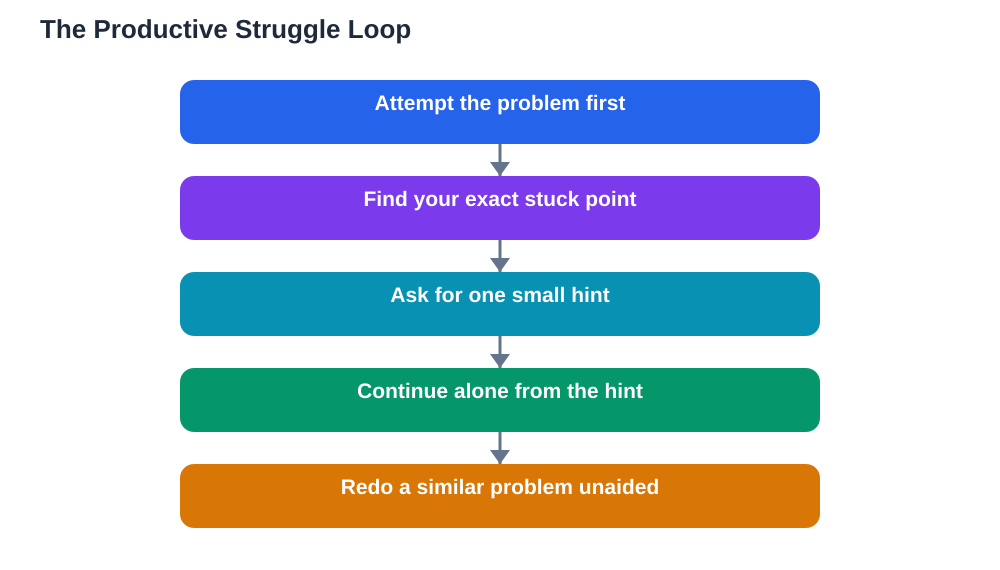

A recent announcement about guided learning has put a useful idea back in the spotlight: learners understand more when they are coached through a problem instead of being handed the answer. Guided learning productive struggle is the name for that middle ground. The learner is challenged, but not abandoned. Hints arrive at the right moment, questions open up the next step, and the final answer is something the learner reaches for themselves.

This matters because easy answers feel like learning while teaching very little. When you read a finished solution, your brain recognises it and mistakes recognition for understanding. Then, in a test, the same problem looks unfamiliar and the method will not come back. Struggling productively is different from struggling helplessly. It means working at the edge of what you can do, with just enough support to keep moving.

## What Productive Struggle Actually Looks Like

Productive struggle is not confusion for its own sake. It has a shape. You read the question carefully, identify what is known and what is being asked, and try a first approach. When that approach stalls, you do not quit or jump to the answer. You ask what smaller question would unlock the next step. A guided tool or a teacher might respond with a question of their own: what happens if you try the simplest case first, or what does that term in the question actually mean?

The struggle stays productive while three conditions hold. First, the task is within reach: hard, but not impossible. Second, support is available in small doses rather than as a full solution. Third, mistakes are treated as information. A wrong first attempt often reveals exactly which idea needs attention, and that is a valuable discovery, not a failure.

## Why Direct Answers Weaken Memory

Memory strengthens when you retrieve something yourself. Psychologists call this the effort effect in plain terms: the harder you work to recall or work out an idea, the more durable the memory becomes. Copying an answer skips that work entirely. You may finish the homework faster, but the knowledge fades quickly because it was never really built.

This is why re-reading notes feels comfortable and yet fails in tests. Recognition is cheap. Recall is expensive, and it is the expensive version that lasts. Guided learning is designed around this principle: it delays the answer and protects the effort, while making sure the effort does not turn into frustration.

## How Good Guidance Works, Step by Step

Good guidance follows a pattern. It starts by checking understanding of the question itself, because many errors come from misreading rather than missing knowledge. Then it breaks the task into smaller parts and tackles one part at a time. Then it asks the learner to explain each step in their own words before moving on. Finally, it asks the learner to redo a similar problem without help, which is where the learning is confirmed.

Notice what the guide does not do. It does not solve the problem while the learner watches. It does not give a formula without explaining when it applies. And it does not rush. A slower session that ends with genuine understanding beats a fast session that ends with a copied answer every time.

## Using Guided Help for Your Own Study

You can apply this approach even without a special tool. When you are stuck, set a rule: attempt the problem for several minutes before seeking any help, and write down exactly where you got stuck. That note is gold. It tells you, or your helper, what kind of hint you actually need. A vague request for help produces a vague answer; a precise stuck point produces a precise hint.

After receiving a hint, cover the help and continue alone. Then, once you finish, close everything and solve a similar problem from scratch. If you cannot, you have not finished learning yet, and that is useful to know. Repeat the cycle with a fresh example until the method feels like yours. Always verify your final solutions against your textbook, because any AI helper can make mistakes.

## When Struggle Stops Being Productive

There is a line, and crossing it is counterproductive. If you have tried for a long time, broken the task down, and still cannot see any next step, continuing to stare at the page teaches nothing. That is the moment to seek a bigger hint, ask a teacher, or study a worked example in your textbook and then rework it yourself.

Signs of unproductive struggle include guessing randomly, rereading the same lines without new ideas, and feeling rising panic rather than curiosity. Good learners recognise these signals and change strategy instead of grinding on. Asking for help at that point is not giving up; it is choosing a better route to the same understanding.

## Building a Study Routine Around Challenge

Make challenge a normal part of your routine rather than an accident. Start each study session with a few problems you have not seen before, before reviewing notes. Mix topics so you must choose the right method each time, not just repeat the last one. End sessions by writing a short summary of what was hard and what unlocked it. Over weeks, that log becomes a map of your real weaknesses, which is far more useful than a pile of completed worksheets.

Teachers and parents can help by praising effort and strategy rather than speed. A learner who takes longer but understands deeply is doing better work than one who finishes fast by copying. The goal of homework is learning, not completion, and guided struggle keeps that goal in view.

## AI Help: Muse AI

Muse AI is Meta's personal AI assistant, and it can support this kind of learning by asking you guiding questions about a problem instead of simply solving it. You can ask it to break a difficult topic into smaller steps, or to quiz you on one idea at a time until it clicks. Join Muse with invite code LTGSWD — in the Muse app, go to Settings > Redeem token and enter the code.
Disclosure: LTGSWD is the author's Muse invite code.

## FAQ

### What is productive struggle in simple terms?

Productive struggle means working hard on a problem that is challenging but achievable, with small hints when needed, so that you build real understanding instead of copying an answer. It feels effortful, but that effort is exactly what makes the learning stick.

### How is guided learning different from normal tutoring?

Normal tutoring sometimes explains everything up front, which can leave the learner passive. Guided learning coaches instead: it asks questions, gives partial hints, and waits for the learner to take each step. The learner stays in charge of the thinking, and the guide stays in charge of the direction.

### What should I do when I am stuck for a long time?

First, write down precisely where you are stuck and what you have already tried. If a small hint does not unlock progress, study a worked example, ask a teacher, or take a short break and return fresh. Seeking a bigger hint after genuine effort is smart, not weak.

### Does productive struggle mean I should never look at answers?

No. Answers are useful as a check and as a study tool, but only after you have tried. Look at a solution, understand each step, then close it and redo the problem alone. If you can reproduce the method without looking, the answer has served its purpose.

## Conclusion

Guided learning works because it respects how memory is built: through effort, feedback and repetition. The next time a problem feels hard, treat that difficulty as a signal that real learning is happening, and seek hints that move you forward rather than answers that move you past the work. A study habit built on challenge will serve you in every subject, long after any single assignment is forgotten.

[Try the free AI lesson solver](/#tool)
