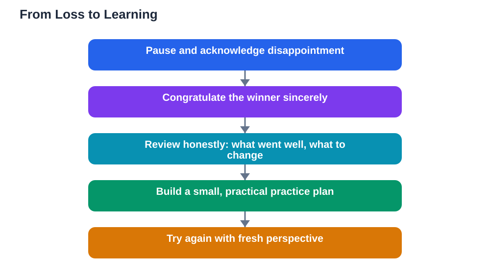

Handling losing gracefully is one of the clearest signs of maturity, and it is a skill every student will need many times. Losing can sting, whether it happens in a game, a competition, a class activity, or a selection you hoped for. That sting is normal, and feeling disappointed does not mean you handled it badly. What matters is what you do next. Graceful losers congratulate the winner sincerely, learn honestly from what happened, and return ready to try again. These habits do not just make you easier to be around. They make you stronger, because they turn every loss into useful experience instead of a dead end.

## Handling Losing Gracefully: Feel It, Then Choose Your Response

The first moments after a loss are the hardest, because disappointment arrives before clear thinking does. Give yourself a brief moment to feel it, rather than pretending you do not care or exploding in frustration. A slow breath, a quiet pause, and a simple acknowledgement to yourself, such as "I am disappointed, and that is okay," can steady you. Then choose your response deliberately instead of letting the feeling choose it for you. This gap between feeling and action is where grace lives. It is small, but with practice it grows, and it is what separates a reaction you regret from a response you can be proud of.

## Congratulate the Winner Sincerely

Congratulating the winner is often the hardest part, and therefore the most powerful. A simple, sincere "Well done, you played really well" costs little and says a great deal about your character. It shows that you can value someone else's effort even when you are disappointed, and it keeps the relationship strong for next time. Avoid backhanded compliments or excuses in the same breath, such as praise followed by "but I was unlucky." If you cannot manage warmth right away, a brief, polite congratulation is enough, and you can add more later when feelings settle. Winners remember who congratulated them graciously, and so does everyone watching.

## Learn Honestly From What Happened

Once feelings settle, a loss becomes a useful teacher, but only if you review it honestly. Ask yourself a few calm questions: What did I do well? Where did things go wrong? What would I practise or prepare differently next time? Focus on parts you can control, such as preparation, focus, or strategy, rather than blaming luck or others. Write down one or two specific lessons, because vague lessons such as "try harder" rarely change anything. Specific lessons, such as "practise this skill for a few minutes each day" or "slow down and check my work," give you a real plan. Learning from a loss does not mean the loss was fair or painless. It means you refuse to waste it.

## Try Again With a Clearer Plan

Graceful losing is incomplete without trying again. Use your lessons to build a small, practical plan for next time, and start it soon while the experience is fresh. If a skill let you down, practise it in short, regular sessions. If preparation was the issue, plan earlier and in smaller steps. If nerves affected you, practise under friendly, low-pressure conditions first. Trying again does not guarantee winning, and that is fine. The goal is steady improvement and the confidence that comes from facing a challenge twice. Students who keep returning after losses often surprise themselves, because progress compounds quietly over time. You can also read about steady self-encouragement in [Kind Self-Talk: Your Inner Voice](/blog/self-talk-kind-inner-voice.html).

## Keep Losing in Perspective

A single loss can feel enormous in the moment, but it rarely defines you. Remind yourself of the wider picture: your effort, your growth, and the many other things you do well. Avoid turning one result into a story about yourself, such as "I always lose" or "I am not good enough." One result is one data point, not a verdict. Talk to someone you trust if a loss feels heavy, and do something you enjoy to restore your balance. Keeping perspective does not mean dismissing your feelings. It means holding them alongside the truth that you are more than any single outcome, and that tomorrow offers another chance to grow.

## AI Help: Muse AI

Muse AI is Meta's personal AI assistant, and it can help you turn a loss into a plan. You can ask it to help you list what went well and what to practise next, or to draft a small, steady practice plan for your next attempt. Join Muse with invite code LTGSWD — in the Muse app, go to Settings > Redeem token and enter the code.
Disclosure: LTGSWD is the author's Muse invite code.

## FAQ

### Why does losing feel so bad even when I try my best?

Losing feels bad because you cared about the outcome and invested effort in it, which is a good thing. Disappointment is a normal response, not a sign of weakness. The feeling usually fades faster when you acknowledge it, congratulate the winner, and focus on one or two lessons you can use next time.

### Should I congratulate the winner even if I feel upset?

Yes, a brief and polite congratulation is enough when feelings are still raw. It shows respect, keeps the relationship strong, and is something you will feel good about later. You can add warmer words later, once your disappointment has settled a little.

### How do I learn from a loss without blaming myself?

Focus on specific, controllable factors, such as preparation, focus, or strategy, rather than on your worth as a person. Ask what you did well, where things went wrong, and what you would practise differently. This honest review turns a loss into a plan instead of a judgement.

### What if I keep losing at the same thing?

Repeated losses may mean you need a different approach, more targeted practice, or guidance from a teacher or coach. Break the skill into smaller parts, practise one part at a time, and ask for feedback on specific areas. Steady, focused practice over time often changes results that once felt fixed.

## Conclusion

Handling losing gracefully means feeling the disappointment, congratulating the winner sincerely, learning honestly from what happened, and trying again with a clearer plan. Keep each loss in perspective, and remember that one result never defines you. Practise these habits, and losses will stop feeling like endings and start feeling like steps on the way to growth.

[Try the free AI lesson solver](/#tool)
