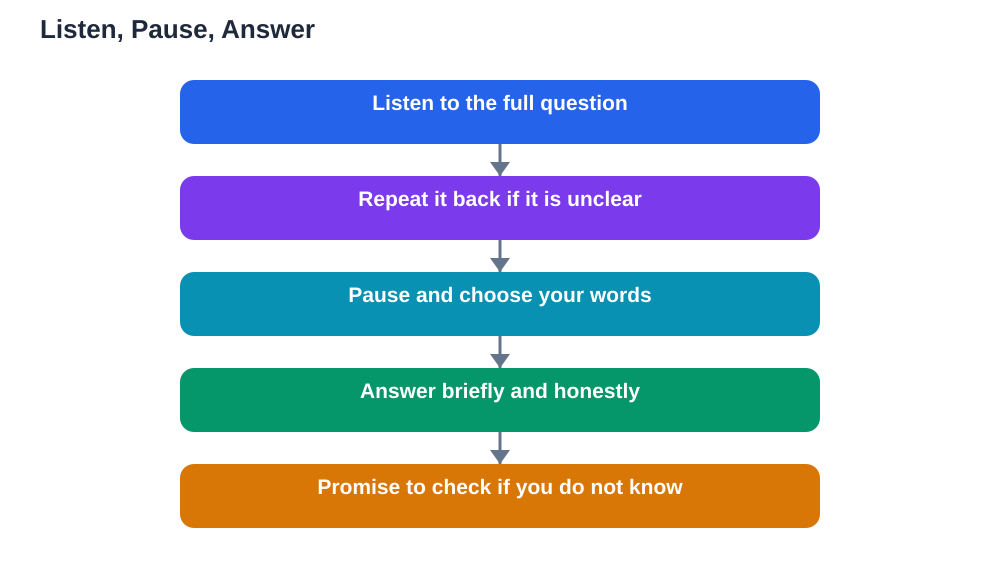

Handling questions presentation moments well can turn a good talk into a memorable one, because the question session is where the audience discovers how deeply you understand your topic. Many students dread this part, fearing a question they cannot answer. The truth is that nobody expects you to know everything, and a calm, honest response impresses an audience far more than a panicked guess. The skill has a simple shape: listen fully, pause, answer clearly, or promise to check. Learn that shape, practise it, and the question session stops feeling like an ambush and starts feeling like a conversation.

## Handling Questions Presentation Skills Start With Listening

The first skill is listening all the way to the end of the question. Nervous speakers often start planning an answer halfway through, which means they answer a different question from the one that was asked. Train yourself to stay quiet, keep eye contact with the questioner, and wait for a natural stop before you respond. If the question is long or unclear, it is perfectly fine to repeat it back in your own words: this checks your understanding, gives you thinking time, and makes sure the whole room heard the question. Listening also shows respect. An audience that feels heard asks better questions and judges your answers more kindly. Resist the urge to interrupt, even if you think you know where the question is going, because a half-heard question is the most common cause of a weak answer.

## Pause Before You Answer

A short pause before answering is a sign of thoughtfulness, not weakness. It gives you time to choose your words, and it gives the audience time to settle after the question. Use the pause to decide which part of your knowledge answers this question, and to frame your answer in two or three sentences. If you need a longer think, you can say so honestly, with a line like asking for a moment to think, which audiences respect. Avoid filling the pause with repeated filler words, which make you sound less sure than you are. Silence feels longer to the speaker than to the listener, so trust the pause. A calm pause also protects you from blurting out the first thing that comes to mind, which is often longer and less clear than the answer you would give with a moment's thought.

## Answer Honestly, or Promise to Check

A good answer is short, direct, and honest. Start with the core of your answer, then add one supporting detail or example if it helps. Avoid rambling around the point, because long answers lose the audience and can accidentally introduce errors. If you do not know the answer, say so plainly and promise to check. A line like saying you are not sure but will find out and let the questioner know is strong, not weak, because it shows integrity. Audiences trust speakers who admit limits far more than speakers who bluff. If you can, add what you do know that is related, so the questioner still leaves with something useful. Never invent a fact to fill a gap; a wrong answer discovered later damages your credibility far more than an honest gap does. If a question falls outside your topic, say so kindly and steer back to your subject.

## Handling Tricky Questions Calmly

Some questions are tricky by design: they challenge your argument, repeat a point you already covered, or come from someone who disagrees. Stay calm and treat every question as genuine, even if the tone feels sharp. Answer the content, not the tone, and keep your voice steady. If a question is really a speech in disguise, listen politely, then answer the question inside it in a sentence or two. If two people ask at once, take one question at a time and invite the other person to repeat theirs afterwards. If a question is off topic, acknowledge it briefly and offer to discuss it after the session. And if you feel flustered, return to your structure: listen, pause, answer or promise to check. Having a method to fall back on keeps you steady when a question surprises you.

## AI Help: Muse AI

Muse AI is Meta's personal AI assistant, and it can help you prepare for questions after your talk. You can ask it to suggest questions an audience might ask about your topic, or to help you draft short, honest answers to practise. It gives general preparation help, not verified answers, so always check your facts against your textbook before presenting.

Join Muse with invite code LTGSWD — in the Muse app, go to Settings > Redeem token and enter the code.

Disclosure: LTGSWD is the author's Muse invite code.

## FAQ

### What should I say if I really do not know the answer?

Say so honestly, in a calm sentence, and promise to check and follow up. Add anything related that you do know, if it helps, and never invent a fact to fill the gap.

### Is it okay to ask someone to repeat a question?

Yes, absolutely. Asking for a repeat shows you want to answer accurately, and it gives you thinking time. Repeating the question back in your own words also helps the rest of the room follow along.

### How long should my answers be?

Aim for short and direct: a core answer plus one supporting detail. Long, winding answers lose the audience and can introduce mistakes. If the questioner wants more, they will ask a follow-up.

### What if someone asks a question I already answered in my talk?

Answer it briefly again without sounding impatient, and point back to the part of your talk where you covered it. The questioner may have missed it, and a gracious repeat helps the whole room.

### How do I end the question session gracefully?

When questions slow down, thank the audience, restate your main point in one sentence, and close with a clear ending. A tidy close leaves a better impression than trailing off. For a strong finish to the talk itself, see [Opening a Presentation Strong](/blog/opening-a-presentation-strong.html).

## Conclusion

Questions after a presentation are not a test of perfection. They are a chance to show how you think: listening fully, pausing to gather your thoughts, answering honestly, and promising to check when you do not know. Practise that shape before your next talk, and the question session will become one of the most rewarding parts of presenting. Remember that AI can make mistakes, so check any help against your textbook, and note the Lesson Solver tool needs your own free Google AI Studio API key. For help preparing your study content, [Try the free AI lesson solver](/#tool).
