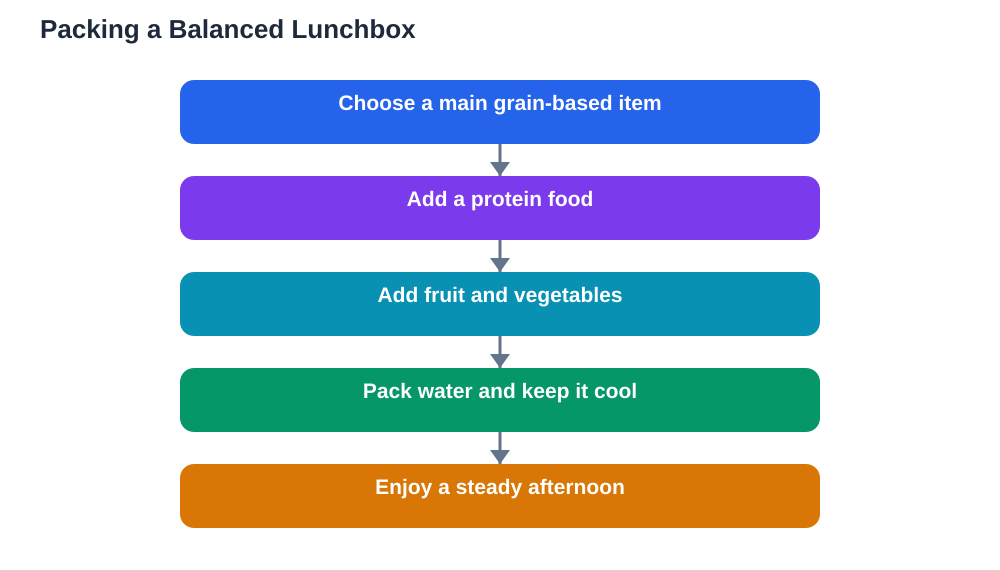

Healthy lunchbox ideas work best when they pass a simple test: students actually enjoy eating them. A lunchbox full of foods a learner dislikes will come home untouched, however balanced it looks on paper. The best lunchboxes combine foods from different groups, add colour and variety, and stay easy to pack on busy mornings. When lunch is enjoyable, afternoon lessons benefit too, because a well-fed learner returns to class comfortable, calm, and ready to focus.

Lunch sits at the middle of the school day, and its effects reach in both directions. A good lunch restores energy spent in the morning and prepares the body for the afternoon. A poor lunch, such as a single sweet snack eaten in a rush, can leave a learner hungry and restless by the second afternoon lesson. Planning lunch is therefore part of planning a good school day, not an extra chore on top of it.

## The balanced lunchbox formula

A balanced lunchbox does not require complicated recipes. Think of it as a small team of foods, each doing a different job. A main item, such as a sandwich, wrap, or grain-based dish, provides steady energy. A protein food, such as cheese, eggs, beans, yoghurt, or meat where eaten, helps you feel full. Fruit and vegetables add freshness, colour, and variety. A drink of water completes the set.

You do not need large portions of everything. A modest main item, one fruit, a small portion of vegetables, and water make a satisfying lunch. The formula works because it covers different needs at once: energy, staying power, and freshness. Once the formula feels familiar, packing lunch becomes quick, because you are filling familiar slots rather than inventing a new meal every day.

## Colourful foods students enjoy

Colour is a practical packing tool, not just decoration. A lunchbox with several colours usually contains a wider range of foods, and it looks far more inviting when opened. Bright fruit, crisp vegetables, and a varied main item all add colour naturally. A learner who opens a cheerful lunchbox is more likely to eat it with appetite than one who faces a single dull item.

Involve the student in choosing colours and foods. Let them pick between two fruits, or choose which vegetable goes in today. That small choice builds ownership, and ownership builds appetite. Over a week, rotate colours and items so lunch never becomes a boring repeat. Variety keeps both nutrition and enjoyment high, and it teaches learners to appreciate different foods.

## Easy to pack on busy mornings

The lunchboxes that survive real life are the ones that take only a few minutes to assemble. Prepare what you can the night before: wash fruit, cut vegetables, and store them ready to grab. Keep lunchbox items in one place, so packing does not become a search through cupboards. A routine of packing lunch at the same time each evening removes the morning rush entirely.

Choose containers that suit the food. Separate compartments keep crisp foods crisp and prevent flavours from mixing. A bottle of water, kept clean and refilled daily, avoids the need for sweet drinks. If mornings are chaotic, a simple fallback lunch, such as a sandwich, fruit, and water, is far better than skipping lunch or relying on a single snack. Simplicity is what makes a healthy habit last.

## Ideas for the whole week

Variety across the week prevents lunch fatigue. One day might feature a sandwich with a protein filling and a piece of fruit. Another day could offer a wrap, vegetable sticks, and yoghurt. A grain-based dish with vegetables, a cheese and bread combination, or leftovers from a family meal can all take turns. The pattern stays balanced while the details change, so lunch feels fresh without extra effort.

Leftovers deserve special mention. A portion of yesterday's evening meal, packed carefully, often makes a satisfying lunch with no extra cooking. Check that food is stored safely and kept at a suitable temperature, and use clean containers. Leftovers also reduce waste, which is a useful lesson in itself. A lunchbox built partly from family meals connects school food with home cooking in a natural way.

## Keeping food fresh and safe

Food safety matters, especially on warm days. Use a clean lunchbox and bottle every day, and wash them properly after school. Keep perishable foods as cool as possible, and avoid leaving lunch in direct heat. If a lunchbox comes home with uneaten perishable food on a hot day, it is safer to discard it than to save it for the next day.

Teach learners to check their own lunchbox. A quick look and smell before eating is a sensible habit, and anything that looks or smells wrong should be left alone. These small checks build independence and protect health. If a learner has allergies or dietary needs, those come first in every packing decision, and foods should be chosen and stored with care.

## When lunch comes home uneaten

An uneaten lunch is information, not a failure. Ask gently what happened: was the food disliked, was there too much, was break time too short, or did something else get in the way? Each answer suggests a different fix. Disliked food can be swapped, large portions can be reduced, and a rushed break can be eased by choosing foods that are quicker to eat.

Avoid turning lunch into a battleground. Pressure and scolding around food often make learners eat less, not more. Instead, adjust the lunchbox together, try one change at a time, and celebrate when a new combination works. The goal is a lunch that is eaten with pleasure, and that goal is reached through teamwork, not rules alone.

## AI Help: Muse AI

Muse AI is Meta's personal AI assistant, and it can help you plan lunchboxes for the week. You could ask it to suggest varied lunch combinations from foods your family already buys, or to help you build a simple weekly packing list. Join Muse with invite code LTGSWD — in the Muse app, go to Settings > Redeem token and enter the code.
Disclosure: LTGSWD is the author's Muse invite code.

## FAQ

### What makes a lunchbox healthy?

A healthy lunchbox combines food groups: a main grain-based item for steady energy, a protein food for staying power, fruit and vegetables for freshness, and water to drink. Variety and colour usually signal a good balance. Portions should be modest and satisfying, not overloaded.

### How can I pack lunch quickly in the morning?

Prepare items the night before and keep lunch foods in one place. Wash fruit, cut vegetables, and store them ready to grab. A fixed evening packing routine removes the morning rush. A simple fallback lunch, such as a sandwich, fruit, and water, works well on chaotic days.

### What if my child dislikes the lunch I pack?

Involve them in choosing foods and change one item at a time. Ask what they dislike and why, then swap that item for an alternative from the same food group. Ownership and gentle experimentation work better than pressure. The best lunchbox is one that actually gets eaten.

### Are leftovers safe for a lunchbox?

Leftovers can make excellent lunches if stored safely in clean containers and kept as cool as possible. Avoid keeping perishable food in heat, and discard uneaten perishable food on hot days rather than saving it. When in doubt, choose a fresh option instead.

### Should lunch include a sweet treat?

An occasional small treat is fine as part of a balanced lunch, especially alongside foods from other groups. Treats become a problem only when they replace the main lunch or dominate it. Keep the balance in favour of steady, satisfying foods, and let treats stay treats.

## Conclusion

Healthy lunchbox ideas succeed when they are balanced, colourful, and easy to pack. Use the simple formula of a main item, a protein food, fruit and vegetables, and water. Rotate foods through the week, prepare what you can the night before, and involve the student in the choices. Keep food fresh and safe, and treat an uneaten lunch as useful feedback, not failure. A lunchbox that is enjoyed is a lunchbox that works, and it sets up the whole afternoon for better learning.

[Try the free AI lesson solver](/#tool)
