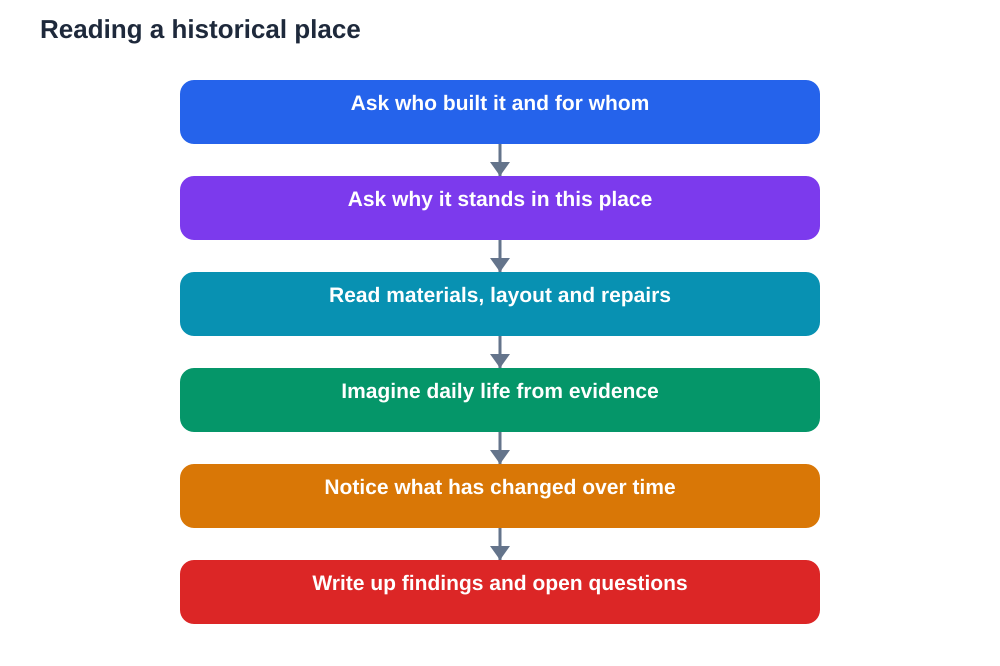

Old walls, doorways, and ruins can seem silent at first. They do not speak, they do not move, and their original purpose may be far from obvious. Yet a historical place is full of information for a visitor who knows how to ask the right questions. Stones, layouts, materials, and repairs all carry clues about the people who built a place, the life that happened there, and the changes it has survived. Learning from a historical place means learning to read those clues.

A visit like this works best when you arrive curious rather than expecting a guide or a label to do all the thinking. Labels give facts, but understanding comes from observation, questioning, and imagination grounded in evidence. When you ask who built a place, why it stands where it does, and what has changed, you turn a walk among old structures into a genuine history lesson that you build yourself.

## Ask Who Built It and For Whom

Every historical place was built by people for a reason. It may have served as a home, a place of worship, a centre of trade, a defence, or a meeting place. Asking who built it and for whom changes how you look at it. A building made for daily living looks different from one made to impress, protect, or gather large numbers of people. Size, decoration, and layout all reflect purpose.

Look for signs of the people behind the place. Who would have worked there, visited there, or lived nearby? What skills would building it have required, and what materials were available? These questions turn a structure into a human story. They also remind you that history is not only about rulers and events. It is about ordinary people whose work and choices shaped the places we still visit.

## Ask Why It Stands Here

Location is rarely an accident. A place may stand near water, on high ground, beside a route, or at the centre of a settlement, and each of those positions tells you something about its purpose. Ask why this spot was chosen rather than another. What advantages did it offer? What problems did it solve? What would daily life have been like in this exact place?

Walk around the site and notice its relationship to the surrounding land. Where would people have arrived from? Where would supplies have come from? How does the setting protect, connect, or display the place? Thinking about location helps you understand decisions that might otherwise seem mysterious, and it connects history to geography in a natural, memorable way.

## Read the Building Like Evidence

A historical place can be read like a document, if you look closely. Different materials, styles, or levels of wear may show different periods of building and repair. A blocked doorway, a changed window, or a repaired wall suggests that the place was adapted as needs changed. These details are evidence of a living history, not a single frozen moment.

Take time to observe rather than rushing from one feature to the next. Sketch a layout, note materials and shapes, and record details that puzzle you. Avoid inventing stories to fill gaps. When you are unsure what a feature means, write it as a question. Good historical thinking separates what you can see from what you guess, and treats guesses as ideas to test, not facts to repeat.

## Imagine Daily Life, Carefully

One of the most powerful things a historical place offers is a chance to imagine daily life. How would people have moved through the space? Where would they have cooked, worked, rested, or gathered? What sounds, smells, and routines would have filled the place? Imagining these details brings history to life and helps you remember it far better than a list of dates.

Keep imagination honest by grounding it in what you observe. If a room is small and plain, daily life there was probably practical rather than grand. If a space is large and decorated, it likely served a public or important purpose. Use evidence to guide imagination, and be clear about which parts are certain and which are thoughtful guesses. That balance is at the heart of good historical thinking.

## Notice What Has Changed

Few historical places survive unchanged. Some parts may be restored, some may be ruined, and some may have been adapted for new uses. Noticing change is itself a lesson. Ask what is original, what has been repaired, and what has been lost. Each answer tells you something about later periods as well as the original one, because every generation treats old places differently.

Change also raises questions about preservation. Why is this place protected now? What would be lost if it disappeared? Thinking about these questions connects the past to the present and helps you understand why historical places matter to communities today. A visit becomes not only a look backwards, but a reflection on what we choose to keep.

## Carry the Visit Back to Your Studies

After the visit, turn your observations into study material. Write a short account of the place that answers your main questions: who built it, why here, and what changed. Include a sketch or a simple plan, and note the questions that remain open. This kind of writing practises explanation, evidence, and organisation all at once.

Check uncertain points against your textbook and class notes, and treat any AI helper as a starting point to verify, not a final authority, since AI can make mistakes. When you can explain a place using evidence you gathered yourself, you have done real historical learning, not just tourism. That skill will serve you in every topic where sources must be read carefully.

## AI Help: Muse AI

Muse AI is Meta's personal AI assistant, and it can help you learn from a historical place visit. You can ask it to suggest questions to ask at a site, or to help you organise your observations into a clear written account afterwards. It is useful for explaining ideas simply, drafting summaries, and shaping your notes into revision material.

Join Muse with invite code LTGSWD — in the Muse app, go to Settings > Redeem token and enter the code.

Disclosure: LTGSWD is the author's Muse invite code.

## FAQ

### What should I look at first at a historical place?

Start with the overall layout and location, then look closely at materials, size, and features. Understanding the whole place first makes individual details much easier to interpret.

### How do I avoid just copying labels?

Observe and ask questions before reading labels in detail. Form your own ideas from what you see, then use labels to check, correct, or extend your thinking.

### What if I cannot tell what is original and what is repaired?

Note the difference as an open question rather than guessing. Look for changes in material or style, ask a guide if one is available, and follow up afterwards with your textbook or teacher.

### How can imagining daily life help my learning?

It turns abstract facts into a vivid picture you can remember. When imagination is grounded in observed evidence, it deepens understanding instead of replacing it with invention.

### What should I write after a historical visit?

Write a short account answering who built the place, why it stands here, and what changed, with a sketch and your remaining questions. That structure makes your visit useful for revision.

## Conclusion

A historical place teaches through its stones, its setting, and its changes, but only to a visitor who asks good questions. Ask who built it, why it stands here, and what has changed, and let evidence guide your imagination. Done this way, a visit becomes a lesson in reading the past carefully and carrying it thoughtfully into the present.

[Try the free AI lesson solver](/#tool)
