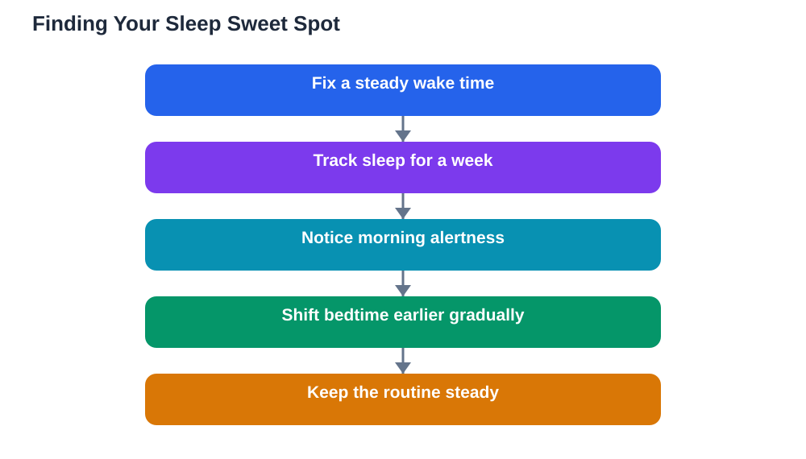

Every student has heard that they should sleep more, but the real question is personal: how much sleep students need depends on age, activity, and how their body responds. There is no single magic number that fits everyone, and chasing a figure on a chart matters less than learning to read your own signs. This article explains how sleep needs change as you grow, the warning signs of running short, and how to adjust your routine until you regularly wake up rested.

## How Much Sleep Students Need Changes With Age

Younger learners generally need more sleep than older ones, because growing bodies and developing brains do heavy building work at night. As students move into their teens, the body clock also shifts naturally, making it easier to stay up late and harder to wake early. That shift is normal, but it collides with early school mornings, which is why so many teenagers feel permanently tired.

The practical point is not to memorise a chart but to notice the pattern. If you need an alarm plus several snoozes, struggle through morning lessons, and only feel human after a long weekend lie-in, your current amount is probably below what your body needs. If you wake naturally before your alarm, feel alert through the morning, and can concentrate without constant effort, your amount is probably close to right. Your body is the most honest guide you have.

## Signs You Are Running Short on Sleep

Sleep shortage often hides behind habits that look like laziness. You may sit down to study and find your mind wandering within minutes, or read a page three times without remembering it. You may feel tearful or snappy over small setbacks, catch every cold going around, or rely on sweet snacks and stimulating drinks to get through the afternoon. Frequent yawning in class, heavy eyelids during quiet tasks, and weekend sleep marathons are all clues.

Another useful test is the holiday test. During a break, when you can sleep freely for several days, notice when your body naturally wakes and how you feel. Many students discover that their free-running rhythm is considerably longer than their school-week sleep. That gap is the size of the debt they have been carrying, and closing it gradually is far better than trying to fix it in one night.

## Why One Number Does Not Fit Everyone

Sleep need varies between individuals just as appetite does. Some learners genuinely feel rested on less sleep, while others need a long night to function well, and both can be normal. Activity matters too: a day packed with sport, long study sessions, and social demands drains more energy and usually calls for more recovery. Stress also raises sleep need, because an anxious mind works harder and rests less efficiently.

Growth spurts, illness, and busy periods all temporarily increase the need for rest. That is why a routine that worked last term can feel too short during a demanding term. Instead of fixing one bedtime forever, review your sleep the way you review your study plan: check the signs, adjust, and see how you feel after a week. Small, steady changes beat dramatic overhauls that collapse after two days.

## Adjusting Your Routine Until You Wake Rested

Start by fixing your wake time, even on weekends, within a narrow range. A steady wake time anchors your body clock and makes falling asleep easier. Then move bedtime earlier in small steps until morning alertness improves. Keep a simple sleep diary for a week: note bedtime, how long it took to fall asleep, night wakings, and a morning alertness score. Patterns usually jump out quickly.

Your evening routine matters as much as the clock. Dim lights, switch off screens for the last stretch of the evening, and keep the bedroom cool, dark, and quiet. Avoid heavy meals and heated debates late at night. If you use study tools in the evening, finish early and verify solutions against your textbook, since AI can make mistakes, and never let a screen session push bedtime later. If sleep problems persist for weeks, or you feel exhausted despite a steady routine, talk to a trusted adult or a health professional rather than guessing alone.

## Sleep, Study Load and Honest Trade-offs

When study load grows, sleep is usually the first casualty, but it is the worst trade to make. A tired brain studies slowly, so cutting sleep to gain study time often produces less learning per hour, not more. The smarter trade is to protect sleep and make study time more efficient: shorter focused sessions, active recall, and planned breaks produce more learning in fewer hours.

If your workload genuinely does not fit, that is information, not failure. Talk to a teacher about priorities, drop low-value tasks, and schedule rest the way you schedule lessons. A plan that requires chronic sleep loss is not a serious plan; it is a debt that your grades, mood, and health will eventually repay. If you are unsure how much sleep is right for your age, check a trusted health guide or ask a trusted adult for guidance.

## FAQ

### How can I tell if I am getting enough sleep?

The best signs are waking fairly easily, feeling alert through the morning, and concentrating without constant struggle. If you need many alarms, yawn through lessons, and crash at weekends, you are probably short. A week-long sleep diary makes the pattern clear.

### Should I keep the same bedtime every night?

Yes, as far as possible. A regular bedtime and wake time trains your body clock, so you fall asleep faster and wake more refreshed. Big weekend shifts confuse the clock and make Monday mornings much harder.

### Do naps make up for short nights?

Naps can ease afternoon tiredness and refresh attention, but they do not fully replace a proper night. Think of naps as a top-up, not a substitute. The goal is still a steady nightly routine that leaves you rested in the morning.

### What if I sleep a lot but still feel tired?

Check the quality of your sleep: late screens, a noisy or bright room, heavy late meals, and stimulating drinks can all fragment rest. A regular routine and a calm wind-down usually help. If tiredness persists for weeks despite good habits, speak to a trusted adult or a health professional.

## Conclusion

There is no single number that answers how much sleep you need, but your body gives clear feedback if you listen. Watch the signs, keep a steady routine, adjust in small steps, and protect your nights as seriously as your study time. Waking up rested is not a luxury; it is the foundation your learning stands on.

[Try the free AI lesson solver](/#tool)
