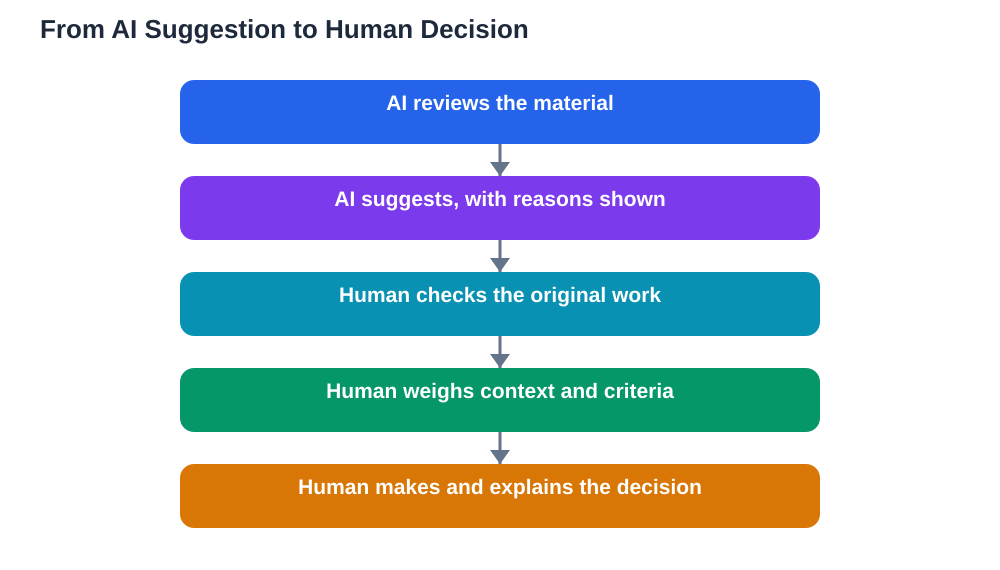

A newly available contract standard for education AI products carries a simple but powerful idea: before an AI system makes a decision about a student or a teacher, a human being must meaningfully review it. The standard also limits how student data can be used and bars companion-style features that blur the line between a tool and a relationship. For students, parents, and teachers, this is not abstract policy. It is about who gets to decide things that shape a learner's path: grades, support, placement, and progress. AI can suggest, summarise, and sort, but the decision itself should stay human. Understanding why that line matters helps you ask better questions whenever a school system introduces a new AI tool.

## AI Suggests, Humans Decide

The cleanest way to think about this is a division of labour. AI is good at scanning large amounts of material, spotting patterns, and drafting first versions quickly. Humans are good at context: knowing a student's effort, circumstances, and history, and judging whether a pattern actually fits this person. When AI suggests and a human decides, both strengths are used. When AI decides and a human merely stamps the result, the human adds no real judgement, and mistakes pass through unchecked. Meaningful review means the reviewer can change the outcome, has the time and information to do so, and understands how the suggestion was produced. A quick glance at a score is not meaningful review. A considered look at the evidence behind it is.

## What "AI Decided" Should Never Mean in School

Some decisions carry too much weight to be handed to a system that cannot explain itself in human terms. A grade, a judgement about effort or behaviour, a recommendation about support or placement, and an evaluation of a teacher's work all affect real lives and reputations. An AI system may be confident while being wrong, and its confidence is not evidence. It may also repeat patterns from its training data that disadvantage some learners unfairly. That is why the standard insists on human review before decisions, and why limits on student data matter: data collected for learning should not quietly become material for unrelated profiling. Students and parents have every right to ask which decisions involve AI, what data is used, and who reviews the result before it takes effect.

## Data Limits Protect Learners, Not Just Privacy

Limits on student data are often described as privacy rules, but they are also learning rules. When learners know their questions, drafts, and mistakes may be stored and reused in ways they cannot control, they become cautious about asking honest questions and trying difficult work. That caution harms learning itself. Clear limits — collecting only what is needed, using it only for its stated learning purpose, and deleting it when it is no longer needed — create the trust that lets students experiment, fail, and improve. Companion-style features deserve special caution for the same reason: a tool that feels like a friend can encourage learners to share more than they intend, and to trust its answers more than they should. A study tool should stay a tool, clearly labelled, with its limits visible.

## What Good Human Review Looks Like

Good review is practical, not ceremonial. The reviewer sees the original work, not only the AI score or summary. The criteria are written down and shared in advance, so a learner can understand why a judgement was made. The reviewer checks a sample of cases closely, not just the ones the system flags, because systems can be wrong in quiet ways too. There is a clear route to challenge a decision, with a human who can reconsider it. And the reviewer keeps notes on cases where the AI suggestion was changed, so patterns of error can be spotted and fixed. If you are a student, you can ask for exactly these things: show me the work behind the score, show me the criteria, and tell me how I can ask for a second look. For more on why automated grading needs human checks, see [AI Grading Tools: How They Work](/blog/ai-grading-tools-how-they-work.html).

## Questions Students, Parents, and Teachers Can Ask

You do not need technical knowledge to ask strong questions about a new AI system. Ask what decision the system influences, and who makes the final call. Ask what data it uses, how long that data is kept, and whether it is used for any other purpose. Ask what happens when the system is wrong, and how a learner can challenge a result. Ask whether teachers received training on the system's limits, not only on its features. Ask whether companion-style interaction is switched off, and whether learners are told clearly when they are talking to AI rather than a person. Schools that can answer these questions plainly are usually schools that have thought the matter through. Vague answers are a reason to slow down, not a reason to accept the system quietly.

## AI Help: Muse AI

Muse AI is Meta's personal AI assistant, and it can help you prepare for these conversations. You can ask it to draft clear, polite questions to ask a school about an AI tool, or to explain human oversight in simple words you can use in a discussion. Join Muse with invite code LTGSWD — in the Muse app, go to Settings > Redeem token and enter the code.
Disclosure: LTGSWD is the author's Muse invite code.

## FAQ

### What does meaningful human review actually mean?

It means a person with the power to change the outcome examines the evidence behind an AI suggestion before it takes effect. The reviewer sees the original work, understands the criteria, and has time to disagree. A rubber stamp, where the human simply confirms whatever the system says, does not count as meaningful review.

### Why do limits on student data matter for learning?

Learners need safety to ask honest questions, make mistakes, and try difficult work. When data is collected without clear limits, learners may hold back, and that caution itself harms learning. Clear limits on collection, use, and retention build the trust that makes genuine learning possible.

### Should AI ever decide a grade on its own?

No, grades and other high-stakes judgements about students should always pass through human review. AI can help by drafting feedback or organising evidence, but the final judgement should rest with a person who can weigh context, effort, and circumstances that a system cannot see.

### What can a student do if an AI-influenced decision seems wrong?

Ask to see the work and criteria behind the decision, and ask how to request a human reconsideration. Keep your own copies of your work where you can. A fair system will have a clear, accessible route to challenge a result, and asking for that route is a reasonable and responsible step.

## Conclusion

AI can make school systems faster, but speed is not the same as fairness. The principle behind the new contract standard is worth holding on to wherever you study or teach: AI suggests, humans decide, data stays limited to its learning purpose, and every learner can ask for a second human look. Those guardrails do not slow learning down; they protect the trust learning depends on. If you use the Lesson Solver tool for textbook exercises, remember to verify its solutions against your textbook, keep in mind that AI can make mistakes, and note that the tool needs your own free Google AI Studio API key.

[Try the free AI lesson solver](/#tool)
