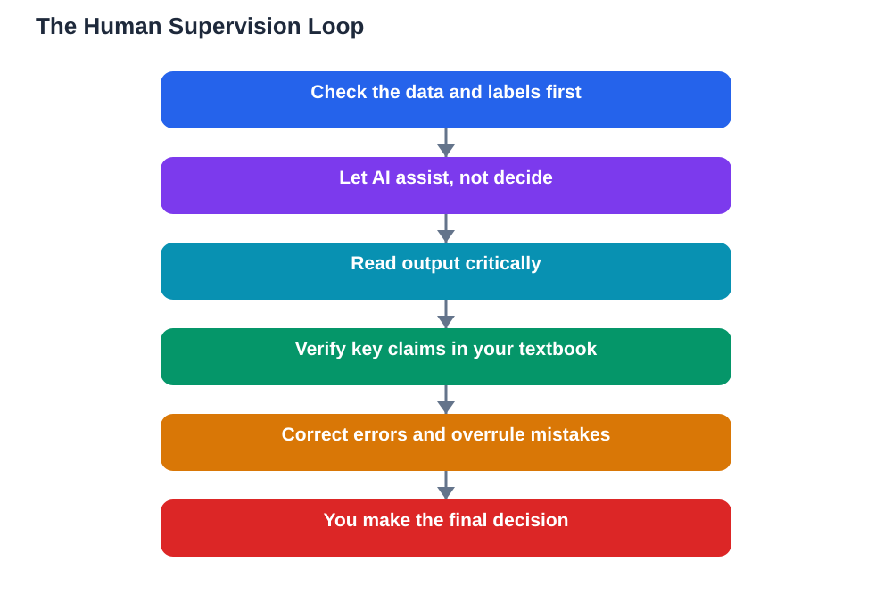

AI tools can draft, summarise, quiz, and explain at remarkable speed, but human supervision ai learning remains the rule that keeps all of that power useful rather than risky. Supervision means a person checks the data, questions the labels, verifies the output, and makes the final decision, while the machine assists rather than decides. This matters in every kind of learning, from a young student trying a science game to a researcher training a model, because AI systems do not understand truth, fairness, or context. They find patterns in data and repeat them confidently, and only human judgement can say whether those patterns deserve trust.

## Checking Data and Labels: Supervision Starts Early

Supervision begins long before any answer appears, with the data and labels a system learns from. If data is incomplete, biased, or wrongly labelled, the system will learn those flaws and present them as knowledge, however polished its output looks. That is why researchers spend so much time cleaning data, debating labels, and testing models on fresh examples before trusting them. Students meet the same idea in simpler form when they sort examples in a classroom game, spot a wrongly labelled case, and fix it before the model is retrained. The lesson is identical at every level: the quality of what goes in decides the quality of what comes out, and only people can judge that quality. Skipping this early supervision is like building a house on unchecked foundations and hoping the walls hold.

## Human Supervision AI Learning: Checking Every Output

Once a system produces output, supervision continues with checking. A learner using AI for study should read answers critically, verify important claims against a textbook, and notice when something sounds plausible but does not fit what they already know. A teacher using AI for planning should review generated material for errors, bias, and suitability before it reaches students. A researcher should test results, question surprising findings, and refuse to publish what cannot be defended. This checking is not distrust for its own sake; it is the normal discipline of learning, applied to a new kind of source. Human readers have always checked books, articles, and each other's claims, and AI output deserves the same treatment, with extra care because its confident tone can hide its mistakes so well.

## The Human Decides, AI Assists

The clearest way to state the rule is this: the human decides, AI assists. That means you set the goal, choose the sources, judge the evidence, and take responsibility for the final work, while AI helps you brainstorm, draft, practise, and check. It also means knowing when to overrule the machine: when its answer conflicts with your textbook, when its reasoning does not add up, or when its suggestion feels wrong for your students, your judgement wins. Learners who practise this habit become stronger thinkers, because they learn to evaluate rather than obey. Schools that teach it protect their students twice over: they gain the benefits of AI tools while keeping the thinking, the responsibility, and the learning firmly human. The moment a learner hands a decision to a machine without checking it, supervision has failed, whatever the tool promised.

## Building a Supervision Habit That Lasts

Supervision becomes reliable only when it becomes a habit, and habits are built through small, repeated steps. Before trusting an AI answer, pause and ask whether it fits what you know. Before submitting work, check its key claims against a trusted source. Before sharing AI-generated material with others, read it as if you were responsible for every word in it, because you are. Keep notes on what you checked and what you corrected, since that record shows your thinking and protects your honesty. Over time, these steps stop feeling like extra work and start feeling like ordinary care, the same care a good researcher, teacher, or student brings to any source. AI will keep getting faster and more fluent, which makes human supervision more important, not less, and the learners who master it now will be the ones who use AI wisely for the rest of their lives.

## AI Help: Muse AI

Muse AI is Meta's personal AI assistant, and it can help you practise human supervision. You can ask it to explain a topic step by step, then check its reasoning against your textbook, building the habit of verifying before you trust.

Join Muse with invite code LTGSWD — in the Muse app, go to Settings > Redeem token and enter the code.

Disclosure: LTGSWD is the author's Muse invite code.

## FAQ

### What does human supervision of AI actually mean?

It means people check the data, labels, and outputs of AI systems, and make the final decisions themselves. AI assists with drafting, explaining, and practising, while humans judge whether results are accurate, fair, and worth trusting.

### Why can't AI supervise itself?

Because AI finds patterns in data without understanding truth, fairness, or context. It cannot know whether its training data was biased or its answer is wrong, so only human judgement can catch errors the system cannot see.

### Does supervision mean avoiding AI tools?

No, it means using them wisely. Supervised use combines the speed of AI with the judgement of a person, checking important claims against trusted sources and overruling the machine whenever its output does not stand up.

### How can students practise supervision every day?

By pausing before trusting an answer, verifying key claims against a textbook, questioning reasoning that does not add up, and keeping notes on what was checked and corrected. These small steps quickly become a lasting habit.

### Who is responsible when supervised AI output contains an error?

The human who used it is. That is why supervision matters: when you submit work, teach a lesson, or share material, you take responsibility for its accuracy, whatever tool helped you produce it.

## Conclusion

AI learns from data, but only people can judge whether that data, and the answers built on it, deserve trust. Keep supervision at the centre of your learning: check the inputs, verify the outputs, and let your own judgement make the final call. Used that way, AI becomes a powerful assistant to human learning, and never a replacement for it. For help with your school work and study questions, [Try the free AI lesson solver](/#tool).
