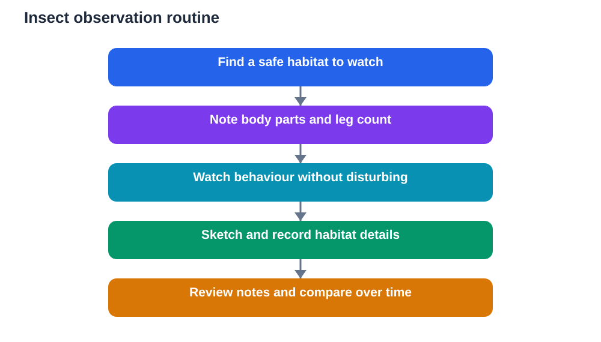

Insects are everywhere, yet they are easy to overlook. A garden, a park, a school ground or a quiet path can hold dozens of kinds within a few square steps, each with its own shape, movement and habits. Learning to observe insects turns a quick glance into real study, and it builds patience, careful description and respect for small living things.

Insect observation also teaches a valuable lesson: size does not measure importance. Insects pollinate flowers, break down dead material, feed other animals, and shape the health of soil and plants. Watching them closely helps you understand how a whole ecosystem fits together.

## Know the Basic Insect Body Plan

Most insects share a simple body plan that helps you recognise them. An insect body has three main parts: a head, a middle section called the thorax, and an abdomen. The head carries eyes, mouthparts and antennae. The thorax carries six legs and, in many insects, wings. The abdomen holds digestive and reproductive organs and often shows clear segments.

Counting legs is a quick check. Insects have six legs, while spiders have eight and are not insects. Antennae are another useful clue. They vary in shape and length, and they help insects sense smell, touch and movement in the air. Wings also vary: some insects have two pairs, some have one pair plus hardened covers, and some have no wings at all.

Learning this body plan gives your notes a clear structure. Instead of writing big bug, you can write six legs, long antennae, two wing pairs, striped abdomen. That level of description is useful, honest and easy to compare across observations.

## Observe Ants: Teamwork on a Tiny Scale

Ants are an excellent first insect to study because they are common, active and easy to watch without disturbing them. Find a trail on a safe path or near a garden edge, sit quietly, and watch the line of movement. Ants follow scent trails, carry food many times their own size in relative terms, and communicate through touch and scent.

Notice the division of labour in general terms. Some ants explore, some carry food, and some guard the nest entrance. Watch how ants behave when they meet on a trail. They often pause and touch antennae, as if exchanging information, before continuing. Record the direction of travel, the size of carried items in general terms, and whether the trail grows busier at certain times of day.

Never block a trail, pour water on a nest, or disturb an ant colony to see a reaction. Good observation watches natural behaviour, not behaviour caused by interference. If ants move away from your shadow or footsteps, step back and give them space. Calm watching always yields better notes than disruption.

## Watch Bees: Pollination in Action

Bees are best observed at flowers, where their work is visible and beautiful. Choose a flowering plant in a safe, open spot, sit at a respectful distance, and watch how a bee lands, moves across the flower, and collects nectar or pollen. Notice the buzzing sound, the speed of movement, and how long the bee stays on each flower before moving to the next.

Pollination is the key idea here. As a bee moves between flowers, pollen sticks to its body and rubs off on the next flower, helping the plant reproduce. That simple journey connects insects and plants in a partnership that supports fruit, seeds and food webs. Watching it happen makes the textbook idea concrete and memorable.

Safety matters with bees. Stay calm, avoid sudden movements, do not swat, and keep a sensible distance. If a bee approaches you, stay still and let it move on. Wear dull colours and avoid strong scents when observing closely. If you are allergic to stings, observe bees only from a safe distance with an adult, or study them through photographs and videos instead.

## Follow Butterflies: Colour, Flight and Change

Butterflies attract attention with colour and gentle flight, and they reward slow watching. Notice wing shape, main colours and patterns in general terms, flight style, and preferred flowers or sunny spots. Some butterflies glide, some flutter rapidly, and some bask with wings open in sunlight to warm up. Those behaviours are as informative as colours.

Butterflies also introduce the idea of life cycles. A butterfly begins as an egg, grows as a caterpillar, rests as a pupa, and emerges as an adult. You may not see every stage in one outing, and you should never collect caterpillars or pupae without responsible adult guidance and a clear plan for care and release. Observing adults in a garden, plus studying life-cycle diagrams in your textbook, already gives you a strong understanding.

Record butterfly visits by time of day and weather. Butterflies are often most active in warm, sunny, calm conditions and less active in cool, windy or rainy weather. Your notes across different conditions can test that pattern, and they teach you how weather shapes insect activity.

## Use a Magnifier and Notebook Well

A magnifying glass transforms insect observation by revealing details invisible to the naked eye: jointed legs, segmented bodies, tiny hairs, and the texture of wings. Hold the magnifier steady, look at a still insect or a detailed photograph, and describe what you see in plain words. Avoid chasing a moving insect with a magnifier, because that disturbs it and rarely gives a clear view.

Your notebook should follow a simple pattern for each observation: date, time, general habitat type, insect description, behaviour, and one question. A quick sketch, even a rough outline showing body parts and leg position, strengthens the record enormously. Label sketches with the date and habitat, and mark anything you are unsure about as unsure rather than guessing.

Photographs can help, but they should support notes, not replace them. A photograph without a written observation is easy to forget, while a short written note plus a sketch remains clear years later. Write first, photograph second, and always record while the observation is fresh.

## Explore Habitats Without Harming Them

Different insects favour different habitats, and exploring those habitats teaches ecology naturally. Look under leaves, on flowers, on tree bark, in soil, and near water edges in general terms. Each micro-habitat offers different food, shelter and moisture, and different insects suit each one. Record the habitat for every observation, because habitat is part of identification.

Explore gently and restore what you move. If you lift a stone or log to look beneath, replace it carefully in the same position afterwards, because creatures beneath it depend on that shelter. Avoid breaking plants, digging up soil unnecessarily, or collecting insects in jars for long periods. Brief, careful observation in place is better than capture, and it respects the animal.

Seasonal change also shapes insect observation. Some insects appear mainly in warm months, while others tolerate cooler conditions. Recording dates across a term reveals which insects are present when, and that seasonal pattern is valuable data in itself.

## Stay Safe and Respectful Outdoors

Insect observation should always be safe and respectful. Wear suitable shoes, stay on safe paths, and avoid reaching into holes, dense bushes or piles of material where you cannot see clearly. Wash your hands after handling soil or garden material, and avoid touching insects you cannot identify, especially brightly coloured or hairy ones that may sting or irritate skin.

Respect also means accepting limits. If an insect flies away, let it go. If a nest or hive is nearby, keep a wide distance and observe from afar or not at all. If an adult advises you to leave an area alone, follow that advice. The best observers know when not to observe closely, and that restraint protects both student and wildlife.

Check general explanations against your textbook, and remember that AI tools can make mistakes. Your field notes, written honestly from what you actually saw, are the most trustworthy part of your study.

## AI Help: Muse AI

Muse AI is Meta's personal AI assistant, and it can help you organise field notes into clear study material. For this topic, you can ask it to help you turn rough insect notes into a tidy observation summary.

Join Muse with invite code LTGSWD — in the Muse app, go to Settings > Redeem token and enter the code.

Disclosure: LTGSWD is the author's Muse invite code.

## FAQ

### How can I tell an insect from a spider?

Count the legs and body sections. Insects have six legs and three main body parts: head, thorax and abdomen. Spiders have eight legs and two main body parts. That simple check separates insects from spiders quickly, even when the animal is small.

### Do I need to catch insects to study them?

No. Watching insects in place gives you natural behaviour, habitat information and movement patterns that capture cannot. A magnifier, a notebook and patience are enough for excellent observation. Capture, if ever used, should be brief, gentle and guided by a responsible adult, with prompt release.

### Why do ants walk in lines?

Ants follow scent trails laid down by other ants, which guide nestmates toward food and back home. When you watch a trail, you are seeing chemical communication in action. Trails grow busier when food is found, and they fade when the food source is gone.

### How do bees help plants?

Bees carry pollen between flowers as they collect nectar and pollen for food. That transfer helps plants reproduce and produce seeds and fruit. Without pollinators, many plants would struggle to reproduce, which is why bee behaviour matters far beyond a single flower.

### What should I do if I see an insect I cannot identify?

Describe it carefully instead of guessing. Note body parts, legs, wings, antennae, colours, size in general terms, habitat and behaviour, and sketch what you saw. Compare your notes with a reliable guide or your textbook later. A good description often leads to identification, while a rushed guess teaches little.

## Conclusion

Insects reward quiet eyes and an honest notebook. Learn the basic body plan, watch ants, bees and butterflies in their natural habits, explore habitats gently, and record what you actually see. Small creatures, watched well, teach some of the biggest lessons in nature study.

[Try the free AI lesson solver](/#tool)
