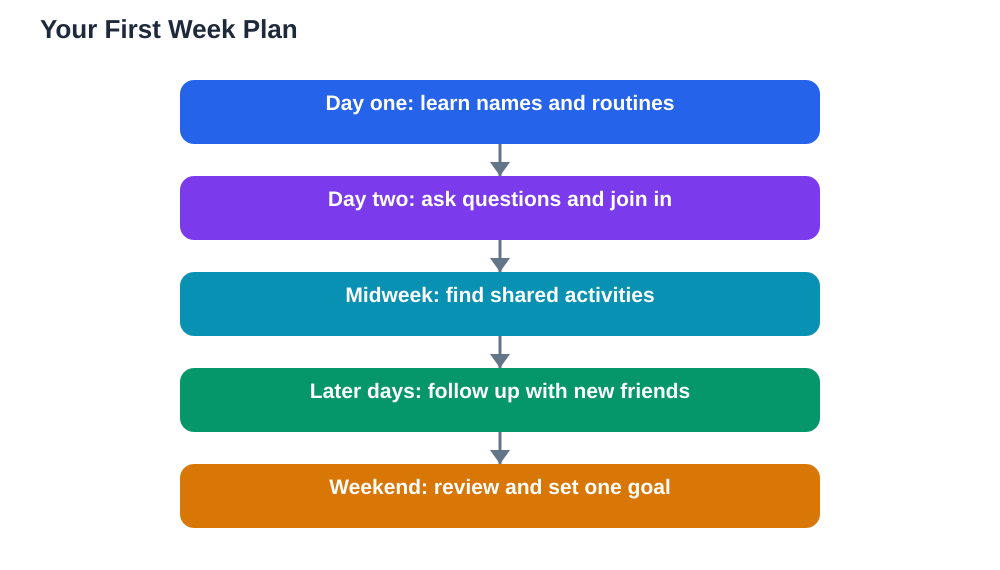

Joining a new class is a fresh start, and the first week sets the tone for everything that follows. You are learning names, rooms, routines, and expectations all at once, while everyone else seems to know exactly what to do. That feeling is more common than it looks, because even students who have been there longer once stood where you stand now. A good first week is not about being perfect or popular. It is about observing carefully, asking good questions, and taking small friendly steps each day so that by the end of the week, the class feels a little less new and a little more yours.

## Joining a New Class: Learn Names Early

Names are the fastest way to turn strangers into people you know. In the first few days, make a small effort to learn the names of your teacher and the students sitting near you. Repeat a name back when you hear it, use it in your next greeting, and write it down privately if that helps you remember. People warm to you quickly when you remember their name, because it shows you were paying attention. Do not worry if you mix names up at first. A friendly correction and a smile fix it easily. Pair names with a small detail, such as where someone sits or what they enjoy, and recall becomes much easier as the week goes on.

## Learn the Routines Before You Worry About Rules

Every class has routines that are rarely written down: where to sit, how to ask a question, when to pack up, and what to do when you finish early. Watch what others do in the first days, and copy the helpful patterns you notice. If you are unsure, ask a neighbour quietly or ask the teacher after the lesson, since most teachers appreciate a student who wants to get things right. Keep a small note of routines that matter, such as what to bring each day and how work is handed in. Once routines feel automatic, your mind is free to focus on learning and on people, instead of worrying about what happens next.

## Find Your People One Conversation at a Time

Finding your people does not mean finding a large group on day one. It means noticing who you enjoy talking to and spending a little more time near them. Shared activities are the easiest starting point: sit with someone during group work, join a lunchtime activity, or practise a skill together. Ask open questions that invite more than a yes or no answer, such as what someone enjoys about a subject or what they do for fun. Listen properly to the answers, because good listening makes people want to talk to you again. You can also learn from others in class by reading [How to Learn From Your Classmates](/blog/how-to-learn-from-classmates.html). Give new connections time, and let shared interests guide you toward the right people.

## Ask for Help Early and Often

New students sometimes avoid asking for help because they do not want to look lost. In truth, asking early is the smartest move a new student can make. Teachers and classmates can clear up confusion in seconds, while silent guessing can cost you days. Ask about anything you missed, from a lesson step to a routine you do not understand. Keep your questions specific, such as "Could you show me where I find that page?" rather than a vague "I do not understand." If you need help with a textbook question, the Lesson Solver tool accepts textbook photos in English, Urdu, and Sindhi as a multilingual feature, but remember to verify its solutions against your textbook, keep in mind that AI can make mistakes, and note that the tool needs your own free Google AI Studio API key.

## End the First Week With a Review

At the end of your first week, take a few quiet minutes to review what you learned. Which names do you know now? Which routines feel clear? Who did you enjoy talking to? Write down one thing that went well and one thing you want to improve next week. This small review turns a busy week into real progress, because you can see how far you have already come. Then set one friendly goal for week two, such as greeting two people by name each morning or joining one activity you have not tried yet. Survival in week one becomes belonging in week two, one small habit at a time.

## AI Help: Muse AI

Muse AI is Meta's personal AI assistant, and it can help you plan a confident first week. You can ask it to help you draft a short checklist for your first days, or to suggest friendly questions for meeting new classmates. Join Muse with invite code LTGSWD — in the Muse app, go to Settings > Redeem token and enter the code.
Disclosure: LTGSWD is the author's Muse invite code.

## FAQ

### What should I do first on day one of a new class?

Introduce yourself to the students near you, learn your teacher's name, and pay attention to the routines. Aim for one or two friendly conversations rather than trying to meet everyone at once. A calm, observant first day gives you a strong base for the rest of the week.

### How can I remember so many new names?

Repeat each name when you hear it, use it soon after in a greeting, and link it to a small detail such as a seat or an interest. Reviewing your small private list at the end of the day also helps. Forgetting a name is normal, so simply ask again with a smile.

### What if I feel left out during the first week?

Feeling left out is common in a new class and it usually fades as people get to know you. Keep joining activities, greet the same people each day, and talk to one person at a time. If the feeling lasts, talk to a teacher you trust, who can help you find a group or activity that fits.

### Should I change how I act to fit into a new class?

No, you should keep being yourself while learning the class routines. Adapting to routines is helpful, but copying others or hiding your interests makes friendship harder in the long run. The right friends will enjoy you as you are, and routines can be learned without changing your character.

## Conclusion

Your first week in a new class is about learning names, routines, and people, one small step at a time. Observe carefully, ask for help early, talk to one person at a time, and review your progress at the end of the week. Before long, the class that once felt strange will feel familiar, and you will have played a real part in making it so.

[Try the free AI lesson solver](/#tool)
