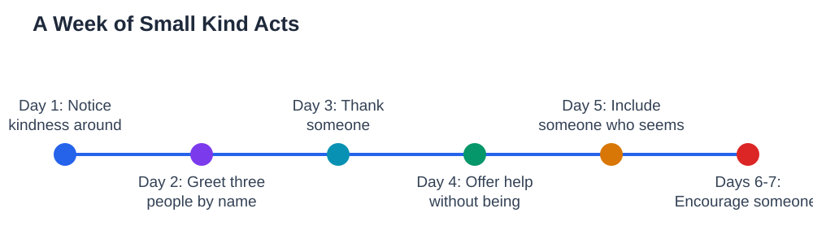

A kindness challenge for students is a simple idea with a surprisingly strong effect: for seven days, do one small kind act each day, on purpose. Kindness is often treated as something that happens by accident, when you feel like it. A challenge turns it into a habit, because you plan it, notice it, and reflect on it. Small acts matter more than grand gestures, because they are easy to repeat and they touch everyday life: a greeting, a thank you, a shared pen, or a seat saved for someone new. Over seven days, these small acts change how a class feels, how you feel about yourself, and how others see you.

## Kindness Challenge Students: Why Small Acts Matter

Small kind acts matter because they are the ones people actually notice and remember. A grand gesture once a year is impressive, but a friendly greeting every morning changes the atmosphere of a whole classroom. Kindness also works in both directions. The person receiving it feels included and valued, and the person giving it often feels calmer, more confident, and more connected. That is because kind acts remind you that you can make a positive difference, even in small ways. A seven-day challenge is long enough to build a habit, but short enough to feel achievable, which is exactly why it works so well for students of any age.

## Day One to Three: Notice, Greet, and Thank

Start the challenge gently. On day one, simply notice kindness around you: who held a door, shared something, or encouraged someone? Noticing trains your attention to see good in others. On day two, greet three people by name, including someone you do not usually talk to, because a warm greeting is one of the simplest kind acts there is. On day three, thank someone specifically for something they did, such as helping you understand a lesson or making you laugh. Specific thanks feel far warmer than a general "thanks," because they show you were paying attention. These first three days build the foundation: noticing, greeting, and thanking are kindness skills you can use every day.

## Day Four to Five: Help and Include

On day four, offer help without being asked: share materials, explain a step to a classmate, or tidy a shared space. Help offered freely feels different from help requested, because it shows you noticed someone else's need. On day five, include someone who seems left out, by inviting them to join your group, sit with you, or take part in an activity. Inclusion is one of the most powerful kinds of kindness, because feeling left out hurts far more than most people realise. If including someone feels awkward, remember that a simple invitation, such as "Would you like to join us?" is enough. You do not need a perfect plan. You only need an open seat and a welcoming voice. For ideas on welcoming new classmates, see [Making Friends in a New School](/blog/making-friends-new-school.html).

## Day Six to Seven: Encourage and Reflect

On day six, encourage someone who is struggling or trying something hard. A few honest words, such as "You are getting better at this" or "I liked how you kept trying," can change someone's whole day. Encouragement is especially powerful when it praises effort rather than only results, because effort is something everyone can control. On day seven, reflect on your week: which act felt best to give, which act meant the most to receive, and what would you like to keep doing? Write down one kindness habit you want to continue beyond the challenge. Reflection turns seven days of acts into a lasting change, because you choose deliberately what to carry forward.

## Keep Kindness Going After the Challenge

The real goal of a kindness challenge is not seven perfect days. It is a habit that continues after the challenge ends. Choose one or two acts that felt natural, such as greeting people by name or including someone new, and keep doing them without counting days. Invite friends to join you, because shared challenges are more fun and spread kindness further. Teachers can support the challenge by noticing kind acts aloud, which encourages the whole class. Kindness does not require extra time, money, or talent. It only requires attention to others and a willingness to act on what you notice. Seven days is a wonderful start, and the habit you build can last far longer. If you use the Lesson Solver tool for textbook questions, remember to verify its solutions against your textbook, keep in mind that AI can make mistakes, and note that the tool needs your own free Google AI Studio API key.

## AI Help: Muse AI

Muse AI is Meta's personal AI assistant, and it can help you plan your kindness challenge. You can ask it to suggest a small kind act for each day, or to help you write a short, sincere thank-you note for a classmate. Join Muse with invite code LTGSWD — in the Muse app, go to Settings > Redeem token and enter the code.
Disclosure: LTGSWD is the author's Muse invite code.

## FAQ

### What is a kindness challenge for students?

A kindness challenge is a seven-day plan where you do one small kind act each day on purpose, such as greeting someone by name, thanking a classmate, or including someone who seems left out. Small, planned acts build a habit of kindness that can continue long after the seven days end.

### Do small kind acts really make a difference?

Yes, small acts are the ones people notice and remember most, because they touch everyday life. A greeting, a thank you, or an invitation can change how someone feels about their whole day. Repeated small acts also change the atmosphere of a classroom over time.

### What if I am shy about being kind to people I do not know?

Start with the smallest, safest acts, such as a smile, a greeting, or holding a door. You do not need a long conversation to be kind. As these small acts feel easier, you can build up to invitations and encouragement. Most people respond warmly to kindness, even from someone they do not know well.

### How can a whole class do the challenge together?

A class can agree on one kind act per day and share reflections at the end of the day or week. Teachers can notice kind acts aloud, which encourages everyone. When a whole class takes part, kindness becomes part of the class culture rather than one student's private habit.

## Conclusion

A kindness challenge proves that kindness does not need to be big to matter. Notice, greet, thank, help, include, encourage, and reflect, one small act at a time over seven days. Then keep the habits that felt most natural, and invite others to join you. Small acts, repeated with attention, can change a classroom, a friendship, and even how you feel about yourself.

[Try the free AI lesson solver](/#tool)
