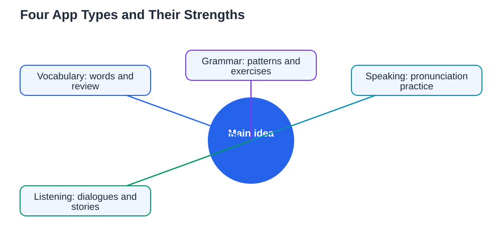

This language apps compared students guide starts with an honest truth: no single app teaches a whole language. Language apps are tools, and like any tools, each type does one job well and other jobs poorly. A vocabulary app drills words efficiently but rarely teaches real conversation. A speaking app builds confidence but may not explain grammar. The learners who get the most from apps are not the ones who download the most apps. They are the ones who pick a small mix that covers different skills, use each app for what it does best, and spend the rest of their time reading, listening, and speaking in real situations.

## Language Apps Compared Students: The Four Main Types

It helps to think of language apps in four broad types rather than as one big category. Vocabulary apps focus on words and phrases, usually through cards, quizzes, and review reminders. Grammar apps focus on patterns and sentence structure, often through short lessons and exercises. Speaking apps focus on pronunciation and conversation, sometimes by listening to your speech and giving feedback. Listening apps focus on understanding spoken language, through dialogues, stories, or clips at different speeds. Most apps blend these types a little, but each one leans toward one strength. Knowing which strength an app leans toward is the key to using it well, because you can then stop expecting it to do everything and start using it for the job it actually does best.

## Vocabulary Apps: Best for Building Word Banks

Vocabulary apps are usually the strongest type for beginners, because they make word learning systematic. They present words with pictures or example sentences, test you with quick quizzes, and remind you to review words before you forget them. This works well for building a solid base of everyday words. Their weakness is that knowing a word on a card is not the same as using it in a sentence, so vocabulary apps alone rarely produce fluent speakers. Use them for what they do best: a short daily session of new words plus review. Then take those words out of the app by writing sentences with them or saying them aloud. You can combine this approach with the routine in [Ten Words a Day: A Language Habit That Sticks](/blog/ten-words-a-day-language.html) to keep your daily word target realistic.

## Grammar and Speaking Apps: Different Strengths, Different Limits

Grammar apps shine when you want a clear explanation of one pattern at a time, followed by short practice exercises. They are useful for untangling a confusing structure or checking a rule you keep getting wrong. Their limit is that exercises inside an app can feel easier than real language, because the app gives you hints and narrow choices that real conversation does not offer. Speaking apps have the opposite profile: they push you to produce sounds and sentences, and some can point out pronunciation problems, which is genuinely useful. Their limit is that conversation with an app is predictable, while conversation with a person is not. The best use of both types is as preparation: learn a pattern in a grammar app, practise saying it in a speaking app, and then try it with a real person as soon as you can.

## Listening Apps: Best for Training Your Ear

Listening apps deserve more attention than they usually get, because understanding spoken language is often the hardest skill for learners. Good listening apps offer dialogues and stories at controlled speeds, with transcripts you can follow and replay. They let you hear natural rhythm, connected sounds, and everyday expressions that textbooks rarely capture. Their weakness is passivity: listening while distracted teaches little, so active listening matters. Listen once for the general meaning, listen again while reading the transcript, and then listen a third time without it, trying to catch words you missed. Short, focused listening sessions beat long background listening, and you can read more about ear training in [Listening Practice: Training Your Ear in a New Language](/blog/listening-practice-language.html).

## How to Choose Your Mix Without App Overload

App overload is the most common mistake learners make with apps. Downloading many apps feels like progress, but switching between them fragments your time and your memory. Choose at most two or three apps that cover different skills, for example one for vocabulary, one for speaking, and one for listening. Give the mix a fair trial of a few weeks before judging it, because every app feels awkward at first. Set a daily time limit for apps, and protect time for real reading, listening, and conversation outside them. If an app stops being useful, or if you find yourself collecting points and streaks without learning, drop it without guilt. Apps should serve your learning, not become the learning itself. If you use the Lesson Solver tool for textbook exercises, remember to verify its solutions against your textbook, keep in mind that AI can make mistakes, and note that the tool needs your own free Google AI Studio API key.

## FAQ

### How many language apps should I use at once?

Two or three apps covering different skills are plenty, and more than that usually fragments your time. Pick one app for your weakest skill, one for daily vocabulary, and perhaps one for listening, then use them consistently for a few weeks. A small, steady mix teaches more than a large collection you rarely open.

### Can an app alone make me fluent?

No app alone can make you fluent, because fluency needs real reading, listening, and conversation with people. Apps are excellent for vocabulary, patterns, and pronunciation practice, but they are preparation for real language use, not a replacement for it. Treat apps as one part of a wider routine that includes speaking and listening outside the app.

### Are free apps good enough for a beginner?

Free versions are usually enough for a beginner, because the core vocabulary, grammar, and listening exercises are what matter most at that stage. Paying for extra features makes sense only when you have used the free version long enough to know exactly which feature you need. Avoid paying before you have a steady habit, since a habit matters far more than premium content.

### How do I know if an app is actually helping me?

An app is helping if you can do something outside the app that you could not do before, such as understanding a short dialogue, saying a new sentence, or reading a simple paragraph. If your only progress is points, levels, or streaks inside the app, the app is entertaining you more than teaching you. Check your real-world skills regularly, not just your in-app scores.

## Conclusion

Comparing language apps is really about comparing jobs: vocabulary apps build word banks, grammar apps clarify patterns, speaking apps train pronunciation, and listening apps train your ear. None of them does everything, and none of them replaces real conversation. Pick a small mix that covers your weakest skills, use each app for its strength, and spend the rest of your time using the language for real. That balance is what turns app time into genuine progress.

[Try the free AI lesson solver](/#tool)
