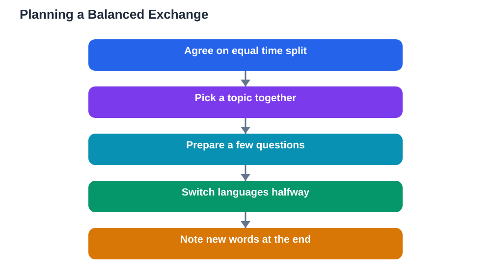

This language exchange partner guide is for any beginner who wants real conversation practice without paying for lessons. A language exchange is a simple, fair arrangement: two people who speak different languages meet regularly, and each person spends part of the time helping the other practise. You teach your language, they teach theirs, and both of you get speaking practice that no app can provide. Done well, an exchange is enjoyable, motivating, and one of the fastest ways to grow confident in conversation. Done carelessly, it can drift into chatting in one language only, or feel awkward and unbalanced. A little planning at the start prevents both problems.

## Language Exchange Partner Guide: How an Exchange Works

A language exchange works on a simple balance: the session time is split evenly between the two languages. In the first half, you might practise the language you are learning while your partner helps you, and in the second half, you switch, helping your partner practise your language. This balance is what makes the exchange fair and useful for both people. Sessions usually last somewhere between a short chat and a longer conversation, depending on what both partners can manage, and meeting regularly, such as weekly, builds progress far better than occasional long meetings. The best exchanges feel like friendly conversations with a purpose, not like formal lessons. You talk about everyday life, interests, and news, and corrections happen naturally along the way.

## Finding a Partner Who Fits You

A good partner fit matters more than a perfect language level. Look for someone whose level is reasonably close to yours, so neither person feels bored or overwhelmed, and whose interests overlap with yours enough to keep conversation flowing. Reliability matters enormously: a partner who shows up on time and keeps the schedule is worth more than a brilliant speaker who often cancels. When you first meet a potential partner, have a short trial conversation to check that you enjoy talking together and that your goals match. It is completely normal to try more than one partner before finding the right fit, and ending an exchange politely when it is not working is better than struggling through sessions that help nobody. Patience in finding the right person pays off for months afterward.

## Planning Sessions That Stay Balanced

Balanced sessions do not happen by accident, they happen by agreement. Before your first session, agree on how the time will be split, and use a simple timer or a gentle signal to switch languages halfway through. Agree on a loose topic for each session, such as daily routines, food, travel, or hobbies, so neither person faces a blank conversation. Prepare a few words or questions beforehand, especially as a beginner, because preparation makes the session far more productive. During your language half, try to stay in the new language even when it is hard, and ask your partner to correct your most important mistakes rather than every small one. End each session by noting a few new words or phrases you learned, so progress is visible and the next session starts with something to review.

## Teaching Your Language Helps You Learn Theirs

Many beginners worry they have nothing to teach, but teaching your own language is easier than it sounds, and it deepens your own learning too. When you explain a word or a pattern in your language, you practise clear, simple communication, which is itself a valuable skill. You do not need to be a teacher: simply speak naturally, slow down when asked, explain words with examples, and correct gently. Your partner will appreciate patience far more than expertise. Explaining your language also makes you notice its patterns more clearly, which sharpens your awareness of how languages work in general. This two-way teaching is the heart of an exchange, and it builds a friendship alongside the learning, which keeps both partners motivated.

## Staying Safe and Comfortable in Exchanges

Safety and comfort come first in any exchange, especially when meeting someone new. Keep early conversations on a reputable exchange platform or in a public, group setting rather than sharing private contact details immediately. Share only what you are comfortable sharing, and never share personal information such as your home address, workplace details, or financial information. Set clear boundaries from the start: which topics are fine, how often you will meet, and how either person can pause or end the exchange. If a partner ignores the time balance, pressures you, or makes you uncomfortable in any way, you have every right to end the exchange, politely and without explanation if you prefer. A good exchange should leave you feeling encouraged, not drained, and protecting that feeling is part of learning well. If you use the Lesson Solver tool for textbook exercises alongside your exchange, remember to verify its solutions against your textbook, keep in mind that AI can make mistakes, and note that the tool needs your own free Google AI Studio API key.

## AI Help: Muse AI

Muse AI is Meta's personal AI assistant, and it can help you prepare for exchange sessions. You can ask it to suggest simple conversation questions on a topic, or to help you draft a short introduction about yourself to practise before meeting your partner. Join Muse with invite code LTGSWD — in the Muse app, go to Settings > Redeem token and enter the code.
Disclosure: LTGSWD is the author's Muse invite code.

## FAQ

### Do I need to be good at a language before finding an exchange partner?

No, beginners benefit greatly from exchanges, as long as both partners know the level and agree on a patient, simple style. You only need a few greetings, everyday phrases, and the courage to try, plus a partner willing to help at that level. Many exchanges work best when both partners are learners, because they understand each other's struggles.

### How long should each language half last?

The halves should be equal, whatever total length you choose, so both partners benefit fairly. A simple approach is to split the session in half with a timer, switching languages at the midpoint. Equal time keeps the exchange fair and prevents the stronger language from quietly taking over the whole session.

### What if my partner only wants to chat in one language?

Raise it kindly at the start of the next session, and remind them of the time-split agreement you both made. If the imbalance continues after a friendly reminder, it is fair to end the exchange and find a partner who respects the balance. A one-sided exchange stops being an exchange, and your learning time deserves respect.

### How do I correct my partner without sounding rude?

Correct gently and sparingly, focusing on mistakes that block meaning or repeat often, rather than every small error. Repeat the correct version naturally in your reply, or offer it warmly with a short explanation. Most partners welcome kind corrections, because that is exactly why they joined the exchange.

## Conclusion

A language exchange partner gives you something no app can: a real person to talk with, learn from, and teach in return. Find a reliable partner at a similar level, agree on a balanced time split, prepare a little for each session, and keep the exchange safe and comfortable for both of you. With those simple foundations, your exchange can become one of the most enjoyable and effective parts of learning a new language.

[Try the free AI lesson solver](/#tool)
