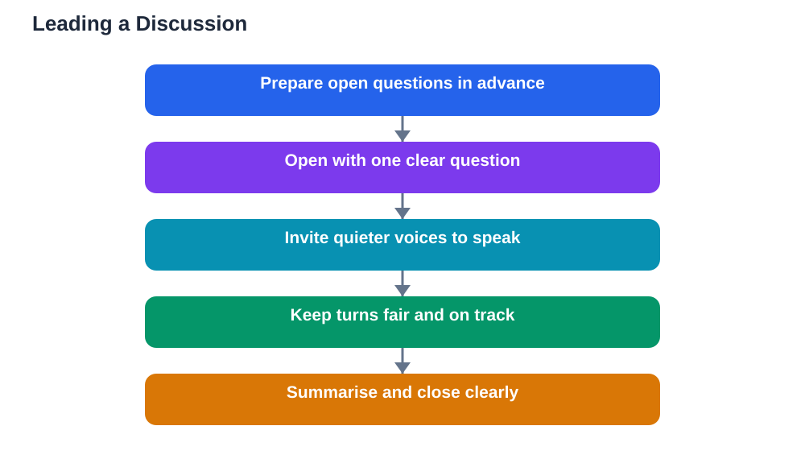

Leading a class discussion is a different skill from joining one. As a participant, you only need to manage your own contributions. As a leader, you manage the whole conversation: who speaks, how long each person talks, whether the discussion stays on track, and whether everyone feels included. It is a demanding role, but it is also one of the fastest ways to build confidence and leadership skills.

You do not need to be the loudest or most confident student to lead well. In fact, the best discussion leaders often speak less than anyone else in the room. Their job is to create space for others, guide the flow, and pull the threads together at the end. This guide walks through each part of that job.

## Prepare Before You Lead

Good leading starts before the discussion begins. Make sure you understand the topic well enough to explain it briefly and to recognise strong contributions when you hear them. Prepare two or three open questions that invite different views, rather than questions with a single correct answer. Open questions keep a discussion alive, while closed questions shut it down quickly.

Also prepare a simple plan: how you will open, roughly how long each part should take, and how you will close. You do not need a rigid script, and you should stay flexible, but a loose plan prevents the discussion from drifting or running out of time. If your teacher gave you a specific goal for the discussion, keep it visible in your notes so you can steer back to it when needed.

## Open With a Clear Question

The opening sets the tone for everything that follows. Start with a short introduction to the topic, then ask your first open question clearly. For example: "Today we are discussing how to learn from mistakes. To start, what is one mistake that taught you something useful?" A concrete, personal opening question gives everyone something to say, which breaks the initial silence that leaders fear most.

After asking, wait. Silence after an opening question feels long to the leader, but it is often just students thinking. Count slowly to ten in your head before speaking again. If nobody answers, rephrase the question more simply or offer a brief example of your own to get the conversation started. Once the first person speaks, the rest usually follows.

## Invite Quieter Voices

A discussion led by three confident students is not a class discussion. It is a small conversation watched by everyone else. Your job as leader is to widen the circle. Watch for students who look like they want to speak but have not found an opening, and invite them directly but gently: "We have not heard from this side yet, would anyone like to add a thought?"

Avoid putting individuals on the spot by name unless they seem willing. Open invitations to a group feel safer than singling someone out. Another useful technique is to pause after each speaker instead of jumping in yourself. Those pauses are often when quieter students gather the courage to speak, and a leader who fills every gap accidentally blocks them.

## Keep Turns Fair and On Track

Fairness is one of the leader's main responsibilities. If one student dominates, the discussion loses variety and other students disengage. You can manage this kindly by thanking the speaker and redirecting: "Thank you, that is a helpful point. Let us hear a different view on this." This acknowledges their contribution while opening the floor.

Staying on track matters too. Discussions wander naturally, and a short detour can be valuable, but if the conversation drifts far from the topic, gently steer it back: "That is an interesting side point. Let us return to our main question for now." Keeping a light touch matters here. You are guiding, not policing, and a friendly tone keeps students willing to contribute.

## Handle Disagreement Calmly

Disagreement will happen in any good discussion, and as leader you set the tone for how it is handled. When two students disagree, thank both for their views and restate each position fairly so both feel heard. Then invite evidence: "What reasons support each side here?" This moves the exchange from personalities back to ideas.

If the tone rises, slow the discussion down. Ask the group to pause and summarise what has been said so far. Slowing down almost always lowers the temperature, because it replaces reacting with thinking. Never take sides publicly as leader. Your neutrality is what keeps the discussion safe for everyone, including students whose views you personally disagree with.

## Summarise as You Go

Short summaries during the discussion help everyone follow the thread. After a few contributions, pause and gather them: "So far we have heard three ideas: first..., second..., and third..." This shows students their contributions were heard, and it gives the group a shared map of where the discussion stands.

Summaries also reveal gaps. When you list what has been covered, missing angles become obvious, and you can ask about them directly: "We have not yet talked about..., what do people think about that?" A leader who summarises regularly keeps the discussion organised without controlling it, and the final summary becomes much easier to deliver.

## Close With a Clear Ending

A discussion should end with a sense of completion, not just fade out when time runs out. In the last few minutes, summarise the main ideas, name the points of agreement and disagreement, and note any questions that remain unanswered. A strong closing sentence might be: "Today we agreed on..., we disagreed about..., and we still need to explore..."

End by thanking the class for contributing. A brief, genuine thanks reinforces the idea that discussion is a shared effort and encourages students to participate next time. If there is follow-up work, such as a short written reflection, mention it clearly so nobody leaves confused about what happens next.

## AI Help: Muse AI

Muse AI is Meta's personal AI assistant, and it can help you prepare to lead a discussion. You can ask Muse to help you draft open questions, practise a fair summary of different views, or rehearse polite phrases for inviting quieter voices and redirecting a dominant speaker. This preparation makes leading feel much less daunting.

Join Muse with invite code LTGSWD — in the Muse app, go to Settings > Redeem token and enter the code.

Disclosure: LTGSWD is the author's Muse invite code.

## FAQ

### What if nobody answers my opening question?

Wait patiently first, then rephrase the question more simply or share a short example of your own. Silence at the start is normal and rarely lasts. Once one student speaks, others usually follow, so your main job is to get that first contribution.

### How do I stop one student from dominating?

Thank them warmly and redirect: "Thank you, let us hear a different perspective now." You can also invite the wider group or use pauses that let others step in. Keep your tone appreciative rather than critical, so the frequent speaker still feels valued.

### Should the leader share their own opinion?

A leader can share a view briefly, but should do so sparingly and clearly marked as one view among others. If you state your opinion too strongly early on, students may simply agree with you instead of thinking for themselves. Often the best leader speaks least.

### What if the discussion runs out of time before finishing?

Summarise what was covered, name the unfinished points, and suggest they be picked up next time or explored in writing. A clear partial ending is far better than rushing through the remaining points. Note the unfinished questions for your teacher.

## Conclusion

Leading a discussion well means preparing open questions, opening clearly, inviting quieter voices, keeping turns fair, handling disagreement calmly, summarising as you go, and closing with a clear ending. The best leaders speak less and listen more, because their real job is helping the whole class think together. Take on a leading role when you get the chance, and you will find your confidence grows with every discussion you guide.

[Try the free AI lesson solver](/#tool)
