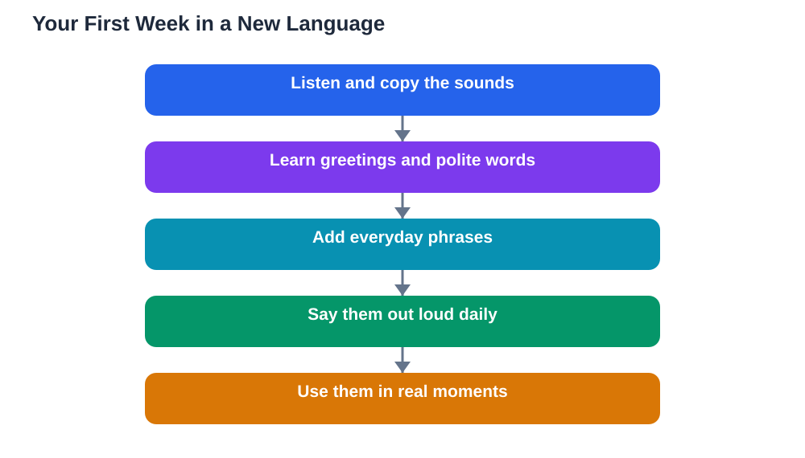

The best learning a new language start is a small one. Many beginners open a thick textbook, try to memorise long word lists, and feel defeated within a week. A better start is much simpler: learn the sounds of the language, a handful of greetings, and a few phrases you can actually use every day. When you can say hello, thank someone, and ask for help, the language stops feeling like a school subject and starts feeling like a tool you own. That early feeling of success is what keeps you going long enough to make real progress.

## Learning a New Language Start: Sounds Before Spelling

Every language has sounds that may not exist in your first language, and your mouth needs time to learn them. Spend your first days listening closely and copying what you hear, rather than staring at written words. Listen to a greeting several times, repeat it out loud, and compare your version with the original. Record yourself if you can, because hearing your own voice makes small differences easier to notice. Do not worry about sounding perfect. Your goal at this stage is simply to train your ear and your mouth to work together. Reading can wait a little while, because a word you can say confidently is far more useful than a word you can only recognise on paper.

## Greetings First: The Phrases That Open Doors

Greetings are the highest-value phrases a beginner can learn. Hello, goodbye, please, thank you, excuse me, and a simple way to say you are learning the language will carry you through many real conversations. These phrases are short, they are used constantly, and people respond warmly when they hear them. Learn them as whole phrases first, not as separate words to assemble, so they come out smoothly when you need them. Practise them out loud every day, even if you are only talking to yourself in the mirror. Once greetings feel automatic, add phrases for everyday needs: asking where something is, ordering food, and saying you do not understand. Each phrase you add makes the next conversation a little easier.

## Everyday Phrases Beat Long Word Lists

Beginners often collect hundreds of single words and then discover they cannot build a sentence. Everyday phrases solve this problem because they teach words inside real patterns. Learn phrases such as "I would like", "Where is", "How much is this", and "Can you help me" as complete units, then swap one word at a time to make new sentences. This approach gives you useful language from the very first day, and it teaches grammar naturally, without rules to memorise. Keep a small phrase notebook and review it often. Ten phrases you can actually say are worth far more than a hundred words you only recognise. For more ideas on building a steady routine, see [Ten Words a Day: A Language Habit That Sticks](/blog/ten-words-a-day-language.html).

## Build a Small Daily Habit You Can Keep

A new language grows through short, regular contact, not through rare marathon sessions. Aim for a short daily session you can genuinely keep, even on busy days. Split it into three tiny parts: listen to a few phrases, say them out loud, and review yesterday's phrases once. Doing a little every day keeps the language fresh in your mind and stops the forgetting that follows long gaps. Put your session at the same time each day, such as after breakfast or before bed, so it becomes part of your routine rather than a decision you must remake daily. If you miss a day, simply start again the next day without guilt. Consistency over weeks beats intensity over a weekend, every time.

## Use the Language From the First Week

You do not need to wait until you feel ready before using the language. Use it in tiny, low-pressure ways from the first week: greet a friend who speaks it, label objects around your home, or think a simple sentence in the new language while you cook. These small uses turn study into a living habit and show you that the language belongs to you, not just to a textbook. Mistakes are part of this stage and they are useful, because every correction teaches you something. You can also read more about being brave with early speaking in [Speaking From Day One: Be Brave in a New Language](/blog/speaking-from-day-one-language.html). If you use the Lesson Solver tool for textbook exercises, remember to verify its solutions against your textbook, keep in mind that AI can make mistakes, and note that the tool needs your own free Google AI Studio API key.

## AI Help: Muse AI

Muse AI is Meta's personal AI assistant, and it can be a friendly practice partner for a beginner. You can ask it to explain a greeting simply, suggest everyday phrases for a situation, or help you draft a short self-introduction to practise out loud. Join Muse with invite code LTGSWD — in the Muse app, go to Settings > Redeem token and enter the code.
Disclosure: LTGSWD is the author's Muse invite code.

## FAQ

### How long should I study each day as a beginner?

A short daily session is enough to make real progress, and it is far better than one long session once a week. Aim for a session you can repeat without strain, split between listening, speaking aloud, and reviewing earlier phrases. The exact length matters less than the habit itself, because regular contact keeps sounds and phrases fresh in your memory.

### Should I learn reading and writing first, or speaking first?

Speaking and listening first usually gives beginners faster confidence, because you can use greetings and phrases in real situations right away. Reading and writing become easier once you already know how the language sounds. That said, if your main goal is reading, give reading a larger share of your time from the start, and let your goal shape the balance.

### How many phrases should a beginner learn in the first week?

A small set of useful phrases is plenty for the first week, such as greetings, polite words, and a few everyday requests. The aim is to know them well enough to say them without hesitation, not to collect a long list. Add new phrases only when the old ones feel comfortable, so your foundation stays solid as it grows.

### What should I do when I feel stuck or overwhelmed?

Feeling stuck usually means the step is too big, not that you lack ability. Go back to phrases you already know, practise them until they feel easy again, and then add just one new phrase. Shortening the session or switching to listening for a day also helps, because progress returns once the pressure drops.

## Conclusion

Starting a new language is not about talent or the perfect textbook. It is about learning the sounds, mastering a few greetings, collecting useful everyday phrases, and showing up for a short session every day. Start small, use what you learn right away, and let each small success carry you to the next step. Before long, the language that once felt foreign will feel like a skill you are genuinely building, one phrase at a time.

[Try the free AI lesson solver](/#tool)
