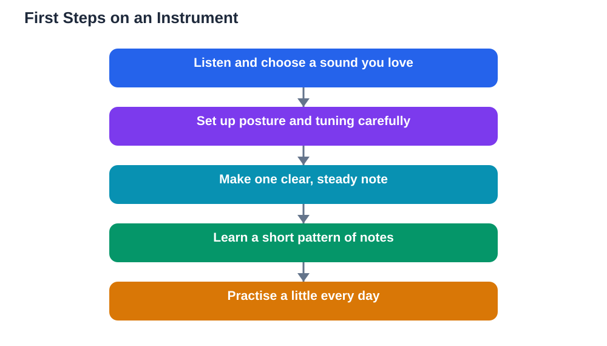

Learning an instrument first steps can feel exciting and a little overwhelming at the same time. There are so many instruments to choose from, and the first weeks involve new skills: holding the instrument, making a sound, reading notes, and practising regularly. The good news is that nobody expects you to master all of this at once. Every musician started with a first note that sounded wobbly, a first practice session that felt clumsy, and a first tune that took many tries. This guide walks through the first steps in order: choosing an instrument, setting it up well, playing your first notes, and building a practice habit that lasts.

## Learning an Instrument First Steps: Choosing the Right Instrument

Choosing an instrument starts with what you enjoy listening to and what feels comfortable to hold and play. Listen to different instruments and notice which sounds make you want to keep listening. If you can, try holding a few instruments and making a sound on each, because an instrument that feels awkward in your hands will be harder to enjoy. Practical matters matter too: think about where you will practise, how you will carry the instrument, and whether you can get lessons or learning materials for it. There is no single best instrument for beginners. The best instrument for you is one whose sound you love, whose size fits you, and which you will look forward to picking up. Talk with a teacher or an experienced player if you can, and try not to rush the choice. A week spent exploring options is time well spent if it leads to an instrument you genuinely enjoy.

## Holding, Sitting, and Setting Up Well

Good posture and setup make playing easier and more comfortable from the very first day. Sit or stand in a balanced position, with your back straight but relaxed, your feet flat on the floor if you are sitting, and the instrument held so you can reach everything without straining. Hold the instrument the way your teacher or method book shows, even if it feels unfamiliar at first, because a comfortable-looking shortcut often creates tension that causes problems later. Keep your shoulders relaxed, your breathing easy, and your hands curved naturally rather than stiff. Before each practice session, check the basics: is the instrument in tune, are the parts assembled correctly, and do you have your music and a pencil nearby? A few minutes spent on setup saves many minutes of frustration, and good habits formed now will support you for years. If anything hurts while you play, stop and adjust your position or ask a teacher for advice, because playing should never be painful.

## Playing Your First Notes

Your first notes do not need to be perfect; they need to happen. Start by making a single steady sound and listening to it: is it clear, is it stable, and can you repeat it? Then add a second note, and practise moving between the two smoothly. Next, learn a very short pattern of three or four notes, and play it slowly, several times, until it feels familiar. Only then should you try a simple tune, and you should expect it to be slow and careful at first. Keep your practice sessions short in the early weeks, because tired hands and tired concentration produce more mistakes than progress. Celebrate small wins: the first clear note, the first smooth change between notes, and the first tune played from start to finish are all real achievements. Record yourself occasionally if you like, because hearing your own progress over a few weeks is wonderfully encouraging. For the basics of reading the notes you will play, see [Reading Music Notes: The Basics](/blog/reading-music-notes-basics.html).

## Your First Practice Routine

A good first routine is short, regular, and varied. Begin each session with a gentle warm-up: a few long notes, a simple scale, or a rhythm exercise, played slowly. Then work on the new skill or piece your teacher has set, in small sections rather than all at once. Spend a few minutes on something you find tricky, and finish with something you enjoy playing, so each session ends on a happy note. Aim for regular practice, ideally most days, rather than one long session at the weekend. If you can only manage a short session on a busy day, that still counts: a few focused minutes keep the habit alive and the skills fresh. Keep a simple practice notebook where you write what you practised and what felt hard, because that record helps your teacher help you and lets you see your own progress. When you use AI tools for study help, verify answers against your textbook, since AI can make mistakes.

## Getting Help and Staying Motivated

Learning an instrument goes better with help. A teacher can correct your posture, choose pieces at the right level, and encourage you when progress feels slow. If lessons are not possible, a good method book, a practice group, or playing along with simple recordings can still guide you. Playing with others, even in a very simple group, is one of the best motivators, because music is naturally social and shared progress feels good. Set small goals you can reach, such as learning one new tune this month or playing a scale smoothly, and celebrate reaching them. Expect plateaus: weeks when nothing seems to improve are normal, and they usually end with a sudden jump forward. If motivation dips, play something fun, listen to music you love, or remind yourself why you chose your instrument in the first place. Enjoyment is not a distraction from learning; it is what keeps learning going.

## AI Help: Muse AI

Muse AI is Meta's personal AI assistant, and it can help you take your first steps on an instrument. You can ask it to explain how to choose between instrument types in plain language, or to suggest a simple first-week practice plan you can follow at home.

Join Muse with invite code LTGSWD — in the Muse app, go to Settings > Redeem token and enter the code.

Disclosure: LTGSWD is the author's Muse invite code.

## FAQ

### How do I choose between different instruments?

Pick the sound you love most, then check practical details such as size, cost, and whether you can get lessons. Trying an instrument in person, even briefly, helps you judge whether it feels comfortable to hold and play.

### How long should a beginner practise each day?

Short, regular sessions work best. A focused session of around fifteen to twenty minutes most days is a great start for a beginner, and you can build up gradually as your concentration and stamina grow.

### What if my first notes sound bad?

That is completely normal. Every beginner's first notes sound wobbly or squeaky. Clear, steady notes come from relaxed posture, careful listening, and patient repetition, not from talent alone.

### Do I need a teacher to learn an instrument?

A teacher helps a lot, especially with posture and technique, but you can still make real progress with a good method book and careful practice. If you learn alone, check your posture regularly and seek advice when something feels wrong.

### When will I be able to play a real tune?

Sooner than you think. Many beginners play a simple tune within the first few weeks, slowly and carefully. Simple tunes are real music, and playing them well is a genuine achievement worth celebrating.

## Conclusion

Your first steps on an instrument are about choosing a sound you love, setting up comfortably, playing your first notes patiently, and practising a little every day. Keep sessions short, celebrate small wins, and ask for help when you need it. For help with your school work and study questions, [Try the free AI lesson solver](/#tool).
