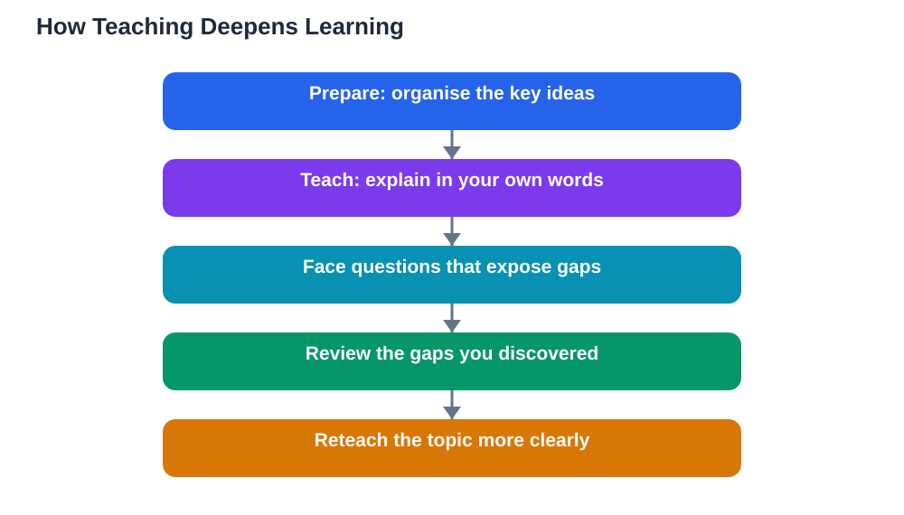

Learning by teaching is one of the most powerful study methods available, and it works for a simple reason: you cannot explain what you do not understand. When you prepare to teach a topic, you have to organise it, simplify it, and connect its parts, and that organising work is itself deep learning. When you actually explain it, the questions you receive expose gaps you did not know you had. Researchers call this the protege effect: students who learn material in order to teach it understand and remember it better than students who learn it only for themselves. This guide explains why learning by teaching works and how to use it in your own study, even if you have nobody to teach.

## Learning by Teaching and the Protege Effect

The protege effect describes a reliable finding: expecting to teach something changes how you learn it. When you study with teaching in mind, you look for the main ideas, the logical order, and the examples that make each idea clear, rather than just memorising surface details. You also monitor your own understanding more carefully, because you know someone will ask questions. Then, when you actually teach, you retrieve the material from memory, put it into your own words, and adapt it to your listener's confusion, which strengthens the memory further. This is why students who explain a topic to a friend often remember it weeks later, while students who only reread their notes forget it quickly. Teaching is not a favour you do after learning, it is a form of learning in its own right, and the best time to teach is while you are still learning, not after you feel ready.

## Teach in Small Pieces, Not Whole Chapters

Learning by teaching works best in small pieces. Pick one concept, one worked example, or one section of a chapter, and teach just that. Trying to teach a whole chapter at once leads to vague summaries that skip the hard parts, while a small piece forces you to be precise. Prepare briefly first: read the section, note the key ideas in order, and think of one example and one likely question. Then teach it to a friend, a family member, or even an empty chair. After teaching, note what you stumbled on, because those stumbles mark exactly what to review. Then teach the same piece again, better. This cycle of prepare, teach, review, and reteach turns a single concept into durable knowledge, and repeating it across small pieces gradually covers a whole subject without the shallow feeling of rushed revision.

## Use the Teach-Back Method in Study Sessions

The teach-back method is a structured way to use learning by teaching with a partner. One person teaches a small piece while the other listens and asks questions, then the roles swap. The listener's job is not to sit quietly but to ask the questions a confused student would ask: "Why does that step work?", "Can you give an example?", "What happens if we change this part?" These questions are gold, because they force the teacher to think deeper than the script they prepared. After both partners have taught, each writes down the gaps they discovered and reviews those gaps before the next session. The guide on [teach back method revision](/blog/teach-back-method-revision.html) explains this method in detail, and the elaboration technique guide at [elaboration technique explain to learn](/blog/elaboration-technique-explain-to-learn.html) shows how explaining reasons, not just facts, deepens memory further. Used regularly, teach-back turns ordinary study sessions into powerful learning.

## Teach When You Have No Audience

You do not need a real audience to benefit from learning by teaching. Explaining out loud to an empty room, recording yourself on your phone and listening back, or writing an explanation as if for a younger student all trigger the same benefits. Writing is especially powerful: if you can write a clear, simple explanation of a topic without looking at your notes, you understand it. If you get stuck mid-explanation, you have found a gap to fill. Another useful trick is to explain a topic to an imaginary beginner who knows nothing about it, because that forces you to define every term and justify every step instead of skipping over the parts you only half understand. Students who use these solo teaching methods often surprise themselves: the explanation reveals both how much they know and exactly what is missing, which makes the next round of study sharply focused.

## Common Mistakes That Weaken Teaching as Learning

Learning by teaching fails when it becomes performance instead of thinking. Reading your notes aloud is not teaching, it is rereading with an audience. Repeating a memorised paragraph without understanding it teaches you nothing new, and teaching from a script you do not understand hides gaps instead of exposing them. Another mistake is teaching only what you already find easy, because that feels good but adds nothing. The growth happens at the edges of your understanding, where questions make you pause. So deliberately teach the parts you find hardest, and welcome questions that stump you: a question you cannot answer is a gift, because it tells you precisely what to study next. Finally, do not skip the review step. Teaching without reviewing the gaps it reveals wastes half the benefit, so always finish a teaching session by noting what to relearn.

## Build Teaching Into Your Weekly Routine

The easiest way to benefit from learning by teaching is to schedule it. After finishing a chapter, spend fifteen minutes teaching its key ideas to a study partner, a family member, or yourself out loud. In group sessions, rotate who teaches each topic, so everyone practises both teaching and questioning. Before an assessment, run a teach-back round where each person teaches one topic to the group, because the group will quickly discover which topics are solid and which need more work. Keep a small notebook of "teaching gaps": the questions you could not answer and the steps you stumbled on. Reviewing that notebook is one of the most efficient revision activities there is, because it targets exactly what you do not yet know. Over a term, this routine builds understanding that survives far beyond any single test.

## AI Help: Muse AI

Muse AI is Meta's personal AI assistant, and it can help you practise learning by teaching. You can ask it to act as a curious listener that asks follow-up questions about your explanation, so you discover gaps in your understanding before you teach a real person.

Join Muse with invite code LTGSWD — in the Muse app, go to Settings > Redeem token and enter the code.

Disclosure: LTGSWD is the author's Muse invite code.

## FAQ

### Does learning by teaching work if I am not an expert?

Yes, and that is the point. You do not need to be an expert to teach, you need to be one step ahead of your listener, or even learning alongside them. Teaching while you are still learning exposes gaps early, when they are easy to fix. If you wait until you feel expert, you miss the learning that teaching itself provides.

### What if nobody wants to listen to me teach?

Teach anyway, to yourself. Explain out loud, record yourself, or write explanations as if for a beginner. These solo methods give most of the same benefit, because the key mechanism is organising and retrieving ideas in your own words, not having a live audience.

### How is learning by teaching different from just revising notes?

Revising notes is mostly input: reading and recognising material. Teaching is output: retrieving, organising, and explaining it, which builds stronger memory and reveals gaps that recognition hides. A topic can feel familiar when you read it and still collapse when you try to explain it, and that collapse is exactly what teaching helps you fix.

### Can teaching a friend hurt my own grades?

No, when done well it improves them, because explaining deepens your own understanding. The only risk is spending all your time teaching others and none reviewing your own gaps, so always finish teaching sessions by noting and reviewing what you could not explain. Teaching and personal revision work best together.

## Conclusion

Learning by teaching works because explaining forces you to organise ideas, retrieve them from memory, and face the gaps that silent reading hides. Teach in small pieces, use the teach-back method with a partner, practise alone when you have no audience, and always review the gaps teaching reveals. Build teaching into your weekly routine, and it will become one of the most reliable tools in your study kit. For step-by-step help understanding a topic before you teach it, [Try the free AI lesson solver](/#tool).
