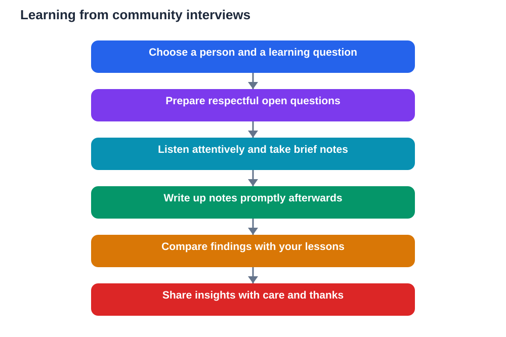

Textbooks teach a great deal, but they cannot teach everything. Around you, in your own community, live people with skills, stories, and knowledge gained through years of work and experience. A worker who practises a craft daily, an elder who remembers how life used to be, or a maker who solves practical problems with their hands can all teach lessons no page can fully capture. Learning from your community means recognising that knowledge lives in people, not only in books.

Community learning also builds respect and connection. When you listen carefully to someone's experience, you learn to value work you may have taken for granted and to see your neighbourhood as a place of learning. That attitude matters far beyond any single interview. It shapes how you understand society, work, and history, and it teaches you to learn from people with humility and curiosity.

## Choose Someone to Learn From Thoughtfully

Start by thinking about what you want to learn and who might know about it. You might want to understand a craft, a kind of work, a change over time, or a skill used in daily life. Choose a person whose experience genuinely relates to your question, and think about why their perspective would be valuable. A thoughtful choice makes the conversation richer for both of you.

Always seek permission and guidance from a teacher or a trusted adult before approaching someone, and respect the person's time and privacy. Explain briefly what you are learning and why you would value their help. Most people are pleased to share when they feel respected and when the request is clear, polite, and not too demanding.

## Prepare Respectful, Open Questions

Good interviews start with preparation. Write a small set of open questions that invite stories and explanations rather than short answers. Ask how someone learned their skill, what a typical day involves, what challenges they face, or how their work has changed over time. Open questions show that you value their experience and give them room to share what matters most to them.

Avoid questions that are intrusive or personal beyond what is appropriate for a learning conversation. Focus on work, skills, experiences, and changes, and let the person decide how much personal detail to share. Preparation also means thinking about follow-up questions, so you can respond thoughtfully to what you hear instead of simply reading a list aloud.

## Listen With Attention and Respect

Listening is the most important interview skill. Give the person your full attention, avoid interrupting, and show interest through patient, respectful listening. Stories often take time to unfold, and the most valuable insight may come after a pause or a detail that at first seems small. Rushing the conversation will lose exactly the depth you came to find.

Take brief notes during the conversation, focusing on key points, phrases, and ideas, rather than trying to write down every word. If you want to record anything, ask permission first and respect the answer. After the interview, write up your notes promptly while the conversation is fresh, separating what the person actually said from your own reflections on it.

## Learn From Workers, Elders, and Makers

Different people teach different kinds of knowledge. Workers can explain how a job is done, what skills it requires, and how problems are solved in practice. Elders can share memories of how life, work, and community have changed, offering a living connection to the past. Makers can show how materials, tools, and techniques come together to create something useful or beautiful.

Each perspective adds something a textbook cannot fully give: the feel of real work, the weight of lived memory, and the ingenuity of practical problem-solving. When you bring these perspectives together, you gain a richer picture of how a community works and how knowledge is passed from one person to another. That picture is itself an important kind of learning.

## Compare Community Knowledge With Lessons

After an interview, compare what you learned with your lessons. Does community experience confirm, extend, or challenge what your textbook says? A craftsperson may describe a process in practical terms that make a classroom idea clearer. An elder may describe a change that helps you understand a historical pattern. These connections make learning concrete and memorable.

Be careful to represent what you heard fairly. Do not exaggerate, invent details, or present one person's view as the view of everyone. Note where views differ and why that might be. Fair, careful reporting is a sign of respect for the person who shared their time, and it is also good study practice. If you use any AI helper to organise your notes, verify important points against your own notes and textbook, since AI can make mistakes.

## Share What You Learned With Care

Sharing community learning can benefit your class, but it must be done with care. Share ideas, skills, and general insights, and thank the person who helped you. Avoid sharing personal details that were not meant for a wider audience. When in doubt, ask what is fine to share. Respectful sharing protects trust and keeps the door open for future learning.

You might present your findings as a short talk, a written summary, or a set of questions for class discussion. Focus on what you learned, what surprised you, and what you still wonder about. A presentation that honours its source and explains its evidence teaches your classmates as well as yourself.

## AI Help: Muse AI

Muse AI is Meta's personal AI assistant, and it can help you learn from your community. You can ask it to help you draft respectful open questions for an interview, or to organise your interview notes into a clear summary afterwards. It is useful for explaining ideas simply, planning questions, and shaping notes into revision material.

Join Muse with invite code LTGSWD — in the Muse app, go to Settings > Redeem token and enter the code.

Disclosure: LTGSWD is the author's Muse invite code.

## FAQ

### How do I ask someone in my community for an interview?

Explain politely what you are learning and why their experience would help, with guidance from a teacher or trusted adult. Keep the request brief, respectful, and clear about how much time you hope for.

### What makes a good community interview question?

Open questions that invite stories and explanations work best. Ask how someone learned a skill, what their work involves, what challenges they face, or how things have changed over time.

### Should I record an interview?

Only with clear permission, and only if the person is comfortable. Brief written notes are often enough, and writing them up promptly afterwards preserves the key points respectfully.

### How do I use an interview in my studies?

Compare what you heard with your lessons, note connections and differences fairly, and turn the insights into a summary or discussion points. Represent the person's views accurately without exaggeration.

### What if different people give different accounts?

That is normal and valuable. Different experiences lead to different perspectives. Note the differences honestly and think about why they might exist, rather than forcing one simple answer.

## Conclusion

Your community is full of teachers, if you learn to ask, listen, and respect what you hear. Interview workers, elders, and makers with thoughtful questions, compare their knowledge with your lessons, and share what you learn with care. Done this way, community learning deepens your studies and your understanding of the people around you.

[Try the free AI lesson solver](/#tool)
