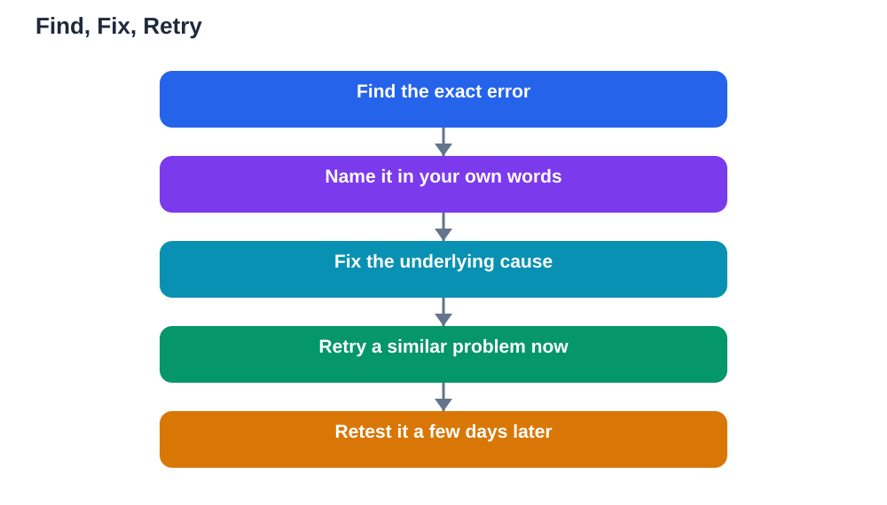

Every student makes mistakes. The students who improve fastest are not the ones who make fewest mistakes; they are the ones who use mistakes best. A mistake, examined honestly, tells you exactly where your understanding broke down. Ignored, the same mistake returns again and again, in homework, in tests, and in later topics that build on the same idea. This guide gives you a practical routine for learning from mistakes: find the error, fix the cause, and retry until the correction sticks.

## Learning From Mistakes Guide: Find the Error First

The first step is to find the exact error, not just notice that an answer is wrong. When you get something wrong, slow down and compare your work with the correct solution line by line. Where does your work first differ from the correct path? That point is the error, and it is usually more specific than you expect. Perhaps you used the wrong operation, skipped a step, misread a word in the question, or applied a rule to a case where it does not fit. Naming the error precisely matters, because "I got it wrong" cannot be fixed, while "I added instead of multiplying in step two" can. Keep a mistakes notebook or a page at the back of your exercise book where you write each error in your own words. Over time, patterns appear: the same kind of error returning is a signal about a weak spot worth extra practice, not a coincidence.

## Fix the Cause, Not Just the Answer

Correcting an answer is easy; fixing its cause takes more thought, and it is the step most students skip. Ask yourself why the error happened. A misunderstanding needs a fresh explanation, perhaps from your textbook, a different worked example, or a teacher. A careless slip needs a habit change, such as underlining key words in the question or checking each step before moving on. A forgotten step needs repeated practice of the full sequence until it becomes automatic. A mixed-up pair of ideas needs a side-by-side comparison: write both ideas down, note how they differ, and practise telling them apart. If you only copy the correct answer, the cause remains, and the same mistake will return on the next similar problem. Fixing the cause takes a few extra minutes, but it saves many repeated errors later. When you use an AI study tool to check your work, verify its solutions against your textbook too, since AI can make mistakes, and remember the Lesson Solver tool needs your own free Google AI Studio API key.

## Retry Soon, Then Retry Again Later

A correction only sticks if you practise it. After fixing a mistake, solve a similar problem immediately, without looking at the corrected solution. If you can do it correctly on your own, the fix is starting to hold. Then test yourself on the same kind of problem again a few days later, because a correction that survives a few days is real learning, while a correction that fades overnight was only copied. This two-stage retry, soon and later, is the heart of learning from mistakes. It also builds confidence: each successful retry proves that you can overcome errors, which makes the next mistake less frightening. Students who retry their mistakes regularly find that their error rate drops steadily, not because they became naturally careful, but because they systematically removed their weak spots one at a time.

## Separate Mistakes From Ability

One of the most harmful habits in studying is treating a mistake as proof that you are bad at a subject. A mistake is evidence about one moment, one idea, or one method. It says nothing about your ability overall. Students who believe mistakes mean low ability tend to avoid hard work, because hard work risks more mistakes. Students who believe mistakes are information tend to seek hard work, because each mistake teaches them something. When you make a mistake, practise talking about it neutrally: "I used the wrong step here" instead of "I am terrible at this." That small language change protects your motivation and keeps you practising. Teachers and good study partners can help here too: ask them to explain the idea again, not just give the answer, so the next attempt is genuinely yours. For a method that pairs well with mistake review, see [Self-Testing: Checking Yourself Without a Teacher Guide](/blog/self-testing-learning-alone.html).

## Build a Mistake Routine Into Your Week

Learning from mistakes works best as a routine, not a reaction. Set aside a short weekly session just for mistakes: open your mistakes notebook, retry the errors from the week, and check which ones are fixed and which still need work. Errors that keep returning deserve a different approach, such as a new explanation or extra practice on that specific skill. Celebrate fixed mistakes too. A mistake you used to make and no longer make is real progress, and noticing it builds the confidence to tackle the next one. Over a term, your mistakes notebook becomes a personal map of your learning: it shows where you struggled, how you fixed it, and how far you have come. That map is far more valuable than a page of perfect answers, because perfect answers hide the learning, while examined mistakes reveal it.

## AI Help: Muse AI

Muse AI is Meta's personal AI assistant, and it can help you learn from mistakes by explaining where a solution went wrong in simple words. You can ask it to walk through a problem step by step, or to give you a similar practice problem to retry after a correction. Join Muse with invite code LTGSWD — in the Muse app, go to Settings > Redeem token and enter the code.
Disclosure: LTGSWD is the author's Muse invite code.

## FAQ

### Should I correct mistakes right away or later?

Correct them as soon as you can, while the problem is still fresh in your mind, because the error and your thinking are easiest to examine then. After correcting, retry a similar problem immediately, and test yourself again a few days later to make sure the correction lasted.

### What if I keep making the same mistake?

A repeating mistake means the cause has not been fixed yet, not that you cannot learn. Go back to the cause: do you misunderstand the idea, mix it with a similar one, or skip a step? Try a different explanation, a side-by-side comparison, or extra practice on that single step, and ask a teacher to explain the idea again if needed.

### Is it worth keeping a mistakes notebook?

Yes, because it turns scattered errors into visible patterns. When you can see that the same kind of error appears repeatedly, you know exactly what to practise. It also records your progress: mistakes you no longer make are proof of real improvement.

### How should I react when a mistake embarrasses me?

Treat it as information, not as a judgement on your ability. Every learner makes mistakes, including strong students, and the students who improve fastest are usually the ones who examine mistakes calmly. Describing the error neutrally, such as naming the wrong step, helps you focus on fixing it instead of feeling bad about it.

## Conclusion

Mistakes are not obstacles to learning; they are the raw material of it. Find each error precisely, fix its cause rather than just its answer, and retry soon and again later until the correction holds. Keep mistakes separate from your sense of ability, and build a short weekly routine for reviewing them. Done this way, every error becomes a step forward, and the student who learns from mistakes steadily becomes the student who makes fewer of them.

[Try the free AI lesson solver](/#tool)
