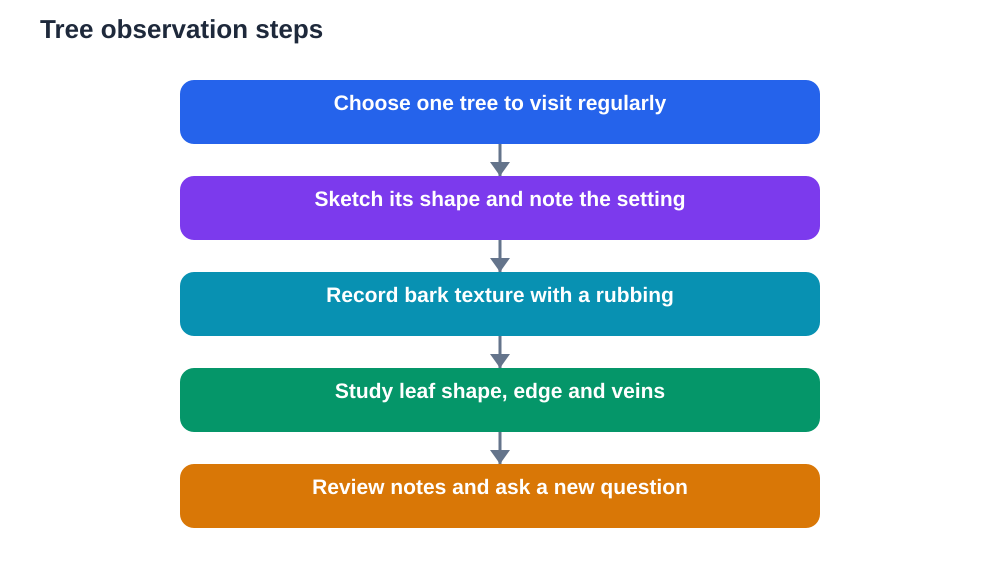

A tree standing near a path can teach a surprising amount if you slow down and look closely. Its bark, leaves, branches and overall shape all carry clues about growth, seasons and the conditions around it. Learning from trees is not about memorising facts from a page. It is about training your eyes to notice patterns, ask questions and record what you see over time.

Trees also make an excellent first subject for outdoor study because they stay in one place. You can return to the same tree week after week and watch it change. That steady return visit turns a quick walk into a real investigation, and it builds patience, careful observation and clear note-taking.

## Start With One Tree

Choose one tree that is easy and safe to visit regularly. It could stand in a garden, a park, a school ground or beside a quiet path. Give it a simple label in your notebook, such as Tree One, and note where it stands in general terms, for example near a fence or beside a path. Avoid climbing it or breaking branches. Good observation never harms the subject being studied.

On your first visit, sketch the whole shape of the tree. Is it tall and narrow, or wide and spreading? Do the branches reach upward, outward or droop toward the ground? A quick sketch, even a rough one, helps you remember the tree far better than a single sentence. Add a few words about the ground beneath it, the light around it and anything growing nearby.

## Read the Bark Like a Surface Story

Bark is the outer covering of a tree, and it varies a great deal. Some bark feels smooth, some feels rough and deeply grooved, and some peels away in thin flakes. Run your hand gently over a small area and describe what you feel in plain words. Is it cracked, ridged, flaky, smooth or bumpy? Colour also matters, but describe shades rather than guessing at causes.

A bark rubbing is a simple and safe way to record texture. Place a sheet of paper against the bark, hold it steady, and rub lightly over it with the side of a soft pencil or crayon. The pattern that appears gives you a record you can keep and compare. Label each rubbing with the date and the tree label so your records stay organised. Never peel bark off a living tree, because bark protects it just as skin protects a body.

Over time, compare rubbings from the same tree and from different trees. You will start to notice that bark patterns are fairly steady for one tree, while different trees show clearly different textures. That contrast is a useful reminder that careful description beats vague impressions.

## Look Closely at Leaves

Leaves are often the most rewarding part of tree study. Look at the overall shape first. Is the leaf broad and flat, long and narrow, or divided into smaller leaflets? Check the edge of the leaf. It may be smooth, wavy, toothed or deeply lobed. Then look at the veins. Some leaves have one strong central vein with smaller veins branching off, while others show veins spreading out like fingers from a single point.

Collect fallen leaves rather than pulling fresh ones from branches. A fallen leaf can be pressed flat in a notebook and labelled with the date and tree. Compare leaves from the same tree and notice that they are similar but not identical. Small differences are normal in living things, and learning to accept variation is part of good science.

Leaf colour also changes with the seasons in many places. Green leaves may turn yellow, orange, red or brown before falling. Recording the date when you first notice a colour change gives you a seasonal marker you can compare from year to year. Always describe what you actually see rather than what you expect to see.

## Understand Tree Rings Without Cutting a Tree

You may have seen pictures of rings inside a cut trunk. Each ring usually marks one growing season, with a lighter band for faster growth and a darker line where growth slowed. Wider rings often suggest a season with favourable growing conditions, while narrower rings suggest a harder season. Together, the rings form a timeline of the life of the tree.

Never cut a living tree to see its rings. Instead, study rings on a fallen branch, a stump that is already cut, or a clear photograph or diagram in a book. Count the rings slowly and mark every tenth ring with a small dot so you do not lose your place. Then look for patterns: stretches of wide rings, stretches of narrow rings, and any sudden changes.

Rings teach a wider lesson too. A living thing does not grow at the same speed all the time. Growth responds to conditions around it, and a record of growth can reveal good years and difficult years. That idea applies well beyond trees, and it is worth writing down in your own words.

## Keep a Simple Tree Journal

A tree journal turns scattered visits into a study. For each visit, record the date, the weather in general terms, and three observations: what the bark looks like, what the leaves are doing, and anything new, such as buds, flowers, fruit, fallen leaves or visiting insects. Short, honest notes beat long, invented descriptions every time.

Drawings belong in the journal as well. A sketch of a leaf, a bark rubbing, or a small map showing the position of the tree all make your record stronger. Over a term, your journal becomes evidence of change, and you can look back and answer questions such as when buds first appeared or when leaves began to change colour.

Review your journal regularly. Ask what changed, what stayed the same, and what surprised you. Those three questions turn note-taking into thinking, and they often lead to a new question worth investigating on the next visit.

## Ask Better Questions Outdoors

Good tree study grows from good questions. Instead of asking only for the name of a tree, ask how it changes, what lives on it or around it, and how it responds to wind, shade or dry weather. Questions such as why one side of a tree has more leaves, or why fallen leaves gather in one spot, can be explored by looking again rather than by guessing.

Some questions cannot be answered in one visit, and that is fine. Write them down and keep them for later. A question carried across several visits is often more valuable than a quick answer, because it teaches you to gather evidence before deciding. When you do look something up, check it against what you observed, and note where observation and reading agree or differ.

Remember to verify solutions and facts against your textbook, and remember that AI tools can make mistakes. Your own careful notes are the most trustworthy record of what you actually saw.

## AI Help: Muse AI

Muse AI is Meta's personal AI assistant, and it can help you turn outdoor notes into clear study material. For this topic, you can ask it to help you organise your tree observations into a tidy summary or to suggest simple questions for your next visit.

Join Muse with invite code LTGSWD — in the Muse app, go to Settings > Redeem token and enter the code.

Disclosure: LTGSWD is the author's Muse invite code.

## FAQ

### How do I start learning from trees if I know nothing about them?

Start with one tree and three simple observations: bark texture, leaf shape and overall shape. You do not need names or technical terms to begin. Describe what you see in plain words, sketch what you notice, and return to the same tree regularly. Knowledge grows naturally as your observations pile up and your questions become sharper.

### Do I need special equipment for tree study?

No special equipment is needed. A notebook, a pencil and a crayon for bark rubbings are enough to begin. A magnifying glass can help with leaf veins and small details, but it is optional. The most important tools are patience, regular visits and honest notes.

### Can I learn about tree age without harming a tree?

Yes, and you should never cut a living tree to check its age. Study rings on material that is already cut, such as a fallen branch or an old stump, or use clear diagrams and photographs. You can also learn a great deal about growth and seasons from leaf changes, buds and bark without ever needing an exact age.

### Why do leaves on the same tree look slightly different?

Leaves vary because living things are not made by a machine. Light, position on the branch, age and weather all influence how a leaf grows. Noticing small differences is a strength, not a problem. It trains you to describe real variation instead of expecting every leaf to match a single ideal picture.

### What should I do if I cannot identify a tree?

That is completely normal, and it does not stop your study. Record bark, leaves, shape and seasonal changes carefully, and treat identification as a later step. Good observation notes remain valuable even without a name, and they make identification much easier when you later compare them with a reliable guide or your textbook.

## Conclusion

Trees reward slow, repeated attention. Bark, leaves, rings and seasonal change each tell part of a longer story, and a simple journal helps you read that story over time. Choose one tree, visit it often, record honestly, and let your questions grow with your observations.

[Try the free AI lesson solver](/#tool)
