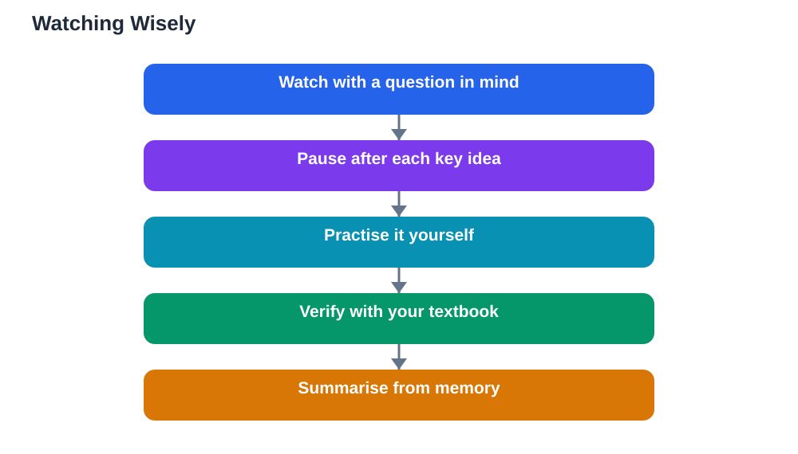

Video can be a wonderful teacher. A good explanation with visuals can make a difficult idea click in minutes, and a worked example shown step by step can succeed where a page of text failed. Yet many students watch hours of educational videos and remember little. The difference is not the videos. It is how you watch them. Watching wisely means pausing, practising, and verifying, instead of letting videos wash over you like entertainment. This guide shows how to turn video watching into real learning.

## Learning From YouTube Wisely: Watch Actively

The first rule of learning from video is simple: never just watch. Keep a notebook open and treat the video like a lesson, not a show. Pause whenever a new idea appears, and write it in your own words before continuing. If the video shows a worked example, pause before the solution is revealed and try it yourself first. This small habit changes everything, because trying first makes your brain work with the idea instead of merely recognising it. Watch at a pace that suits understanding, not speed: slowing a fast explanation down is smarter than watching it twice at full speed without understanding. If a section confuses you, rewind and watch it again, then write down exactly what is still unclear. Active watching takes longer per video, but it means you need far fewer videos to actually learn.

## Pause, Practise, Then Continue

A useful rhythm for study videos is pause, practise, continue. Pause the video after each key idea. Practise that idea immediately: solve a similar problem, repeat the explanation aloud, or draw the diagram from memory. Only then continue to the next idea. This rhythm works because memory strengthens when you retrieve an idea yourself, not when you hear it again. Watching a whole video in one go and then trying to remember it afterwards is much weaker. Keep your practice short and focused: one problem, one summary sentence, or one sketch per pause is enough. Over a single video, these small practices add up to genuine understanding. It also helps to watch with a question in mind, such as "What is the main idea of this video, and how would I explain it?" When the video ends, answer that question from memory before moving on to anything else.

## Verify With a Second Source

Videos are made by people, and people make mistakes, oversimplify, or present opinions as facts. Wise learners verify important ideas with a second source before trusting them fully. Your textbook is usually the best second source: check whether the video's explanation matches what your book says, especially for definitions, formulas, and steps in a method. If the video and the book disagree, trust the book and ask a teacher about the difference. A second video from a different creator can also help, particularly if it explains the same idea in a different way. Be cautious with videos that make dramatic claims, promise shortcuts that skip understanding, or present one person's opinion as settled fact. A good learning video explains its reasoning, shows its working, and admits where an idea is tricky. If you use AI tools to check textbook exercises, the same caution applies: verify solutions against your textbook, remember that AI can make mistakes, and note that the Lesson Solver tool needs your own free Google AI Studio API key.

## Choose Creators, Not Just Videos

One-off videos from random creators vary wildly in quality. A better approach is to find a few creators whose teaching style suits you and stick with them. A good creator explains ideas in steps, uses clear examples, corrects common mistakes, and keeps videos focused on one topic. Watch a full video before subscribing or saving a channel: a flashy thumbnail and a confident voice are not proof of good teaching. Check whether the creator's explanations match your textbook and whether their examples actually work when you try them. Once you have two or three trusted creators, your video time becomes far more productive, because you stop gambling on unknown quality. Avoid channels that spend more time on entertainment than explanation, and be honest with yourself about whether a video is teaching you or merely entertaining you. Both have their place, but only one counts as studying.

## Keep Video Time Under Control

Video platforms are designed to keep you watching, and the next recommended video is always tempting. Wise learners set boundaries before pressing play. Decide in advance how many videos you will watch and what you want to learn from them, and stop when you reach that goal. Turn off autoplay when studying, so each video is a deliberate choice rather than an automatic continuation. Keep your phone's other apps closed during a study video, and take a short break between videos instead of chaining them. A good test at the end of a study session is simple: can you explain, from memory, what the videos taught you? If you cannot, the session was entertainment, not study, and the fix is more pausing and practising, not more videos. For a broader plan for independent study, see [Learning on Your Own: A Beginner's Guide](/blog/learning-on-your-own-guide.html).

## AI Help: Muse AI

Muse AI is Meta's personal AI assistant, and it can help you learn from videos wisely by summarising a video's key ideas in simple words for you to check your own notes against. You can ask it to explain a point from a video differently, or to quiz you on what you just watched. Join Muse with invite code LTGSWD — in the Muse app, go to Settings > Redeem token and enter the code.
Disclosure: LTGSWD is the author's Muse invite code.

## FAQ

### How many times should I watch an educational video?

Once, actively, is usually better than three times passively. Pause, practise, and take notes during a single careful viewing, then revisit only the sections that were unclear. Rewatching an entire video without practising rarely adds much, because recognition feels like learning even when it is not.

### Should I take notes while watching a video?

Yes, but notes should be in your own words, not copied sentences. Pause the video, summarise the idea briefly, and continue. Notes written this way become a useful review tool later, while copied sentences only prove you can pause and type.

### How do I know if a video is trustworthy?

Check the explanation against your textbook, which is your most reliable second source, and see whether a second creator explains the idea the same way. Trust videos that show their working, explain their reasoning, and acknowledge tricky parts. Be cautious with videos that make dramatic claims or promise shortcuts without explanation.

### What if I keep getting distracted by recommended videos?

Turn off autoplay before you start studying, and decide in advance exactly which videos you will watch. Treat each video as a deliberate choice, and take a short break between videos rather than letting one roll into the next. If distraction keeps winning, try watching with a notebook and a written question to answer, which keeps your attention on learning.

## Conclusion

YouTube can be a powerful study tool when you watch wisely: pause often, practise each idea before continuing, and verify important points with a second source such as your textbook. Choose a few creators whose teaching you trust, set clear limits on video time, and always end a session by explaining from memory what you learned. Used this way, videos stop being a distraction and start being one of the most flexible teachers you have, available whenever you need a different explanation.

[Try the free AI lesson solver](/#tool)
