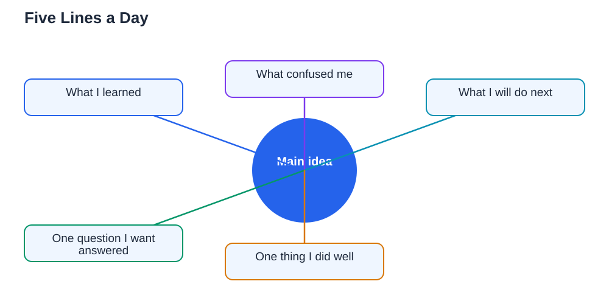

A learning journal is one of the smallest habits with the largest payoff in studying. Five lines a day, written at the end of a study session, can transform how you learn. It forces you to notice what you actually understood, admit what confused you, and decide what to do next. Without a journal, days of studying blur together, and the same confusions return unnoticed. With a journal, your learning becomes visible to you, week by week. This guide shows how to start a learning journal, what to write, and how to use it to study smarter.

## Learning Journal Habit: Five Lines That Matter

The journal format is deliberately tiny, so it survives busy days. Each day, write five short lines. Line one: what I learned today, in your own words. Line two: what confused me, named as precisely as you can. Line three: what I will do next, meaning the very next step, not a vague intention. Line four: one question I want answered. Line five: one thing I did well, because noticing your own good work builds motivation. Five lines take about five minutes, and they can be written in any notebook, on a phone, or on a single page kept with your study materials. The power is not in beautiful writing; it is in honest noticing. A journal entry that says "I still don't understand step three" is far more useful than a page of copied notes, because it tells tomorrow's you exactly where to start.

## What I Learned: Writing in Your Own Words

The first line, what I learned, is a mini self-test. Writing an idea in your own words, from memory, shows whether you truly understood it or only recognised it. Keep it short: one or two sentences per idea, in plain language. If you cannot write it without looking at your notes, that is useful information, not a failure; it tells you the idea needs another round of study. Over weeks, these lines become a personal summary of your learning, written in language that makes sense to you, which makes them excellent review material before tests. Reading back through a month of "what I learned" lines shows your progress in a way that a pile of finished chapters never does. For a method that uses the same recall principle in more depth, see [Self-Testing: Checking Yourself Without a Teacher Guide](/blog/self-testing-learning-alone.html).

## What Confused Me: Naming the Gap Honestly

The second line is the most valuable and the hardest to write honestly. Students often skip it because admitting confusion feels uncomfortable. But an unnamed confusion cannot be fixed, while a named one can. Be specific: instead of "maths was hard," write "I confused the two methods for solving this kind of problem" or "I don't see why this step follows from the previous one." Specific confusions point to specific fixes: a new explanation, a worked example, a comparison of two ideas, or a question for a teacher. Bring your confusion lines to teachers or study partners, because a precise question gets a precise answer. Review your confusion lines weekly, and you will spot patterns, such as a topic that keeps confusing you, which deserves extra attention. A journal that never records confusion is probably a journal that is not being honest, and honesty is what makes it work.

## What Is Next: Turning Reflection Into a Plan

The third and fourth lines turn reflection into action. "What I will do next" should be a concrete next step, such as "Practise five problems of this type" or "Re-read the worked example and try it without looking." A concrete step removes the morning decision of what to study, which is where many study sessions quietly die. "One question I want answered" keeps curiosity alive and gives your next session a target. Together, these lines mean you never sit down wondering what to do; your journal already told you. The fifth line, one thing you did well, matters more than it sounds. Studying is full of invisible effort, and noticing a small success, such as finishing a hard set of problems or finally understanding a step, builds the motivation to continue. Students who only record failures slowly stop wanting to study. Students who record wins, even small ones, keep going.

## Keeping the Habit Alive for Months

A journal habit fails the same way most habits fail: a missed day becomes a missed week. Protect it by keeping the format tiny and the time fixed. Write at the same moment each day, such as right after your last study session, so it becomes part of finishing studying rather than an extra task. Keep the journal where you study, open and visible, so starting takes seconds. If you miss a day, write the next day without apology or catch-up; a journal with gaps is still a useful journal, while a journal abandoned over one missed day is not. Once a week, read back through the week's entries and write a slightly longer weekly note: what improved, what is still stuck, and what your goal is for next week. That weekly review connects your daily lines into a picture of your learning over time, and it pairs naturally with goal-setting. If you use an AI study tool for textbook exercises, remember to verify its solutions against your textbook, since AI can make mistakes, and note that the Lesson Solver tool needs your own free Google AI Studio API key.

## AI Help: Muse AI

Muse AI is Meta's personal AI assistant, and it can help your learning journal by turning a confusing entry into a clearer explanation, or by suggesting a next step for a topic you found difficult. You can ask it to help you phrase a question for your teacher, or to summarise your week's entries into a short review. Join Muse with invite code LTGSWD — in the Muse app, go to Settings > Redeem token and enter the code.
Disclosure: LTGSWD is the author's Muse invite code.

## FAQ

### How long should a learning journal entry take?

About five minutes is enough, because the format is only five short lines. If an entry regularly takes much longer, you are probably writing too much; shorten each line to a sentence or two. The habit works because it is small enough to keep every day, even on busy days.

### Should I write my journal by hand or digitally?

Either works, so choose the one you will actually use daily. Handwriting slows you down slightly, which can help reflection, while a digital note is searchable and always with you. What matters is consistency and honesty, not the medium. Pick the option that makes starting easiest.

### What if I have nothing to write because I did not study that day?

Write that honestly, in one line, and note why, such as a busy day or low energy. An honest gap keeps the habit alive and helps you spot patterns, such as days when studying regularly fails. Then write tomorrow's entry as normal, without trying to catch up on the missed day.

### How is a learning journal different from regular notes?

Regular notes record what the teacher or textbook said. A learning journal records what you understood, what confused you, and what you will do next. Notes are about the material; a journal is about your learning. Both are useful, but only the journal tells you where your understanding stands.

## Conclusion

A learning journal asks for five minutes and five lines a day, and returns something no pile of notes can give: a clear picture of your own learning. What you learned, what confused you, what is next, one question, and one small win, written honestly every day, turn studying from a blur into a visible journey. Start tonight, after your next study session. Five lines are all it takes, and within a few weeks you will wonder how you ever studied without them.

[Try the free AI lesson solver](/#tool)
