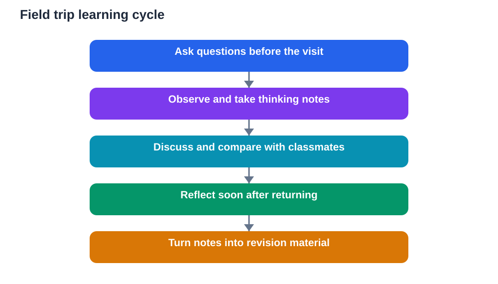

A field trip can feel like a break from lessons, but it can also be one of the most memorable ways to learn. When you see, hear, and touch real things, ideas that felt flat in a textbook suddenly make sense. A machine, a plant, a building, or a workshop becomes easier to remember because you were actually there. The difference between a pleasant day out and a powerful learning day is rarely the place itself. It is the preparation before you go, the attention you pay while you are there, and the short reflection you do when you return.

Many students arrive at a visit with no questions in mind. They walk around, look at everything briefly, and leave with a few photos and very little they can explain later. That is a missed chance. A field trip gives you evidence for your learning: things you observed yourself, questions you asked, and connections you made. If you treat it like a lesson that happens outside, you will return with material you can use in homework, revision, and class discussion for weeks afterwards.

## Ask Questions Before You Leave

Good learning on a field trip starts before the journey. Look at what your class has been studying and write down a small set of questions you genuinely want answered. What do you already know about the topic, and what puzzles you? A question gives your eyes a job. Instead of wandering and glancing at everything, you start looking for specific answers, and you notice details other people walk past.

Keep your questions open and curious rather than questions that need only a yes or no answer. Ask how something works, why it was made that way, what problem it solves, or what would happen if one part changed. Write your questions in a notebook you will actually carry. If you keep them only in your head, the excitement of the day will push them out. A short list is better than a long one, because it leaves room for surprises you did not expect.

## Look for Connections to Your Lessons

During the visit, keep asking yourself how what you see links to what you have already learned. A process you studied in class may look quite different in real life, with extra steps, safety checks, or materials you had not imagined. A pattern from a lesson may appear in an unexpected place. Noticing these links is real understanding, not just memorisation, because you are matching an idea to evidence in front of you.

When you spot a connection, write it down in your own words straight away. Note what you saw, why it reminded you of a lesson, and what was new or different. This habit turns a visit into a set of examples you can reuse later. When you later explain a concept, you will be able to say what you saw and why it mattered, which is far stronger than repeating a definition.

## Take Notes That Capture Thinking

Notes on a field trip should capture thinking, not just labels. Copying every label or sign is slow and rarely useful, because you can usually find that information later. What you cannot recover later is what you noticed, what surprised you, and what questions came to mind. Those are the notes worth making. A quick sketch, a few key words, and a short sentence about why something mattered will help you far more than pages of copied text.

Try to record observations, questions, and ideas separately so they do not blur together. Observations describe what you actually saw. Questions record what you still want to know. Ideas record what you think it means. This simple split keeps your notes honest and useful. It also makes revision easier, because you can see what is evidence, what is still open, and what is your own interpretation.

## Talk, Ask, and Compare Notes

Learning grows when you talk about it. Compare what you noticed with a classmate and you will often find that you each saw different things. One person may have noticed a detail, another may have heard an explanation, and a third may have asked a question that changed how everyone understood the visit. Sharing observations fills gaps and corrects misunderstandings while the experience is still fresh.

Do not be shy about asking questions during the visit. Guides and staff usually enjoy thoughtful questions, and a good question often leads to an explanation that no label could give. Listen carefully to the answer, note the key point, and follow up if something is still unclear. Asking is not a sign of weakness. It is how curious learners turn a display into understanding.

## Reflect Soon After You Return

Reflection is the step most students skip, and it is the step that locks learning in place. Soon after the trip, while memories are still vivid, spend a short while writing what you learned, what surprised you, and what you still wonder about. You do not need a long essay. A clear, honest paragraph for each point is enough, as long as it is in your own words.

Reflection also helps you spot what did not make sense. If you cannot explain something you saw, that is useful information. It tells you exactly what to review, what to ask about in class, and what to look up. Without reflection, a field trip fades into a pleasant memory. With reflection, it becomes knowledge you can explain, use, and build on.

## Turn the Day Into Study Material

Once you have reflected, turn your notes into something you can revise from. You could write a short summary, make a set of questions for yourself, draw a simple diagram of a process you saw, or prepare two or three points to share in class. The format matters less than the act of turning scattered notes into organised understanding.

Check your summary against your textbook and class notes. Where your visit confirms what you learned, note the example. Where it adds something new, add it carefully, and remember that any tool or helper can make mistakes, so verify important details against your textbook before using them in homework. This checking habit keeps your field trip learning accurate and trustworthy.

## AI Help: Muse AI

Muse AI is Meta's personal AI assistant, and it can help you prepare for and reflect on a field trip. You can ask it to turn your rough notes into clear questions before a visit, or to help you organise your reflections afterwards into a tidy summary. It is a helpful study companion for planning, explaining ideas simply, and drafting revision notes.

Join Muse with invite code LTGSWD — in the Muse app, go to Settings > Redeem token and enter the code.

Disclosure: LTGSWD is the author's Muse invite code.

## FAQ

### How do I prepare for a field trip the night before?

Read over the related lesson briefly, write a small set of open questions, and pack a notebook and pen. Knowing what you want to find out makes the whole visit more focused, and a notebook lets you capture thoughts that photos alone cannot hold.

### What should I write down during a visit?

Write what you observed, what surprised you, what questions came to mind, and how things connect to your lessons. Short notes in your own words, plus quick sketches, are far more useful later than copying long labels word for word.

### What if I cannot understand something I see?

Note exactly what confused you and ask a guide, a teacher, or a classmate while you are still there. If it remains unclear, write it as an open question to follow up in class, because naming the confusion is the first step to resolving it.

### How soon should I reflect after a field trip?

Reflect the same day if you can, while details and feelings are still fresh. Even a short reflection that evening will preserve far more learning than waiting several days, when small observations have already faded.

### Can a field trip help with homework later?

Yes, when you keep useful notes and a reflection. Real examples from a visit make explanations stronger, give you concrete details to write about, and help you remember ideas because you connect them to something you experienced yourself.

## Conclusion

A field trip is more than a day out when you prepare questions, observe with purpose, talk about what you see, and reflect soon afterwards. Each of these habits is small on its own, but together they turn a visit into lasting understanding. Take your notebook, stay curious, and let the day teach you something you can explain long after you return.

[Try the free AI lesson solver](/#tool)
