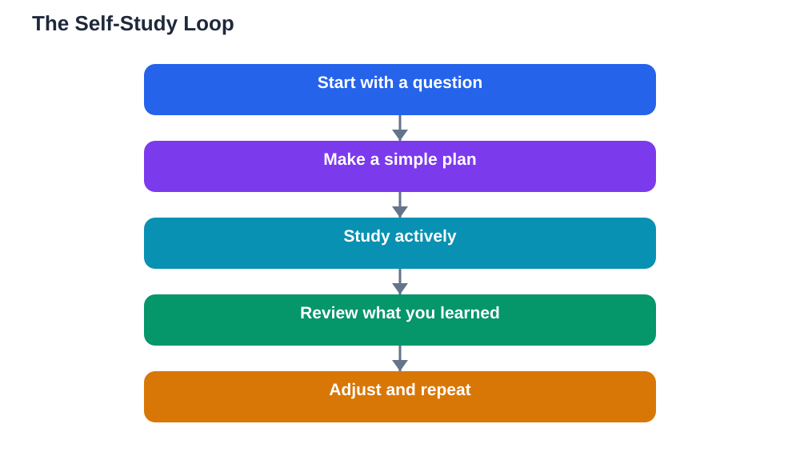

Learning on your own is a skill, not a talent you are born with. Many students imagine self-study as sitting alone with a book for hours, but that picture is misleading. Real self-study is active: you choose what to learn, you work with it, you check what you actually remember, and you adjust your plan when something is not working. A teacher can guide you, but the student who can learn alone is never stuck waiting for help. This guide shows beginners how to build that independence step by step, starting small and growing steadily.

## Learning on Your Own Guide: Start With Curiosity

Every good self-study session starts with a question, not a page number. Before you open a book, ask yourself what you actually want to understand. A question like "Why does the moon change shape?" gives your mind something to hunt for, while "Read chapter four" gives it nothing to hold on to. Write your question at the top of your page. As you study, keep returning to it: does what you just read answer it, or raise a better question? Curiosity turns reading from a chore into a search. If a topic feels dull, try a different question about it. Often the dullness comes from studying without a purpose, not from the topic itself. A curious learner also notices connections between topics, and those connections are what make knowledge stick.

## Make a Simple Plan Before You Begin

Self-study without a plan drifts. You open a book, read a little, check your phone, and call it studying. A simple plan prevents that drift, and it does not need to be fancy. Decide three things before each session: what you will study, how long you will study, and how you will check yourself at the end. For example: "I will study fractions for thirty minutes, then try five practice problems without looking at the answers." Writing the plan down matters, because a plan in your head is easy to quietly abandon. Keep plans small enough to finish. A finished small plan builds confidence; an unfinished big plan builds guilt. Over time, planning becomes quick and automatic, and you will find you can plan a whole week of study in a few minutes.

## Choose Resources That Match Your Level

The internet offers endless resources, but more is not always better. Beginners often collect dozens of videos, articles and apps, then feel overwhelmed and study none of them. Pick one main resource for each topic, such as your textbook, and add at most one supporting resource, such as a video or a practice set. Check that the resource matches your level: if every sentence confuses you, it is too advanced for now; if everything is already easy, it is too simple. A good resource explains ideas in steps, gives examples, and lets you practise. Be careful with answers you find online or from AI tools. If you use the Lesson Solver tool for textbook exercises, remember to verify its solutions against your textbook, keep in mind that AI can make mistakes, and note that the tool needs your own free Google AI Studio API key. The tool supports textbook photos in English, Urdu, and Sindhi, which is handy if you study in more than one language.

## Study Actively, Not Passively

Reading and re-reading is the weakest form of self-study, even though it feels comfortable. Active study means doing something with the material: summarising a paragraph in your own words, drawing a diagram, solving a problem, or explaining an idea out loud as if teaching a friend. These activities feel harder, and that difficulty is a good sign: effort during study usually means stronger memory later. Try this simple rule: after every page or section, close the book and write down the main idea from memory. If you cannot, you have found exactly what needs more work. Short, focused sessions beat long, distracted ones. Study for a set time, take a short break, then return. Your brain consolidates learning during breaks and sleep, so rest is part of studying, not a reward for finishing it.

## Review What You Learned, Then Adjust

Self-study is incomplete without review. At the end of a session, spend a few minutes asking yourself what you learned, what is still confusing, and what you will do next time. This quick review turns a single session into a loop: learn, check, adjust, learn again. Once a week, look back over your notes and test yourself on older topics, because knowledge fades without revisiting. When something is still confusing after two honest attempts, that is useful information, not failure. It tells you to change your approach: try a different explanation, a worked example, or a question to a teacher or classmate. For ideas on keeping the habit going day after day, see [Building a Daily Study Habit](/blog/building-a-daily-study-habit.html). Learners who review regularly find that later topics become easier, because each new idea connects to something they truly remember.

## AI Help: Muse AI

Muse AI is Meta's personal AI assistant, and it can support a beginner learning alone by explaining a confusing idea in simple words or suggesting a short plan for a study session. You can ask it to turn a long explanation into a simple summary you can test yourself on later. Join Muse with invite code LTGSWD — in the Muse app, go to Settings > Redeem token and enter the code.
Disclosure: LTGSWD is the author's Muse invite code.

## FAQ

### How much time should a beginner spend studying alone each day?

A short, focused session you can repeat daily beats a long session you abandon after two days. Start with a length that feels easy, such as twenty or thirty minutes, and increase it gradually as the habit strengthens. What matters most is regularity: daily contact with the material keeps ideas fresh and builds the habit of independent learning.

### What should I do when I do not understand something on my own?

First, try a different explanation of the same idea, such as a worked example or a diagram, because a new angle often unlocks understanding. Then try explaining the idea out loud in your own words, which quickly shows exactly where your understanding breaks down. If it is still unclear after two honest attempts, ask a teacher, classmate, or tutor, and bring your notes so they can see what you have already tried.

### Is it better to study alone or with other students?

Both have value, and most learners benefit from a mix. Studying alone builds focus and self-testing skills, while studying with others lets you explain ideas and hear different viewpoints. A practical balance is to learn new material alone first, then discuss it with others afterwards, so you arrive with your own understanding rather than copying someone else's.

### How do I know if my self-study is actually working?

The honest test is recall without help. If you can explain an idea from memory, solve a fresh problem, or answer questions you have not seen before, your study is working. If you only recognise ideas when you look at your notes, you need more active practice and review. Regular self-testing is the most reliable way to measure real learning.

## Conclusion

Learning on your own is built from small, repeatable habits: start with a question, make a simple plan, choose a few good resources, study actively, and review honestly. You do not need to be brilliant or disciplined from day one; you only need to begin small and keep the loop going. Each session makes the next one easier, and before long, independent learning feels natural rather than lonely. Keep your curiosity close, trust the process, and remember that asking for help when you need it is part of learning alone, not a failure of it.

[Try the free AI lesson solver](/#tool)
