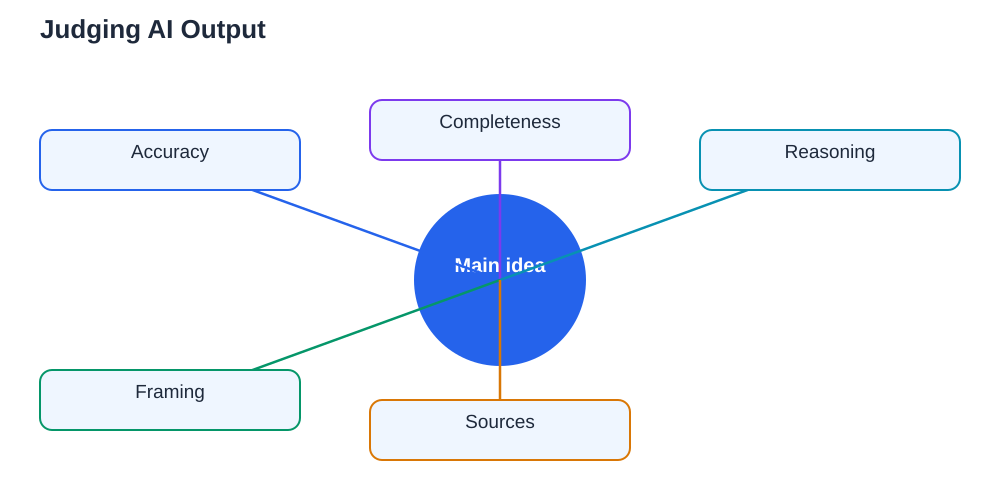

A newly approved university AI learning module makes an important pairing explicit: practical AI use on one side, critical assessment of AI-generated material on the other. Students learn to use AI tools and, in the same course, to judge what those tools produce. That pairing deserves to become standard for every student, at every level, because AI output is now part of daily study life. The skill is not technical. It is the old academic skill of source criticism, applied to a new kind of source: one that writes fluently, sounds confident, and can be wrong in ways that are hard to spot. Learning to judge AI output is no longer an optional extra. It is a core student skill, like reading critically or checking a calculation.

## Practical Use and Critical Assessment Belong Together

Teaching AI use without teaching judgement produces confident misuse: students who can generate long answers quickly but cannot tell a good one from a bad one. Teaching judgement without practical use produces fear without competence: students who distrust everything but cannot use the tools well when they need them. The two halves need each other. Practical use teaches you what tools are good at: brainstorming, explaining, drafting, organising, and giving feedback on your own work. Critical assessment teaches you where they fail: invented facts, outdated claims, biased framing, oversimplified explanations, and answers that sound complete while missing the key point. A student who has both can move fast without being fooled, which is exactly the combination modern study demands.

## Four Checks for Any AI Answer

Judge an AI answer with four quick checks before you use it. First, accuracy: can you verify the key claims against your textbook, class notes, or another reliable source? Second, completeness: does the answer address the whole question, or has it quietly skipped the hard part? Third, reasoning: do the steps actually follow from each other, or does a confident conclusion rest on a shaky step? Fourth, framing: is the answer neutral, or does it present one view as if it were the only view? Run these checks most strictly on anything you will submit, repeat in an exam, or build further work on. For lighter uses, such as brainstorming, a looser check is fine — but never let an unchecked brainstorm become a final answer. For more on verification habits, see [Checking AI Output for Study](/blog/checking-ai-output-study.html).

## Spot the Warning Signs of Weak Output

Weak AI output has recognisable fingerprints. Watch for vague generalities where you asked for specifics, and for long answers that repeat the question in different words without adding substance. Watch for claims without sources, examples that feel invented, and steps that jump from one idea to the next without explanation. Watch for overconfidence: an answer that presents a debated point as settled fact, or that never mentions limits, exceptions, or uncertainty. Watch for style over substance: polished formatting, confident headings, and bullet points can make a shallow answer look thorough. When several of these signs appear together, slow down and verify before you trust anything in the answer. A good answer survives checking; a weak one falls apart under it, and that is useful information.

## Judge, Then Improve, Then Decide

Judgement is not only about rejecting bad output; it is about improving useful output. When an answer is partly right, identify the strong part and the weak part separately. Keep the clear explanation, discard the invented example, and fill the gap from your textbook. Ask a follow-up question that targets the weakness: ask for the source, ask for a worked example, or ask how the answer would change under different conditions. Compare two different answers to the same question and note where they disagree — disagreement is a map of what needs checking. Finally, decide as a human: what will you keep, what will you correct, and what will you discard? That decision is the learning. A student who judges and improves an AI answer has understood the topic far better than a student who merely copies a perfect one.

## Build the Skill Into Every Subject

AI judgement is not a separate subject to study once and forget. Practise it wherever you already study. In science, check AI explanations against experiments and worked examples. In language work, check AI writing for tone, accuracy, and originality, and rewrite it in your own voice. In history and social topics, check AI summaries for balance and missing perspectives. Keep a small log of AI errors you catch — invented facts, misread questions, plausible but wrong steps — and review it occasionally. You will start to recognise your own most common traps, and the tools' most common failures. That log is a personal textbook on critical thinking, written from your own experience, and it will serve you long after any particular tool has changed.

## AI Help: Muse AI

Muse AI is Meta's personal AI assistant, and it can help you practise judging AI output. You can ask it to explain a claim in two different ways so you can compare them, or to suggest what to check when an answer seems too smooth to be true. Join Muse with invite code LTGSWD — in the Muse app, go to Settings > Redeem token and enter the code.
Disclosure: LTGSWD is the author's Muse invite code.

## FAQ

### Why is judging AI output a core student skill now?

Because AI output is part of daily study, and it can be fluent while being wrong. Students who cannot judge it will absorb errors and submit work they do not understand. Students who can judge it use AI safely and learn more from every interaction.

### What are the quickest checks for an AI answer?

Check accuracy against a reliable source, check completeness against the full question, check whether the reasoning steps actually follow, and check whether the framing is neutral. Apply all four strictly to anything you will submit or use in an exam.

### How can I tell if an AI answer is weak?

Look for vague generalities, repetition without substance, claims without sources, invented examples, unexplained jumps in reasoning, and overconfident treatment of debated points. Polished formatting can hide all of these, so judge content, not presentation.

### Should I stop using AI if I find errors in its output?

No, errors are a reason to judge more carefully, not to abandon the tool. Keep the strong parts, correct the weak parts from your textbook, and use follow-up questions to target weaknesses. The process of judging and improving is itself valuable learning.

## Conclusion

Practical AI use and critical assessment belong together, and the student who masters both has a real advantage. Judge every important AI answer for accuracy, completeness, reasoning, and framing. Spot the warning signs of weak output, improve what is partly right, and make the final decision yourself. That habit will protect your learning now and your judgement for years to come. If you use the Lesson Solver tool for textbook exercises, remember to verify its solutions against your textbook, keep in mind that AI can make mistakes, and note that the tool needs your own free Google AI Studio API key.

[Try the free AI lesson solver](/#tool)
