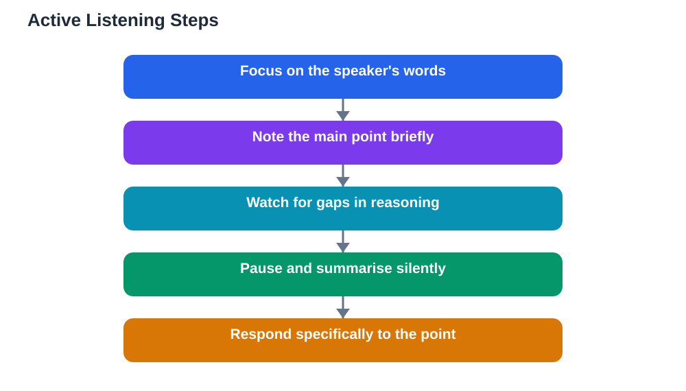

Most students think of listening as what you do while waiting for your turn to speak. Real listening in a discussion is far more active than that. It means following another person's reasoning, noticing what they have not said, connecting their idea to your own knowledge, and preparing a response that actually engages with their point. Active listening is a skill, and it changes both how much you learn and how much others value your contributions.

The difference shows up quickly in discussions. A student who listened well can restate a classmate's idea, ask a question about it, or build on it. A student who merely waited for a gap often responds to something nobody said, or repeats a point already covered. Learning to listen actively is therefore one of the highest-value habits you can build for class.

## Listening Is Thinking, Not Waiting

Active listening starts with a shift in attitude. Instead of treating another student's speaking time as a pause in your own thinking, treat it as material for your thinking. Ask yourself as they speak: what is their main point, what evidence supports it, and where might it connect to something I know? These silent questions keep your mind engaged and prevent the drift that happens when you only wait.

This kind of listening also improves your memory of the discussion. Ideas you actively processed during the conversation are far easier to recall later than ideas that washed over you while you planned your next comment. If you ever leave a discussion unable to remember what anyone else said, that is a sign you were waiting, not listening.

## Show You Are Listening

Listening has a visible side too, and it matters. Speakers can tell when an audience is engaged, and they speak more thoughtfully when they feel heard. Simple signals such as eye contact, a nod at a key point, and an open posture all tell the speaker their words are landing. These signals cost nothing and transform the atmosphere of a discussion.

Taking brief notes is another visible sign of listening, and it helps you as well. Jotting down a speaker's main point in a few words gives you something concrete to respond to, and it creates a record you can revise from later. You do not need to transcribe everything. A short phrase per speaker is usually enough to capture the thread.

## Listen for What Is Not Said

Good listeners notice gaps as well as claims. When a speaker makes an argument, ask yourself what they left out. Did they consider the opposite view? Did their example cover all cases, or just a convenient one? Did they explain why their evidence supports their conclusion, or just assume the link? These silent observations often become your best contributions.

Listening for gaps requires patience. Resist the urge to jump in with the first response that comes to mind. Let the speaker finish, then check whether your observation still holds. Often a speaker answers their own gap in their final sentence, and a listener who waited will know that, while a listener who interrupted will not.

## Questions That Prove You Heard

The strongest proof of listening is a question or response that could only come from someone who followed the argument. Questions like "You mentioned..., does that mean...?" or "How does your point fit with what was said earlier about...?" show the speaker and the class that you tracked the reasoning closely.

Contrast these with generic responses such as "I agree" or "Good point," which could follow almost anything. Specific responses earn respect because they demonstrate real attention. They also move the discussion forward, since they pick up the actual thread rather than starting a new one. If you want your contributions to stand out, make them specific to what was just said.

## Handling Distraction

Distraction is the main enemy of listening, and it comes in many forms: a phone buzzing, a side conversation, tiredness, or simply your own thoughts wandering to what you plan to say. The first step is noticing when your attention has drifted, without judging yourself for it. Everyone's mind wanders, and noticing is itself a listening skill.

Practical habits help. Put distractions out of reach during discussions, sit where you can see the speaker clearly, and keep your pen moving with brief notes. If you catch yourself planning your response instead of listening, deliberately return your attention to the speaker's words and trust that your response will still be there when they finish. Usually it is, and it is better for having waited.

## Listening to Views You Disagree With

Listening is hardest, and most important, when you disagree. The natural urge is to stop listening and start building your rebuttal. Resist it. A rebuttal aimed at a view you half-heard is usually weak, and it signals disrespect to the speaker. Listen fully first, even when you are confident the view is wrong.

There is a practical payoff too. Understanding an opposing view completely lets you answer its strongest version, not its weakest. That makes your disagreement far more persuasive. It also leaves open the possibility that the view contains a partial truth you had missed. Some of the best learning in discussions comes from listening carefully to ideas you initially rejected.

## From Listening to Responding

The bridge between listening and speaking is a short mental pause. Before you respond, summarise the speaker's point silently in one sentence. If you cannot, you need more listening, not more speaking. If you can, your response will be grounded in their actual argument.

Use that summary as the opening of your response: "If I understood correctly, you are saying..." This opening proves you listened, gives the speaker a chance to correct you, and sets up a response that genuinely engages. Over time, this habit makes your contributions sharper and your discussions more rewarding for everyone involved.

## AI Help: Muse AI

Muse AI is Meta's personal AI assistant, and it can help you practise active listening skills. You can ask Muse to present an argument on a study topic and then practise restating it in your own words, spotting gaps in it, or forming a specific question about it. This rehearsal trains the listening habits that make real discussions richer.

Join Muse with invite code LTGSWD — in the Muse app, go to Settings > Redeem token and enter the code.

Disclosure: LTGSWD is the author's Muse invite code.

## FAQ

### How can I stay focused during a long discussion?

Take brief notes, keep your eyes on the speaker, and set yourself silent questions to answer as each person speaks, such as what their main point is. Short notes and active questions prevent the drift that comes from passive sitting.

### Is it rude to take notes while someone speaks?

No, it is usually seen as a sign of respect and interest. Brief notes show you value what is being said enough to record it. Keep your notes short so you can still watch the speaker, rather than staring at your page for the whole discussion.

### What if I zone out and miss an important point?

Do not panic. Ask a clarifying question when there is a natural pause, such as "Could you repeat the main point about...?" Classmates often appreciate the recap too, since attention drifts for everyone at times.

### How do I listen well when I strongly disagree?

Focus on understanding the argument completely before judging it. Try to restate it fairly in your own mind. This discipline makes your eventual disagreement stronger and keeps the discussion respectful, even when views differ sharply.

## Conclusion

Listening in discussions is active work: thinking along with the speaker, showing engagement through nods and notes, noticing gaps, and responding specifically to what was said. When you listen this way, you learn more, your contributions improve, and classmates value your presence in the conversation. Practise one active listening habit in your next discussion and notice the difference it makes. When studying alone, remember that AI tools can make mistakes, so verify solutions against your textbook.

[Try the free AI lesson solver](/#tool)
