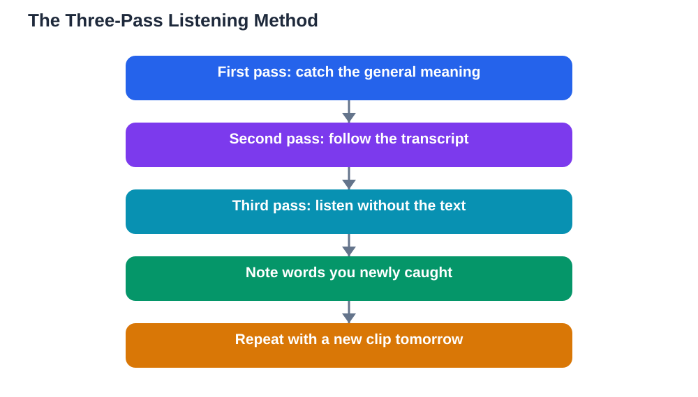

Listening practice in a new language is ear training, and like any training, it works best when it is deliberate, gradual, and regular. Many learners play hours of audio in the background and wonder why their understanding barely improves. The problem is not the amount of listening, it is the kind: passive hearing washes over you, while active listening trains your ear to catch sounds, words, and patterns. The good news is that ear training does not require special talent. It requires short, focused sessions, material at the right level, and a few simple steps that turn hearing into understanding.

## Listening Practice New Language Ear Training: Start Slow and Short

Your ear needs time to adjust to a new sound system, so start with slow, clear material and short sessions. Short dialogues, slow narrated stories, or simple conversations are ideal, because they let you hear individual words instead of a blur of sound. Listen to a short clip several times rather than a long clip once, since repetition is what teaches your ear to recognise words. A focused session of a few minutes, done daily, trains your ear far better than an hour of background audio. As understanding grows, gradually increase speed and length, but only when the current level feels comfortable. Pushing into fast, difficult material too early teaches frustration, not listening, so let comfort guide your pace upward.

## The Three-Pass Method for Any Clip

One of the most effective listening routines is the three-pass method, and it works with almost any short clip. On the first pass, listen without reading anything, and simply try to catch the general meaning and any words you recognise. On the second pass, listen while following a transcript or subtitles, and notice the words you missed and how sounds connect in natural speech. On the third pass, listen again without the transcript, and see how much more you understand now that your ear knows what to expect. This method works because each pass has a different job: meaning first, detail second, and confident understanding third. Keep a small list of words you caught on the third pass but missed on the first, because those words are exactly what your ear is learning.

## Songs, Shows, and Stories as Ear Training

Songs, shows, and stories are excellent ear training because they are enjoyable enough to repeat, and repetition is the heart of listening progress. Songs are especially useful for rhythm and pronunciation, since melody and repetition make phrases memorable. Start with slow songs and simple lyrics, and sing along once you know the words, because singing trains both ear and mouth together. Shows and stories offer natural dialogue and everyday expressions, but choose material close to your level, and watch or listen in short sections rather than whole episodes. Pause often, replay lines you missed, and shadow the speakers by repeating their lines quietly right after them. Enjoyment matters here: material you like is material you will return to, and returning is what builds an ear.

## What to Do When Speech Sounds Too Fast

Fast speech feels overwhelming because spoken language connects sounds together, drops some sounds, and runs words into each other. This is normal, and it is a skill your ear learns with practice, not a sign that you lack ability. When speech feels too fast, slow it down if your player allows it, and listen to short sections repeatedly until the blur separates into words. Focus on catching key words first, such as nouns and verbs, rather than trying to hear every single word, because key words usually carry the meaning. Reading the transcript after a difficult section also helps, since knowing what was said teaches your ear what to listen for next time. Over weeks of this practice, speech that once sounded impossibly fast will start to feel merely quick, and then normal.

## Building Listening Into Your Daily Routine

Listening practice fits easily into daily life if you keep sessions small and attach them to existing habits. Listen to one short dialogue with breakfast, a song on a walk, or a short story before bed, and keep the total daily time modest but regular. Vary your material across the week so your ear meets different voices, speeds, and topics, because variety prevents your ear from getting used to only one speaker. Keep a simple listening log: the clip, what you understood on the first pass, and one new word or phrase you caught. This log makes progress visible, which keeps motivation alive during the slow early weeks. For app options that support listening, see [Language Apps Compared: What Each One Does Best](/blog/language-apps-compared-students.html). If you use the Lesson Solver tool for textbook listening exercises, remember to verify its solutions against your textbook, keep in mind that AI can make mistakes, and note that the tool needs your own free Google AI Studio API key.

## AI Help: Muse AI

Muse AI is Meta's personal AI assistant, and it can support your listening practice in a simple way. You can ask it to explain a phrase you heard but did not understand, or to write a short, slow dialogue on a topic you can listen to and practise with. Join Muse with invite code LTGSWD — in the Muse app, go to Settings > Redeem token and enter the code.
Disclosure: LTGSWD is the author's Muse invite code.

## FAQ

### Why can I read a language better than I can understand it spoken?

Reading gives you time to pause, reread, and think, while listening happens in real time with connected sounds and no pauses. Your ear simply needs separate training, because recognising a word on paper and recognising it in fast speech are different skills. Regular active listening closes this gap over time.

### Should I use subtitles or transcripts when listening?

Subtitles and transcripts are helpful tools, especially on the second pass of a clip, because they show you the words your ear missed. The key is not to depend on them permanently: listen without them first and last, so your ear does the work, and use the transcript in the middle to fill gaps. Over time, you will need them less and less.

### How long does it take to understand spoken language comfortably?

Progress depends on how much active listening you do and how close the material is to your level, so there is no single timeline. Most learners notice clear improvement within weeks of daily short sessions, especially with the three-pass method. Comfort grows gradually, speaker by speaker and topic by topic, rather than arriving all at once.

### Is background listening while doing other things useful?

Background listening is pleasant and can keep you in touch with the sounds of the language, but it teaches much less than focused listening. Treat it as a bonus on top of short active sessions, not as a replacement for them. Your ear improves fastest when you listen with attention, repeat difficult parts, and check what you missed.

## Conclusion

Training your ear is a gradual, rewarding process built on short, active sessions rather than long, passive hours. Start slow, use the three-pass method, enjoy songs and stories at your level, and tackle fast speech in small, repeated sections. With daily practice, the blur of sound will steadily separate into words, sentences, and meaning, and listening will change from the hardest skill into one of the most enjoyable.

[Try the free AI lesson solver](/#tool)
