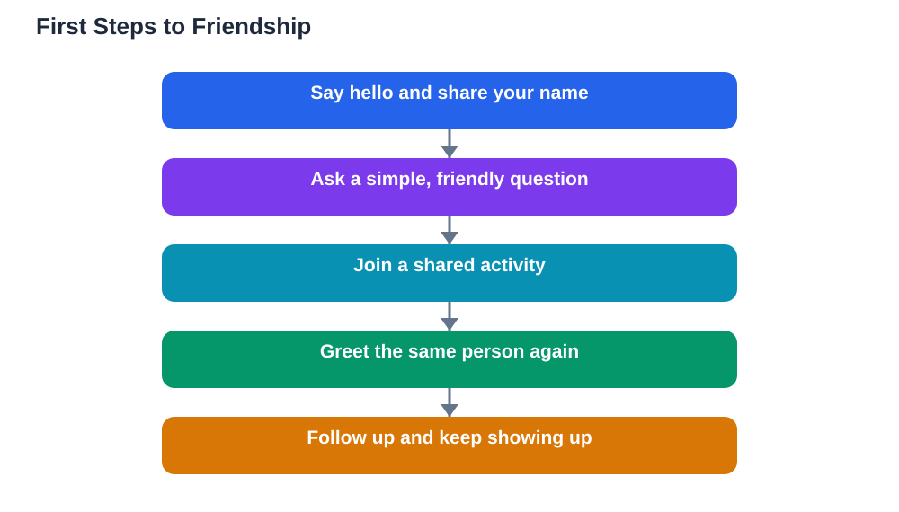

Making friends in a new school can feel exciting and scary at the same time. Everything is unfamiliar: the rooms, the routines, and the faces around you. It helps to remember that most other students have felt exactly the same way at some point, even the ones who look confident. Friendship rarely arrives in one dramatic moment. It usually grows from small, repeated moments: a hello in the hallway, a shared laugh over a lesson, or sitting beside the same person twice. You do not need to impress everyone or change who you are. You only need a few friendly habits, repeated patiently, and the courage to take the first small step.

## Making Friends New School: Start With Simple Introductions

A good introduction is short, warm, and easy to answer. Your name, one friendly question, and a smile are enough. Try lines such as "Hi, I am new here. What is your name?" or "Hi, can I sit here?" These openers work because they give the other person something simple to respond to. Avoid rehearsing a long speech about yourself, since conversations grow better when both people take turns. After someone answers, follow up with a small question about something you share, such as a lesson, a hobby, or what they enjoy doing after school. If you forget a name, that is normal. Just ask again kindly, and most people will be happy to repeat it. For more ideas on speaking up in class, see [Asking Questions in Class With Confidence](/blog/asking-questions-in-class-confidence.html).

## Join In Without Forcing It

Joining in works best when you look for natural openings rather than pushing into a closed group. Sit near others at lunch, join a group activity, or offer a small, useful help, such as sharing a pen or explaining a step you understood. Shared activities make conversation easier because you have something to talk about besides yourselves. If a group seems busy, do not take it personally. Try another group, or talk to one person first rather than a whole crowd. One friendly connection often leads to more, because that person can introduce you to others. Keep showing up in the same places, since familiarity itself builds comfort over time.

## Be Yourself, Even When You Feel Nervous

Trying to copy others in order to fit in usually backfires, because it is hard to keep up and it hides what makes you interesting. Being yourself does not mean sharing everything at once. It means letting your real interests, humour, and kindness show in small ways. Mention a book you liked, a game you enjoy, or a hobby you practise, and notice who lights up at the same things. Those shared interests are the strongest ground for friendship. If someone does not share your interests, that is useful information, not a rejection. You are looking for people who enjoy you as you are, and there are usually more of them than it first seems.

## Handle Awkward Moments With Kindness

Awkward moments happen to everyone who is new. You might sit at the wrong table, mispronounce a name, or say something that lands flat. The best response is a light, kind recovery: smile, laugh gently at yourself, and move on. Most people forget small awkward moments far faster than you do, and handling them calmly actually makes you easier to be around. If you feel embarrassed, take a slow breath and remind yourself that one moment does not define you. You can also read about sorting out friendship bumps in [Friendship Conflicts and How to Solve Them](/blog/friendship-conflicts-solutions.html). Treat others with the same patience you would want for yourself, and awkward days will pass more quickly.

## Keep Friendships Growing After the First Hello

A first hello is only the beginning. Friendships grow when you follow up: greet the same person again the next day, remember something they told you, and ask about it later. Small acts of reliability matter a great deal. Keep promises, listen when someone speaks, and show up when you said you would. You do not need to spend every break together, and healthy friendships leave room for other friends too. If a friendship fades, do not panic. Some connections are brief, and others deepen slowly over weeks. Keep being friendly, keep joining in, and keep an open seat beside you for the next person who is also hoping someone will say hello.

## AI Help: Muse AI

Muse AI is Meta's personal AI assistant, and it can help you practise for a new school in a low-pressure way. You can ask it to suggest friendly introduction lines, or to help you brainstorm questions to ask a new classmate. Join Muse with invite code LTGSWD — in the Muse app, go to Settings > Redeem token and enter the code.
Disclosure: LTGSWD is the author's Muse invite code.

## FAQ

### How do I make friends if I am very shy?

Start with one person and one small step, such as a hello or a simple question about a lesson. Shy students often make loyal, thoughtful friends, because they listen well and notice details. You do not need to talk the most in a group. A few warm, repeated conversations with the same person can grow into a real friendship over time.

### What should I do on my very first day?

Learn a few names, find your rooms and routines, and aim for one friendly conversation rather than trying to meet everyone. Sit near others, smile, and ask a simple question when the moment feels right. If the day feels overwhelming, that is normal, and tomorrow gives you another chance with familiar faces.

### What if a group does not include me?

Do not assume it is personal, since groups are often just busy or caught up in their own conversation. Try talking to one person from the group on their own, or look for a different group or activity where people are more open. Keep being friendly, and remember that finding your people sometimes takes a few tries.

### How long does it take to make real friends?

Real friendship usually takes weeks of small, repeated contact, not a single day. Shared lessons, activities, and conversations slowly build trust and familiarity. Be patient with the process, keep showing up, and judge progress by small signs, such as remembered names, greetings, and shared laughs.

## Conclusion

Making friends in a new school is a skill, not a talent you either have or lack. Introduce yourself simply, join in where you can, be yourself, recover kindly from awkward moments, and follow up after the first hello. Each small, brave step makes the next one easier, and over time unfamiliar faces become familiar friends. If you use the Lesson Solver tool for textbook questions, remember to verify its solutions against your textbook, keep in mind that AI can make mistakes, and note that the tool needs your own free Google AI Studio API key.

[Try the free AI lesson solver](/#tool)
