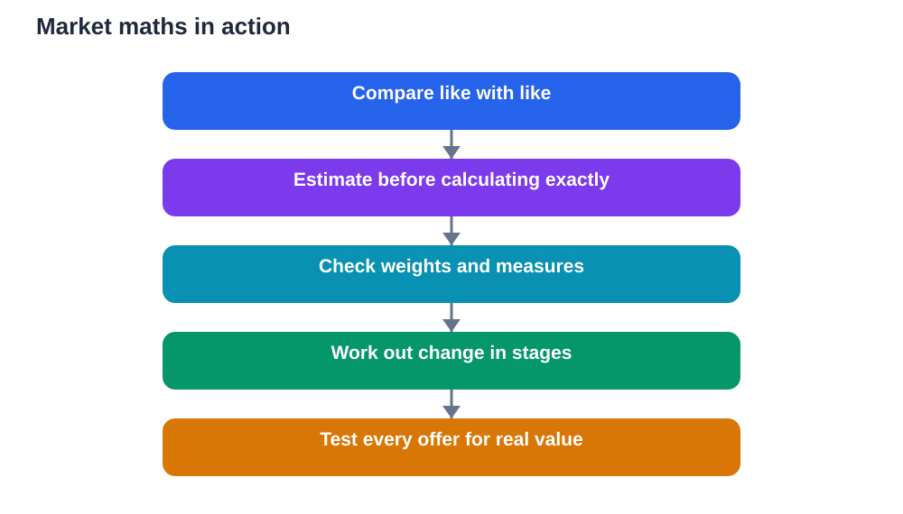

Maths can feel abstract on a page, full of numbers with no story behind them. A market visit changes that completely. Suddenly prices, weights, change, and value are real decisions with real consequences. You compare, estimate, calculate, and judge, all in a busy place where being quick and careful both matter. That is why a market is one of the best classrooms for everyday maths, and why a visit there can make classroom ideas click.

The point of market maths is not to turn shopping into a test. It is to notice the maths that is already happening around you and to practise it in a setting where it matters. When you work out whether a larger pack is better value, check change without being asked, or estimate a total before you reach the till, you are using the same skills your lessons teach, only with purpose and pressure added. That purpose makes the learning stick.

## Compare Prices Like a Thoughtful Buyer

The first market maths skill is comparison. Two items may look similar but carry different prices, sizes, or qualities, and the cheapest price is not always the best value. Start by comparing like with like: the same kind of item, in a similar size, from sellers offering similar quality. Then think about price per unit, such as price for a given weight, so you compare fairly rather than being misled by a bigger pack or a brighter label.

Estimation helps here. Before calculating exactly, make a rough guess about which option seems better value and why. Then check with a careful calculation. If your exact answer surprises you, look again at the numbers. That habit of estimating first and checking afterwards protects you from careless errors and builds number sense faster than silent, mechanical calculation ever will.

## Understand Weights and Measures

Markets are full of weights and measures, and understanding them saves confusion. A seller may weigh produce, describe amounts by weight, or sell items in bundles of different sizes. Knowing how units relate to each other helps you judge whether an amount is what you expected and whether a price is fair for that amount. It also helps you compare offers that are not presented in the same way.

Watch how weighing is done and think about what could affect the result, such as packaging, handling, or the scale itself. This is not about suspicion. It is about understanding measurement as a real process with real sources of error. In class, measurement often looks perfect. In a market, you learn that careful measurement matters precisely because small differences add up.

## Work Out Change Without Rushing

Handling money is a practical maths skill that deserves practice. Before paying, estimate the total and think about what change you should receive. After paying, check the change calmly rather than putting it away unseen. This is not only about avoiding mistakes. It is about building confidence with mental arithmetic in a real situation where you cannot simply ask for more time.

If you are unsure, work in stages. Add up the main items first, then the smaller ones. Round sensibly for an estimate, then calculate more precisely if you need to. Practising this way, without a calculator, strengthens mental maths in a way that worksheets alone rarely do. Over time, the calculations become quicker, and the habit of checking becomes automatic.

## Think About Bargaining Mathematically

Bargaining, where it is a normal part of market life, is also maths in disguise. It involves judging a starting price, deciding what an item is worth to you, and working out a fair middle point. That judgement draws on comparison, estimation, and a sense of value. A thoughtful buyer does not simply aim for the lowest possible price. They consider quality, quantity, and whether the deal is genuinely good.

Before bargaining, know the range of prices you have seen for similar items, so your judgement is based on evidence rather than guesswork. Decide in advance the most you are willing to pay, and be prepared to walk away politely if the price stays above that. Clear thinking, calm communication, and respect for the seller all matter as much as the numbers themselves.

## Spot Deals That Are Not Really Deals

Markets are full of offers that sound better than they are. A discount, a bundle, or a bonus item may look generous until you work out the actual cost per unit or compare it with a plain alternative. Learning to test an offer with a quick calculation is a life skill, not just a school skill. It protects you from being swayed by presentation rather than value.

Ask simple questions about any offer. What exactly do you get, and for what total price? How does that compare with buying the items separately? Do you actually need the extra quantity, or will some of it go to waste? These questions turn advertising into arithmetic, and they train you to make decisions based on evidence rather than excitement.

## Turn the Visit Into Revision

After a market visit, your experience can become excellent revision material. Write down a few real examples: a price comparison you made, a change calculation you checked, or an offer you tested. Then turn each example into a practice problem for yourself, with the working shown step by step. Real examples are easier to remember than invented ones, because you can picture the stall, the item, and the decision.

Check your working against your textbook methods, and remember that any AI helper you use for checking can make mistakes, so verify important steps yourself rather than copying an answer. The goal is understanding, not just a correct total. When you can explain why a deal was good or why change was correct, you have learned maths that will serve you far beyond the market.

## AI Help: Muse AI

Muse AI is Meta's personal AI assistant, and it can help you practise market maths after a visit. You can ask it to explain price-per-unit comparisons simply, or to help you turn a real market example into practice problems. It is useful for clear explanations, step-by-step working, and revision questions based on your own experience.

Join Muse with invite code LTGSWD — in the Muse app, go to Settings > Redeem token and enter the code.

Disclosure: LTGSWD is the author's Muse invite code.

## FAQ

### How can a market visit help with maths?

It gives you real prices, weights, and change to work with, so calculation has a purpose. Comparing value, estimating totals, and checking change all practise classroom skills in a setting where accuracy genuinely matters.

### What is the simplest way to compare two prices fairly?

Compare like with like and think about price for the same amount, such as price per unit of weight. That way a larger pack or a different presentation does not mislead you into thinking it is better value.

### How do I get better at working out change mentally?

Estimate the total before paying, then check the change in stages after paying. Regular, calm practice with real amounts builds speed and confidence much faster than occasional worksheet drills.

### Should I bargain, and how do I decide a fair price?

Where bargaining is normal, base your judgement on prices you have seen for similar items and decide your maximum beforehand. Aim for a fair deal that reflects quality and quantity, and stay polite whatever the outcome.

### How do I tell if a special offer is really good value?

Work out what you actually receive for the total price and compare it with buying items separately. Ask whether you need the extra quantity, because a bargain you waste is not a bargain at all.

## Conclusion

A market visit turns maths into something you can see, weigh, and judge. Compare prices fairly, understand measures, check change carefully, and test every offer with a quick calculation. Practised this way, maths stops being a set of exercises and becomes a tool you can trust whenever money and value are involved.

[Try the free AI lesson solver](/#tool)
