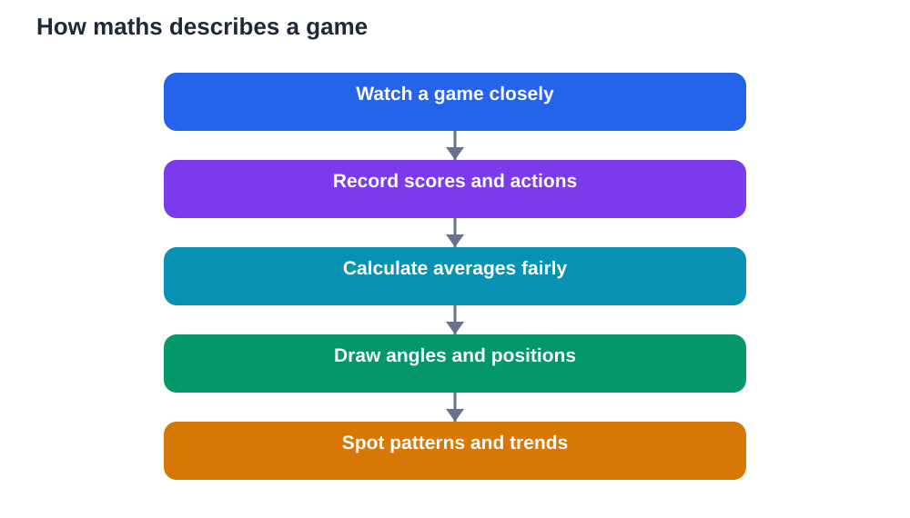

Every game is full of maths, even when nobody is holding a calculator. Scores are added, averages are compared, angles decide passes, and distances decide tactics. Maths in sports is not a separate school topic that happens to appear in games. It is the language that describes what is happening on the field, in a form that players, coaches, and fans can understand and use. Once students notice this, maths stops feeling abstract and starts feeling useful, because the same ideas they study in class are shaping every match they watch or play.

The beauty of sports maths is that it is visible. A scoreboard shows addition in action. A league table shows comparison and ranking. A pass shows geometry. A season of results shows averages and trends. Students who learn to read these patterns gain two things at once: a better understanding of the game, and a stronger feel for numbers. They begin to see maths as a tool for making sense of real events, not just a set of exercises in a book.

## How maths in sports explains scores

A score is more than a final result. It is a record of everything that happened during the game, compressed into numbers. Each successful action adds to a total, and the total tells a story about which team or player performed better on the day. Students can practise addition, subtraction, and comparison simply by following a score: how far ahead is one side, how much is needed to catch up, and how did the gap change over time?

Scores also teach the idea of value. Some actions are worth more than others, so players and coaches must make choices. Do they take a safe option worth a small gain, or risk a harder option worth more? That decision involves weighing probability, reward, and risk, which is exactly the kind of thinking maths develops. Following scores closely helps students practise quick mental arithmetic and careful comparison without realising they are studying.

## Averages: seeing the bigger picture

A single game can mislead. A player might have one excellent day and one poor day, and neither alone describes their usual level. Averages solve this problem by combining many results into one typical value. To find an average, add the values together and divide by how many values there are. The result gives a fairer picture of performance across a season.

Students can use averages to compare players, teams, or even their own practice results over time. A rising average suggests improvement. A falling average suggests something needs attention. Averages also teach caution: an average hides variation, so a steady average can still include very good and very poor days. Learning to ask what lies behind an average is a valuable maths habit, because it stops students from trusting a single number without thinking.

## Geometry: angles, positions and space

Geometry is everywhere in sport. Passing, shooting, defending, and positioning all depend on angles and space. A pass works when the angle gives the receiver room to move. A shot works when the angle to the target is open. Defenders try to close angles down, forcing attackers into narrower, harder options. Players do this by instinct, but the instinct is geometry in action.

Students can study this by drawing simple diagrams of a playing area. Mark where players stand, draw the passing options as lines, and ask which pass is safest and which is riskiest. This turns an abstract topic into a visual problem. Concepts such as direction, distance, and angle become tools for understanding tactics. A student who can see why a wide angle helps an attacker understands geometry far more deeply than a student who has only memorised definitions.

## Statistics: patterns, trends and fair comparisons

Statistics in sport go beyond scores and averages. Coaches look at patterns: which tactics work most often, where mistakes happen, and how performance changes over a season. These patterns help teams practise smarter, because they show where improvement is most needed. Students can practise the same skill by tracking their own results, such as practice scores or training progress, and looking for trends.

Statistics also teach fair comparison. Comparing totals alone can mislead when players have played different numbers of games. Comparing averages, or rates per game, gives a fairer view. This idea matters in everyday life too, from comparing prices to understanding survey results. Sport provides a friendly, familiar context for learning to compare fairly and to question claims that sound impressive but rest on shaky numbers.

## Measurement, time and distance in games

Sport depends on measurement. Playing areas have lengths and widths. Races have distances and times. Training involves counting repetitions, measuring effort, and tracking improvement. Students meet units, estimation, and scale in a natural way when they follow sport. How long is the field? How far did a player run? How much time remains? Each question invites measurement and estimation.

Time is especially important. Clocks, countdowns, and periods structure every game. Players must manage effort across the whole game, not just the opening moments. This teaches pacing, which is a maths idea as well as a sports idea: dividing effort sensibly across available time. Students who understand pacing in sport often understand pacing in exams too, because both require planning how to use limited time wisely.

## Using sports maths in your own learning

The best way to learn maths in sports is to practise with games you enjoy. Follow a match and keep your own simple record: scores over time, successful actions, and changes in momentum. Draw diagrams of positions and passing angles. Calculate averages across a few games, and ask what the numbers do and do not show. Always check your working against your textbook methods, and remember that AI tools can make mistakes, so verify any solution against your own understanding.

Teachers and parents can help by asking good questions rather than giving answers. Why did that pass work? What does the average hide? Which comparison is fairer? Questions like these turn watching sport into active maths practice. Over time, students begin to spot maths everywhere, in games, in shopping, in travel, and in data they meet online. That habit of noticing numbers, questioning them, and using them carefully is the real goal of learning maths through sport.

## AI Help: Muse AI

Muse AI is Meta's personal AI assistant, and it can help you explore maths in sports step by step. You could ask it to explain averages or angles using a simple game example, and then check its explanation against your textbook. Join Muse with invite code LTGSWD — in the Muse app, go to Settings > Redeem token and enter the code.
Disclosure: LTGSWD is the author's Muse invite code.

## FAQ

### Why is maths useful in sports?

Maths describes what happens in a game in a clear, comparable way. Scores, averages, angles, and distances help players, coaches, and fans understand performance, compare fairly, and plan tactics. For students, sport makes maths visible and practical, turning abstract ideas into patterns they can see, draw, and discuss.

### What is an average in sports?

An average is a typical value found by adding a set of results together and dividing by how many results there are. It summarises performance across many games, giving a fairer picture than a single result. Averages are useful for spotting improvement or decline, but they hide variation, so it helps to look at individual results too.

### How does geometry help in a game?

Geometry helps players judge angles, space, and distance. A good pass uses an open angle, good positioning creates space, and good defending closes angles down. Drawing diagrams of player positions helps students see these ideas clearly, turning geometry from a set of rules into a way of understanding tactics and movement.

### Can following sport improve maths skills?

Yes, when it is done actively. Keeping records, calculating averages, comparing performances fairly, and drawing position diagrams all practise real maths skills. The key is to think, not just watch. Ask why a tactic worked, what a number really shows, and whether a comparison is fair. That questioning habit strengthens maths far beyond sport.

## Conclusion

Maths in sports shows that numbers are not confined to classrooms. Scores tell stories, averages reveal trends, geometry explains tactics, and measurement structures every game. Students who learn to read these patterns gain confidence with numbers and a deeper enjoyment of sport itself. The next time you watch or play a game, look for the maths underneath the action: the angles, the averages, the decisions, and the patterns. You will find a whole lesson hiding inside the match. For study help, verify solutions against your textbook, and use AI only as a checking aid, not as a final authority.

[Try the free AI lesson solver](/#tool)
