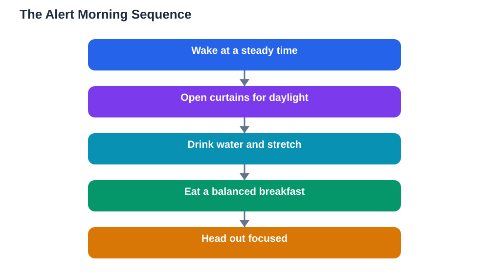

The first hour of the day often decides how the rest of it goes. A groggy, rushed morning leaves you playing catch-up through every lesson, while a calm, alert start makes learning feel easier. These morning alertness tips are built on four simple levers: light, water, movement, and breakfast. None of them requires special equipment, and together they can turn a slow start into a focused school day.

## Morning Alertness Tips Start the Night Before

Alert mornings begin with steady nights. A regular bedtime and wake time train your body clock, so you wake more naturally and feel less groggy. If your mornings always feel terrible, the first fix is usually the evening: an earlier, steadier bedtime and screens off before bed. No morning trick fully compensates for a short, chaotic night.

Keep your wake time steady, even on rest days, within a close range. A wildly shifting weekend wake time confuses the body clock and makes the next school morning painful. When the alarm goes off, get up rather than snoozing repeatedly: snoozing fragments the waking process and often leaves you groggier than a single clean start.

## Light: The Strongest Wake-Up Signal

Daylight is the most powerful signal that tells your brain the day has begun. Open the curtains as soon as you wake, step near a window, or spend a few minutes outside if you can. Bright light suppresses the sleepy feeling and resets your internal clock for the day ahead. On dark mornings, turning on bright room lights immediately serves the same purpose, just less strongly.

Make light part of your routine rather than an afterthought. Get dressed near a window, eat breakfast in a bright room, or walk part of the way to school in daylight. Even a short exposure early in the morning sharpens alertness for hours, and it also helps you fall asleep more easily the following night, because the clock gets a clear day-night pattern.

## Water, Movement and Breakfast: Fuelling the Morning Brain

After a night without fluids, a drink of water is a simple, effective first step. Keep a glass by your bed or drink one while you get ready. Gentle movement comes next: stretching, a short walk, or a few minutes of light activity wakes up the body far better than sitting hunched over a phone. Movement raises blood flow and shakes off stiffness, and it does not need to be intense to work.

Breakfast then gives the brain fuel after the overnight fast. A balanced morning meal with some protein, whole grains, and fruit sustains energy better than a sugary snack that spikes and crashes. If mornings are rushed, prepare breakfast the night before: overnight oats, fruit, or a packed sandwich take little morning time. Skipping breakfast entirely leaves many students flagging by mid-morning, when lessons demand the most focus.

## Building a Morning Routine That Sticks

A good morning routine is short, fixed, and pleasant. Decide the order the night before: alarm, light, water, stretch, wash, breakfast, bag check, out the door. Doing the same steps in the same order removes morning decisions, which is valuable when your brain is still waking up. Prepare as much as possible the evening before: clothes laid out, bag packed, notes ready, so the morning is calm rather than a search mission.

Avoid the phone trap in the first minutes. Scrolling in bed keeps you in a half-awake state and eats the time meant for light, movement, and breakfast. Keep the phone on charge away from the bed, and check messages only after you are dressed and fed. A calm, phone-free first stretch of the morning usually feels better within days, and the extra alertness carries into the first lessons.

## When Mornings Stay Hard Despite Good Habits

If you follow a steady routine and still struggle every morning, look at the whole picture. Late screens, heavy evening meals, or an irregular weekend pattern may be undoing your mornings. Review your sleep diary for a week and spot the pattern. Sometimes the fix is an earlier bedtime rather than a better alarm.

Persistent, severe morning exhaustion despite good habits deserves a conversation with a trusted adult or a health professional, since it can signal a sleep problem or another health issue. Most students, though, find that steady sleep plus light, water, movement, and breakfast transforms their mornings. And when you study in the morning, verify solutions against your textbook, since AI can make mistakes, even when you feel sharp.

## AI Help: Muse AI

Muse AI is Meta's personal AI assistant, and it can help with this topic by building a personalised morning routine from your school start time. Ask it to draft a short, step-by-step morning checklist that fits your schedule.
Join Muse with invite code LTGSWD — in the Muse app, go to Settings > Redeem token and enter the code.
Disclosure: LTGSWD is the author's Muse invite code.

## FAQ

### Why do I feel groggy even after sleeping well?

A short period of grogginess after waking is normal, and it fades faster with light, water, and movement. Repeated snoozing, dark rooms, and immediate phone scrolling all prolong it. Give yourself a bright, active first few minutes instead.

### Is a cold shower necessary for alertness?

No. Gentle movement, daylight, water, and breakfast are enough for most students. A cool wash or splash of water on the face can help if you enjoy it, but alertness does not require anything extreme or uncomfortable.

### What is the best quick breakfast before school?

A balanced one: something with staying power, such as whole grains with fruit, plus a protein food like eggs, yoghurt, or nuts if you eat them. Prepare it the night before if mornings are rushed, and avoid a breakfast that is only sugary snacks.

### How long does it take for a morning routine to work?

Most students notice easier mornings within a week or two of steady wake times, morning light, and a fixed routine. The body clock adapts gradually, so keep the routine consistent even on days when it feels slow at first.

## Conclusion

Alert mornings are not luck; they are built. Steady sleep, bright light, a drink of water, gentle movement, and a balanced breakfast give your brain everything it needs to start sharp. Build the routine tonight by preparing for tomorrow, and let tomorrow morning prove how much difference a calm start makes.

[Try the free AI lesson solver](/#tool)
