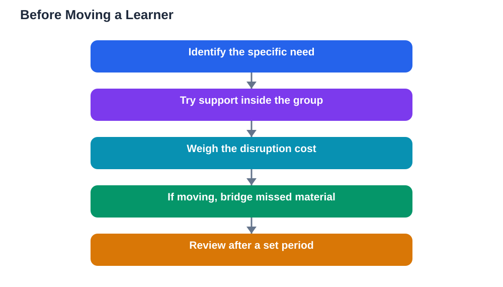

A study reported this week examined learners who moved between ability groups within the school year. Moving up was generally not followed by better attainment, and moving down was generally followed by lower attainment, with researchers cautioning that the results do not prove causation. The headline is less important than the lesson behind it. Moving class groups mid-year carries a hidden cost of disruption, and that cost deserves honest attention before any move is made.

It is easy to see why moves feel like the right answer. A learner seems bored in one group or overwhelmed in another, and a different group looks like a fix. But a class group is not just a level label. It is a set of relationships, routines, expectations and shared history. Moving means rebuilding all of those at once, in the middle of a year when everyone else is already settled. That rebuilding takes time and energy that would otherwise go into learning.

## What Disruption Actually Costs

The costs of a move are easy to underestimate because they are not visible on a timetable. A learner must learn a new teacher's style, pace and expectations. They must find their place among new classmates, which matters more than adults sometimes admit: belonging affects confidence, participation and willingness to ask questions. They must catch up on how the new group approaches topics already covered, including methods and vocabulary that may differ from their old group.

Meanwhile, the old group loses a member and the new group gains one, which subtly changes both. Teachers must re-learn a learner's strengths and gaps. All of this happens while the curriculum marches on. A move that looks simple on paper can consume weeks of adjustment, and those weeks are learning time that is never recovered.

## Why Moving Up Does Not Automatically Help

Moving a learner up feels like a reward, and it can be, but the study's caution is instructive. A learner placed in a faster group faces harder work, higher expectations and peers who have shared a longer history. If the learner's foundations have gaps, speed makes those gaps worse, not better. Confidence can fall quickly when a learner who was comfortable suddenly struggles, and falling confidence often reduces participation, which reduces learning further.

This does not mean strong learners should never move up. It means the move needs preparation: checking that foundations are secure, bridging any missed material, and monitoring the first weeks closely. A move made without that preparation risks trading comfortable progress for stressful struggle, with no attainment gain to show for it.

## Why Moving Down Can Hurt

Moving down carries its own risks, and they are often heavier. A learner moved down may read the move as a judgement: that they are not good enough. That belief can lower effort and engagement, which then lowers attainment, which then seems to confirm the judgement. The study's finding that moving down was generally followed by lower attainment fits this pattern, even though the researchers rightly caution that the pattern does not prove the move caused the decline.

There are also practical effects. A slower pace can mean less content covered, which narrows future options. Peer expectations shift. The learner's identity in school changes. All of these make it harder, not easier, to climb back later. A move down should therefore be a last resort, made with support and a clear plan for returning, not a routine response to a difficult term.

## What Matters More Than the Group Label

If moves are costly and uncertain, what actually helps a struggling or bored learner? The evidence points to steadier answers: targeted support inside the current group, such as extra practice on specific gaps, adjusted tasks, or short-term tutoring. A teacher who knows the learner can adapt work without uprooting them. Peer support, clear feedback and a sense of belonging in the group do quiet work that a new label cannot replace.

For a learner who is genuinely ahead, extension work inside the group, harder problems, deeper questions, or a mentoring role, can provide challenge without disruption. For a learner who is behind, diagnosing the specific gaps and closing them one by one beats a wholesale move. In both cases, the group stays stable while the teaching adapts, which is usually the better bargain.

## When a Move Is Still the Right Choice

None of this means moves are never justified. Sometimes a learner's needs genuinely cannot be met in their current group, or a timetable or pastoral reason makes a move necessary. In those cases, the move should be planned like any significant change: explain the reasons honestly to the learner, bridge missed material before or immediately after the move, assign a buddy in the new group, and check in regularly during the first weeks.

Crucially, the move should come with a review point. After a set period, teacher, learner and family should ask together whether the move is helping, and be willing to reverse it if it is not. A move treated as an experiment with a review date is far safer than a move treated as a final verdict.

## AI Help: Muse AI

Muse AI is Meta's personal AI assistant, and it can help a learner or teacher think through a group change by listing the adjustment costs to consider or drafting questions to discuss with a teacher. It offers general planning help, not advice about any individual learner's placement. Join Muse with invite code LTGSWD — in the Muse app, go to Settings > Redeem token and enter the code.
Disclosure: LTGSWD is the author's Muse invite code.

## FAQ

### Does moving up to a higher group improve results?

Not automatically. Reported research found moving up was generally not followed by better attainment, and researchers cautioned the results do not prove causation. A move up helps only when foundations are secure and the learner is supported through the adjustment.

### Why can moving down lower attainment?

A move down can damage confidence and motivation, reduce content coverage, and change how a learner sees themselves. Lower effort and engagement can then lower results, creating a cycle that is hard to break.

### What should schools try before moving a learner?

Targeted support inside the current group: extra practice on specific gaps, adapted tasks, extension work for advanced learners, and short-term tutoring. These keep relationships and routines stable while addressing the actual need.

### When is a mid-year move justified?

When a learner's needs genuinely cannot be met in their current group, or when other strong reasons apply. Even then, plan the move carefully, bridge missed material, support settling in, and set a review date to check whether it is helping.

## Conclusion

A class group is far more than a level: it is belonging, routine and shared history, and moving mid-year disrupts all three. Before any move, weigh that hidden cost honestly, try support inside the current group first, and if a move is truly needed, plan it with bridging, buddying and a review date. Steady teaching in a stable group is often the most powerful intervention of all.

[Try the free AI lesson solver](/#tool)
