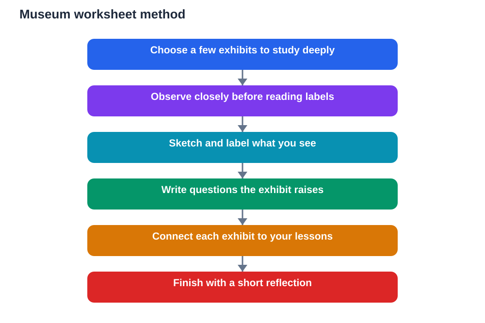

A museum can be an exciting place to visit and an easy place to forget. There is so much to look at that everything can blur together, and by the end of the day you may remember that you enjoyed it without remembering what you actually learned. A simple worksheet changes that. It slows you down, focuses your attention on a few exhibits, and gives you something to think with long after you leave. The goal is not to fill every box. It is to look closely, think carefully, and leave with ideas you can explain.

A good worksheet works like a conversation with the exhibits. It asks you to observe before you judge, to sketch before you describe, and to connect what you see to what you already know. When you use one well, a museum visit becomes a lesson you take part in, not a walk past interesting objects. You return with evidence, questions, and examples instead of only memories of being there.

## Start With a Few Exhibits, Not Everything

The biggest mistake on a museum visit is trying to cover everything. A worksheet should help you choose a small number of exhibits to study deeply rather than rushing through a whole building. Pick exhibits that link to your current lessons or that genuinely spark your curiosity. Depth beats speed every time, because a few well-understood objects teach more than many glanced-at ones.

Before you begin, read the worksheet prompts and decide what you want to find out at each stop. If a prompt asks what an object was used for, look for clues in its shape, material, and size before reading the label. Guessing thoughtfully first, then checking, makes the answer stick. It also trains you to read objects like evidence, which is a skill that transfers to many subjects.

## Observe Before You Read the Label

Observation is the heart of museum learning. Spend time looking before you read. What is the object made of? How big is it compared with your hand or your body? What marks, colours, or wear can you see? What parts look carefully made, and what parts look plain or practical? These details tell a story about how the object was used and who used it.

Write your observations as plain facts first, then add your thoughts separately. For example, you might note a shape, a material, and a pattern of wear, and only then suggest what the object might have been for. Keeping facts and ideas apart helps you think clearly and avoids jumping to a conclusion that the evidence does not support. It also makes your worksheet a record you can trust later.

## Sketch What You See, Even Simply

You do not need to be an artist for sketching to help. A quick sketch forces you to look longer and notice proportions, shapes, and details you would otherwise miss. When you draw, you have to decide what matters: which lines define the object, where one part joins another, and what stands out. That decision-making is learning in action.

Label your sketch with a few words about materials, size, and anything unusual. A sketch with labels is far more useful than a perfect drawing with no notes, because it captures both what you saw and what you thought about it. Later, when you revise, your sketch will bring the object back to mind much faster than a paragraph alone.

## Ask Questions the Exhibit Raises

Every interesting object raises questions. Who made it, and for whom? What problem did it solve? What would life have been like for the person who used it? What has changed since then, and what has stayed the same? A worksheet with space for questions turns curiosity into a habit, and a habit of questioning turns a visit into investigation.

Write down questions even when you cannot answer them on the spot. Unanswered questions are valuable because they give you a reason to read, discuss, and research after the visit. Some of your best learning may happen when you follow up a question that began in front of a single exhibit. Keep the question in your own words so it stays meaningful to you.

## Connect Each Exhibit to Your Lessons

Connection is what makes a museum visit stick. After observing and sketching, ask how the exhibit links to something you have studied. Does it confirm an idea from a lesson, challenge it, or add a detail you had not considered? Does it show a process, a way of life, or a way of thinking that your textbook describes in words? Writing the connection in a sentence or two turns a visit into revision material.

Be honest when a connection is uncertain. If you think an exhibit relates to a lesson but you are not sure how, write that uncertainty down. Checking it afterwards, against your textbook and class notes, is good study practice. Remember that AI helpers can also make mistakes, so verify any important claim before using it in homework, just as you would check a label against another source.

## Finish With a Short Reflection

At the end of the visit, a worksheet should leave space for reflection. Which exhibit surprised you most, and why? What did you learn that you did not expect? What would you look at again if you had more time? These prompts help you sort a busy day into a few clear takeaways instead of a jumble of impressions.

Share your reflection with a classmate if you can. You will often find that different people chose different exhibits and noticed different things. Comparing reflections widens what everyone learned and can spark new questions worth exploring together. A visit remembered together tends to stay remembered longer.

## AI Help: Muse AI

Muse AI is Meta's personal AI assistant, and it can help you get more from a museum worksheet. You can ask it to suggest observation questions for an exhibit, or to help you turn rough worksheet notes into a clear summary afterwards. It is useful for explaining ideas simply and organising your thoughts into revision notes.

Join Muse with invite code LTGSWD — in the Muse app, go to Settings > Redeem token and enter the code.

Disclosure: LTGSWD is the author's Muse invite code.

## FAQ

### Do I need a printed worksheet for a museum visit?

No, a simple notebook page with headings for observe, sketch, ask, and connect works just as well. What matters is the thinking routine, not the format, so use whatever you will actually carry and complete.

### How many exhibits should I study in depth?

A small number studied carefully is better than many seen quickly. Choose exhibits linked to your lessons or curiosity, and give each one real attention before moving on to the next.

### What if I cannot draw well?

Simple sketches still help, because drawing makes you observe proportions and details. Label your sketch with notes about shape, material, and size, and remember that the thinking matters more than artistic skill.

### Should I read the label first or observe first?

Observe first when you can, then read the label to check your ideas. Observing first trains you to gather evidence, while reading afterwards confirms or corrects what you thought you saw.

### How do I use my worksheet after the visit?

Turn your notes into a short summary, a set of revision questions, or points to share in class. Check uncertain connections against your textbook so your worksheet becomes reliable study material.

## Conclusion

A museum worksheet works when it slows you down and makes you think. Observe carefully, sketch simply, ask real questions, and connect what you see to your lessons. Done this way, a museum visit stops being a blur of interesting objects and becomes a set of ideas you can remember, explain, and use.

[Try the free AI lesson solver](/#tool)
